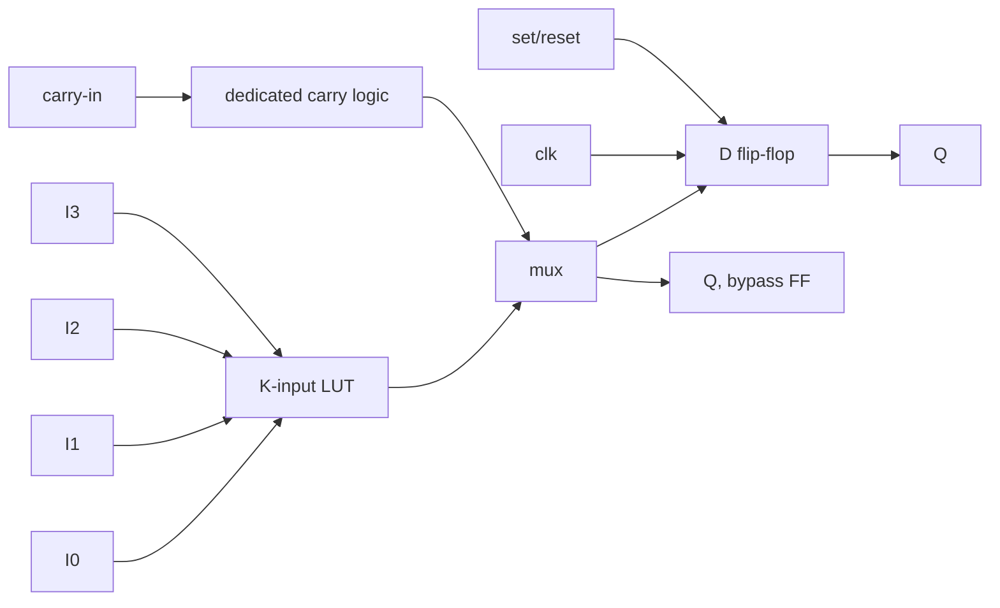
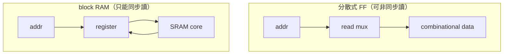

# 4.1 FPGA 基本架構概論

> 本章是第 4 章的起點：在進入 `ice40.rs`、`ecp5.rs`、`bram.rs`、`pnr/chipdb.rs`
> 的原始碼之前，先建立一張「FPGA 裡到底有什麼」的地圖。之後每一節討論的
> 映射（mapping）與擺置繞線（place & route），都是把 Veryl 電路塞進這張地圖。

---

## 4.1.1 從 RTL 到晶片：EDA 工具在做什麼

一顆 FPGA 是一張**預先做好、功能未定**的硬體：裡面有海量的運算單元與
可程式互連，使用者的「程式」就是一組配置位元（configuration bits），
決定每個單元做什麼、訊號走哪條路。veryl-eda 的 FPGA 流程是：


這條流水線的每一站都在回答同一個問題：**「我的電路」與「FPGA 的固定硬體」
之間的差距，要用什麼組合填補？** 本章剩下的章節逐站拆解原始碼。

---

## 4.1.2 Logic cell：LUT + FF 是萬能積木

FPGA 的基本運算單元幾乎都是這個形狀：



一個 $`K`$ -輸入查找表（Look-Up Table, LUT）只是 $`2^K`$ 位元的 SRAM：

$$
f(I_0,\dots,I_{K-1}) \;=\; \text{INIT}\big[\,I_0 + 2 I_1 + 4 I_2 + \dots\,\big]
$$

任何 $`K`$ 輸入的組合函數都能塞進一個 LUT——這正是「FPGA 可以實作任何
電路」的關鍵（ $`K`$ -LUT 網路在理論上是普遍的邏輯表示法）。再接一個正反器，
就得到時序邏輯。iCE40 的 LC（logic cell）、ECP5 的 slice 內部，都是這個模型。

**為什麼這樣設計**：LUT 把「邏輯」變成「記憶體查表」，製程上只是一堆
小 SRAM + mux，不需要為每種閘做客製電路；同時 toolchain 也不必處理
真實 CMOS 閘的驅動能力問題——所有訊號都是同級的。代價是面積與速度
遠不如 ASIC 標準單元（第 5 章的 ASIC 流程會明顯看到差異）。

### 覆蓋問題（LUT covering）

合成器要回答：把一大片 AND/OR/XOR 閘切成一顆顆 $`K`$ -LUT，怎麼切最好？
這是 NP-hard 的覆蓋問題，一般用兩個指標取捨：

$$
D = \text{LUT 層數（影響 } F_{\max}\text{）}, \qquad
A = \text{LUT 數量（影響面積 / 繞線擁塞）}
$$

veryl-eda 的 `ice40::lut_cover` 用的是經典的 cut enumeration：
每個節點保留至多 `CUTS = 16` 個候選 cut，先按深度選（depth-first），
再用 area flow 做面積回復（area recovery），第 04.2 節會逐行讀它。

---

## 4.1.3 進位鏈：加法器的專用高速公路

$`N`$ 位元加法器若全用 LUT 實作，每一位元都要等前一位元的進位從
LUT 繞出來，延遲隨 $`N`$ 線性成長且每級都多一次繞線延遲。所以 FPGA
在 logic cell 之間放了**專用進位硬體**，相鄰 cell 之間有硬接線：

全加器的進位輸出：

$$
c_{out} = (a \wedge b) \vee \big((a \oplus b) \wedge c_{in}\big)
$$

iCE40 把這條式子攤成一個專用的 `SB_CARRY` cell（majority 電路）；
ECP5 把它收進 `CCU2C` 的 LUT 裡（`INIT0/INIT1 = 0x96AA`，第 04.3 節）。
veryl-eda 在 `ice40::find_carries` 裡做模式匹配，從通用閘級網路裡
**找回**這個結構：

```rust
// ice40.rs — 找 (a & b) | ((a ^ b) & c)
pub(crate) fn find_carries(gates: &[&Cell], node: &HashMap<u32, usize>)
    -> HashMap<u32, (Bit, Bit, Bit, u32)>
{
    for c in gates {
        if c.typ != "$_OR_" { continue; }          // 外層是 OR
        // OR 的兩個輸入：一個 AND(a,b)，一個 AND(xor^ci)
        // 且 XOR 的兩個輸入必須就是 (a, b)
        ...
    }
}
```

**為什麼要「事後辨識」而不是產生 netlist 時就標記？** 因為 elaborator
（`elab.rs`）刻意保持中立：它只產生 `$_AND_/$_OR_/$_XOR_/$_MUX_`
等 yosys 風格的通用閘。加法器結構辨識放在映射層，同一份 netlist
才能同時餵 iCE40、ECP5、ASIC 三個後端。

---

## 4.1.4 Block RAM：用「記憶體」省下整片 FF 海

一個 256×32 的暫存器陣列若用 flip-flop 實作，要 8192 個 FF 加上一棵
巨大的讀出 mux；FPGA 內建的 block RAM（iCE40 `SB_RAM40_4K`：4096 bits
 configurable）用真正的 SRAM 巨集 + 位址解碼器實作同一件事。

但有一個根本限制：



`bram.rs` 的模組註解直接寫明了這條規則：

> whose read ports are *synchronous* (each read data bit goes straight into a
> flip-flop on the write clock ...) becomes `SB_RAM40_4K` blocks ...
> Asynchronous reads stay logic, because the block RAM only has a registered
> read port.

所以 `always_comb begin data = mem[addr]; end`（非同步讀）**不會**變成
block RAM；只有 Veryl 裡同步讀的寫法（讀資料直接進 FF）才會被 `bram::infer`
辨識出來。第 04.4 節拆這段辨識程式碼。

---

## 4.1.5 可程式互連：island-style 與 switch matrix

logic cell 只是「島」（island），島與島之間的「海」就是互連。現代 FPGA
幾乎都是 **island-style routing**：

- 每個 tile 有 **switch matrix**：一組導線（wires）與可程式開關（pips）。
- 導線分長短：鄰居級的 `local/neigh_op`、跨 4 格的 `sp4_h/sp4_v`、
  跨 12 格的 `sp12_h/sp12_v`、全域時脈的 `glb_netwk_N`。
- 一個 **pip**（programmable interconnect point）是一個 mux 輸入：
  「dst 這條線可以由 src 這條線驅動」，驅動它的配置位元模式記在
  chipdb 的 `group` 裡。

`pnr/chipdb.rs` 對導線的命名分類（`Kind` enum）正是這張地圖的程式化版本：

```rust
// chipdb.rs — 從導線名稱判斷它的角色
pub enum Kind {
    Other, Local, LutIn, LutOut, Ctrl,
    Glb, Glb2Local, Sp4H, Sp4V, Sp12H, Sp12V,
    Io, Carry, Fabout,
}
// "lutff_0/in_3" → LutIn、"sp4_h_r_12" → Sp4H、
// "glb_netwk_5" → Glb、"carry_in" → Carry
```

第 04.5 節會把 chipdb 的文字格式與解析器整段讀完。

### 繞線為什麼難

繞線（routing）本質是在一張巨大的圖上做**資源分配**：每條 net 要找一條
從驅動器到每個負載的路徑，而且**兩條 net 不能共用同一條導線**。
veryl-eda 的 `pnr/route.rs` 用的是 PathFinder 演算法：先讓大家搶，
擁塞的導線每輪加價，直到沒有人搶同一條線：

$$
\text{cost}(w) = b_w \cdot \prod_{n}(1 + p_{n,w} \cdot h_{cur})
$$

（ $`b_w`$ 是基本代價、 $`p_{n,w}`$ 是 net $`n`$ 目前占用導線 $`w`$ 的歷史懲罰，
$`h_{cur}`$ 是本輪擁塞懲罰。）第 4 章後段（pnr 系列）會展開。

---

## 4.1.6 全域網路：時脈與 reset 的專車道

時脈要同時到達上千個 FF，若走一般 span 導線會有嚴重的 skew 與擁塞。
所以 FPGA 有專用全域緩衝（global buffer）。iCE40 UP5K 有 8 條
`glb_netwk`，而且有一個奇怪的硬限制，`pnr/mod.rs` 註解寫著：

```rust
// ---- global networks: set/reset nets need an even one ----
for (list, even) in [(&resets, true), (&clocks, false)] {
    ...
    let i = free.iter().position(|g| !even || g.2 % 2 == 0)
        .ok_or("out of global networks")?;
```

reset 必須用**偶數編號**的全域網路，時脈用剩下的。這是從 chipdb 的
`gbufin` 表（fabout → glb_netwk 的入口）推得的架構事實，工具只是服從。

---

## 4.1.7 iCE40UP5K vs ECP5：兩代架構的差異

veryl-eda 支援的兩顆 Lattice 晶片剛好代表兩個世代：

| 面向 | iCE40 UP5K | ECP5 (LFE5U-85F) |
|---|---|---|
| 基本單元 | LC：SB_LUT4 + FF，16 tile/LAB | slice：2×LUT4+2×CCU2C 半格 + 2 FF |
| 進位硬體 | 獨立 `SB_CARRY` cell，鏈必須從 LC0 開始 | 收進 `CCU2C`：一格兩位元 |
| FF 控制訊號 | 實體 pins（C/R/S，極性靠變體） | mux 選擇：`CLKMUX/LSRMUX/CEMUX/SRMODE` 字串參數 |
| block RAM | `SB_RAM40_4K`（4096 bits，同步讀） | `DP16KD`（16K bits，true dual-port，v2.3 才做） |
| 配置格式 | `.asc`（文字位元表）→ icepack → `.bin` | `.config` → ecppack |
| 開源工具鏈 | IceStorm（icestorm/nextpnr-ice40） | Project Trellis（nextpnr-ecp5） |
| FF 上電值 | 恆為 0 | 由 `REGSET` 決定 |

這張表的每一列都對應一節原始碼：LC 模型在 `pnr/pack.rs`、
`SB_CARRY` vs `CCU2C` 在第 04.2 / 04.3 節、FF 參數風格的差異
（位置式 vs 字串 mux 選擇）是 04.3 的主題之一、block RAM 在 04.4。

**為什麼這樣設計（工具面）**：veryl-eda 對兩顆晶片共用同一套
`lut_cover`（`ecp5.rs` 第一行就 `use crate::ice40::{find_carries, lut_cover, ...}`），
只有在**架構真的不同**的地方（進位鏈打包、FF 參數、string params）
才分岔。這是映射程式碼正確的切法：演算法（覆蓋）與架構（cell 型別）
分層，新增一種 FPGA 時可以重用覆蓋器，只寫新的 cell 包裝。

---

## 4.1.8 位元流與配置位元：一切的最終形態

FPGA 的「程式」是一個巨大的位元陣列。以 iCE40 為例，`.asc` 檔就是
每個 tile 的位元矩陣文字版：

```
.io_tile 9 6
00000000000000000000000000000000000000000000000000
...
.logic_tile 10 6
0000100000000000...
```

`pnr/mod.rs` 的 `Asc` 結構管理它，所有寫入都經過兩個管道：

1. **tile function bits**（`Asc::func`）：查 chipdb 的 `tile_bits` 表，
   例如 `("logic", "LC_3")` 是 LC3 的 20 個配置位元位置；
2. **pip bits**（`Asc::pip`）：同一個 mux 的多個輸入共用位元，
   `groups` 表把「位元位置 → 位元值」打包，衝突會被偵測：

```rust
// pnr/mod.rs
fn pip(&mut self, p: u32) -> R<()> {
    let pip = &self.chip.pips[p as usize];
    if let Some(&old) = self.groups.get(&pip.group) {
        if old != pip.pat {
            return Err(format!("conflicting settings for the input mux of {}",
                               self.chip.label(pip.dst)));
        }
        return Ok(());
    }
    ...
}
```

這就是 FPGA 的底層真相：**mapping、placement、routing 的一切決定，
最後都化成某個 tile 裡某幾個位元的 0 與 1。**

---

## 4.1.9 本章重點

- FPGA = 大量 (LUT + FF) logic cell + 專用進位鏈 + block RAM + 可程式互連；
  設計流程的每一站都在把電路「塞」進這些固定形狀。
- $`K`$ -LUT 是 $`2^K`$ 位元的真值表；覆蓋（covering）是 NP-hard，實務用
  cut enumeration + depth/area 兩階段取捨（`ice40::lut_cover`）。
- 進位鏈是架構提供的硬體特權，工具必須從通用閘網路裡「找回」加法器
  結構（`find_carries`）——這是通用 IR 與架構知識的分工邊界。
- block RAM 只有同步讀，非同步讀的記憶體無法映射（`bram.rs` 的推斷條件）。
- 互連是 island-style 的 wires + pips 圖；繞線是擁塞約束下的資源分配
  （PathFinder）。時脈/reset 走專用全域網路，iCE40 的 reset 限定偶數編號。
- iCE40 與 ECP5 的差異集中在進位鏈打包與 FF 控制訊號的表達方式；
  veryl-eda 兩者共用 LUT 覆蓋演算法，只分岔架構相關的部分。
- 最終一切化為 tile 配置位元：`Asc::func`（tile function）與 `Asc::pip`
  （mux 設定）是唯二的寫入管道。
