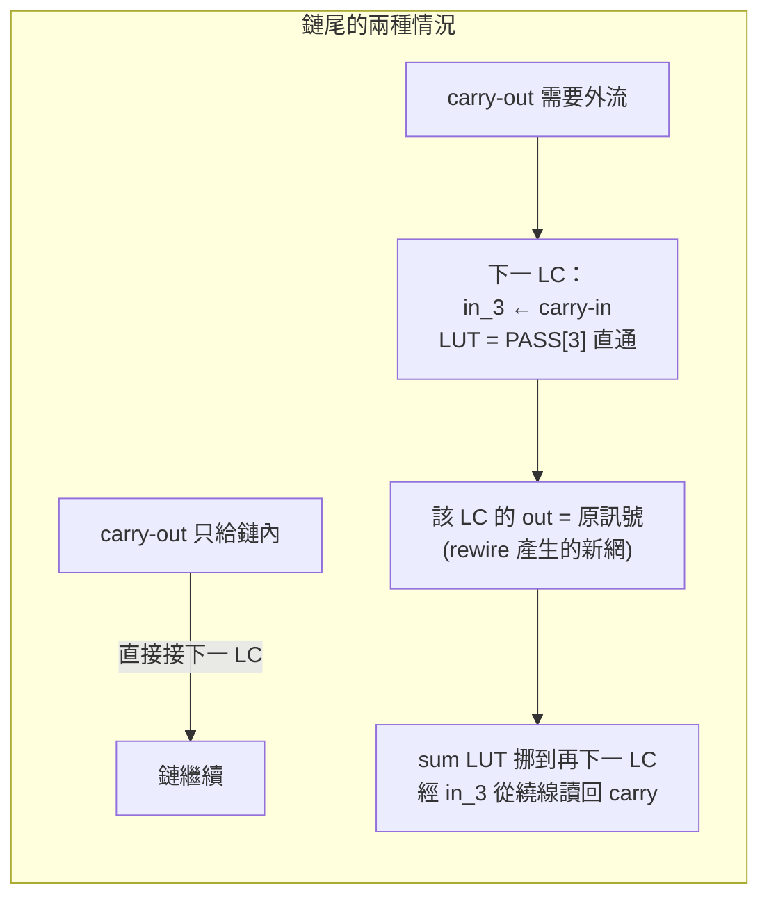
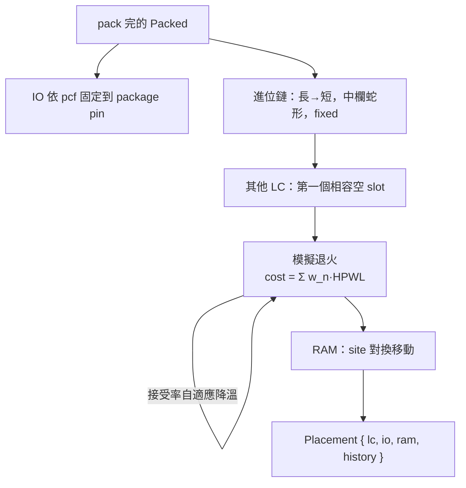

# 4.6 打包、佈局與繞線：讓邏輯「站上」晶片

> 對照原始碼：`veryl-eda/src/pnr/pack.rs`、`pnr/place.rs`（本節）
> `pnr/route.rs`（下一節）。上一節（04.5）結束在一份 iCE40 映射網表：
> `SB_LUT4` / `SB_CARRY` / `SB_DFF*` / `SB_RAM40_4K`。但這些只是「抽象單元」，
> 晶片上真正存在的東西是**邏輯胞（LC）**、**tile**、**線段（wire）**與
> **PIP（可程式連接點）**。本節講三個轉換：pack（網表 → LC）、place（LC → 座標）、
> 以及 route 的前置概念（完整的 PathFinder 留給 4.7）。

## 4.6.1 為什麼要「打包」？iCE40 邏輯胞的真實結構

iCE40 的基本邏輯資源不是一個 LUT + 一個 FF 分開擺，而是一個 8-LC 組成的
**tile**，每個 LC 是：

```text
        in_0..in_3（in_3 可從進位鏈來，也可從繞線來）
             │
             ▼
      4-LUT（16-bit 真值表 INIT）──┬──► 組合輸出 lutff_z/out
             │                    │
             ▼                    ▼
   進位單元（in_1/in_2 + 下方 LC 的  │
   carry-in → carry-out）          FF（clk / s_r）
```

`pack.rs` 的檔頭註解寫得很精確（`pack.rs:1-8`）：

> An LC is a 4-input LUT, a carry unit (inputs hardwired to the LUT's
> in_1/in_2, carry-in from the LC below) and a flip-flop fed by the LUT.

也就是說**一個 LC 只有一個 LUT 輸出**：FF 的 D 腳只能吃同一個 LUT 的輸出。
打包就是把網表裡的三種 cell 合併進 LC：

| 網表 cell | 進到 LC 的哪裡 | 條件 |
|---|---|---|
| `SB_LUT4` | `init`（16-bit）+ `ins[0..4]` | 佔一個 LC |
| `SB_CARRY` + 它的 sum LUT | `carry: true`，LUT 算 sum | 進位鏈佔同欄連續 LC |
| `SB_DFF*` | `ff: Some(Ff)` | **當且僅當**它的 D 來自某 LUT 的唯一輸出 |

FF 合併的判斷在 `pack.rs:274-284`：

```rust
let d = c.port("D").unwrap();
let q = c.out();
let sole = cx.users.get(&d).map(|u| u.len() == 1).unwrap_or(false) && !ported(d, &port_bits);
if let Some(&l) = lc_of_out.get(&d).filter(|_| sole) {
    if lcs[l].ff.is_none() {
        lcs[l].ff = Some(ff);
        lcs[l].out = Some(q);   // LC 的對外輸出從 LUT 結果換成 FF 的 Q
        lc_of_out.remove(&d);
        continue;
    }
}
```

兩個關鍵詞：

* `sole`：D 這條網**只有 FF 這一個使用者**，而且不是輸出埠。
  如果別的邏輯也要讀 LUT 的組合輸出，iCE40 沒有第二根線給你——必須
  「FF 與 LUT 分家」，LUT 的輸出經繞線再進一個只有 FF 的 LC（`D` 接
  `in_0`、真值表設成 `PASS[0] = 0xAAAA` 直通）。
* `out` 換成 `q`：合併之後，這個 LC 驅動的網不再是 LUT 的輸出而是 FF 的 Q。

### FF 的型別編碼

yosys 的 `SB_DFF` 家族用名字編碼行為（`ff_kind`，`pack.rs:109-115`）：

```rust
/// SB_DFF[N][S]{R,S} -> (negedge, sync, reset pin and value)
fn ff_kind(t: &str) -> R<(bool, bool, Option<(&'static str, bool)>)> {
    let k = t.strip_prefix("SB_DFF")...;
    let neg = k.starts_with('N');       // N = 負緣
    let (sync, k) = if k.len() == 2 { (true, &k[1..]) } else { (false, k) }; // S = 同步
    ... match k { "" => None, "R" => Some(("R", false)), "S" => Some(("S", true)), ... }
}
```

四個字母自由組合出 8 種 FF：`SB_DFF`（無 reset）、`SB_DFFR`（同步 reset 0）、
`SB_DFFSR`（同步 set 1）、`SB_DFFNR`（負緣…）等。打包後統一成
`Ff { clk, sr, neg, set, asynch }` 五個欄位——因為 LC 的硬體只有
「set/reset 值（bit 18）」與「同步/非同步（bit 19）」兩個組態位元。

### 常數的處理：fold 與 canon

兩個小而重要的最佳化（`pack.rs:73-93`）：

1. **`fold_consts`**：若某輸入接常數 0/1，直接把 16-bit 真值表沿那個
   變數「壓縮」掉，輸入腳設為 `None`（留空）。
2. **`canon`**：反過來，對**沒接**的輸入，把真值表改成對該變數不敏感——
   即把每一對差在 bit k 的表項合併：

$$
\mathrm{init}'_{i} \;=\; \mathrm{init}_{\,i \,\&\, \neg(1\ll k)}
\qquad \forall i \in [0,16)
$$

```rust
pub fn canon(lc: &mut Lc) {
    for k in 0..4 {
        if lc.ins[k].is_none() && !(k == 3 && lc.in3_chain) {
            let mut v = 0u16;
            for i in 0..16 { v |= ((lc.init >> (i & !(1 << k))) & 1) << i; }
            lc.init = v;
        }
    }
}
```

為什麼要 canon？因為**沒接的輸入腳不會被繞線**（省繞線資源），
而未繞線的腳在矽上的值是任意的——真值表必須對它不敏感，電路才正確。

### 剩下的常數：得用一個 LC 來「生」

iCE40 沒有全域常數網；若一個 LC 的輸入真的需要常數 1（例如 reset 未接的
FF），`pack.rs:294-310` 就造一個 `init = 0xFFFF`（或 0）的常數 LUT，
把常數「繞」過去：

```rust
let mut const_net = |v: Bit, lcs: &mut Vec<Lc>, cx: &mut Ctx| -> Bit {
    *konst.entry(v).or_insert_with(|| {
        let n = cx.fresh();
        lcs.push(Lc { init: if v == Bit::C1 { 0xFFFF } else { 0 }, out: Some(n), ..Default::default() });
        n
    })
};
```

`konst` 這個 memo 保證整個設計最多花兩個 LC 生出 0 與 1，大家共享。

## 4.6.2 進位鏈：pack 最精巧的一段

iCE40 的進位鏈是硬連線：一欄內**連續**的 LC，第 $`n`$ 個 LC 的 carry-out
物理上接到第 $`n+1`$ 個的 carry-in，中間不經過繞線——這是加法器快的
全部理由。代價是：

1. 每個 LC 的 carry 單元輸入被**硬綁**在 LUT 的 `in_1`/`in_2`；
2. carry-in 只能來自下方 LC、欄頂的 `CarryInSet` 常數，或 `carry_in_mux`；
3. 想把 carry-out 讀給普通邏輯，只能讓**下一個 LC 的 LUT** 把 carry-in
   當 `in_3` 並輸出（直通表 `PASS[3] = 0xFF00`）。

`pack` 的鏈偵測（`pack.rs:156-177`）分兩步：先用 `driver` 表把
「某個 `SB_CARRY` 的 CI 是另一個 `SB_CARRY` 的輸出」配成 `next_c`（鏈的
後繼關係），再找每個 carry 的 **sum LUT**——那個 `I3` 接 carry-out、
且 `I1`/`I2` 與 carry 的 `I0`/`I1` 相同的 LUT：

```rust
for &(u, pin) in cx.users.get(&ci).map(|v| v.as_slice()).unwrap_or(&[]) {
    let l = &cx.cells[u];
    if pin != "I3" || l.typ != "SB_LUT4" || taken.contains(&u) { continue; }
    let (i1, i2) = (l.port("I1").unwrap(), l.port("I2").unwrap());
    if (i1, i2) == (a, b) || (i1, i2) == (b, a) { sum_lut.insert(c, u); taken.insert(u); break; }
}
```

鏈的起點處理三種 carry-in（`pack.rs:194-201`）：常數 0 → 直接開始；
常數 1 → 記 `chain.cin = true`（佈局後在 tile 上設 `CarryInSet` 位元）；
一般訊號 → **先放一個 feed-in LC**，它用 `CI & CI` 配 carry-in 0 的技巧
把任意訊號變成鏈的第一個 carry（`ins = [None, Some(ci), Some(ci), None]`）。

鏈行進時（`pack.rs:204-252`）有個狀態 `pass_out`：當 carry-out 被普通
邏輯或埠需要時，**鏈本身不斷**，改由下一個 LC 的 LUT 把 carry 讀出來；
若原本下一個 LC 是 sum LUT，就把 sum 挪去更後面的 LC，並讓它經繞線
把 carry 讀回來（`rewire` 換網）：

```rust
// the carry-out is needed by ordinary logic: read it out through
// the next LC's LUT; a sum LUT that was going there moves to its
// own LC and reads the carry back from routing (the chain itself
// stays unbroken, which keeps the carry path fast)
```



## 4.6.3 佈局：帶硬約束的模擬退火

`place.rs` 把每個 LC 放進一個 **slot**（column × 30 列 × 8），三條硬規則
（`place.rs:1-8` 檔頭）：

1. 一個 tile 的 8 個 LC **共享** clock、set/reset 與時鐘極性 → 同 tile 的
   FF 必須有相同的「控制集」；
2. 進位鏈佔同欄連續 LC，且**必須從某 tile 的 LC 0 開始**（carry-in 才能吃
   tile 的 `CarryInSet`）；
3. BRAM 佔一組 `ramb`/`ramt` site，用交換移動。

### 成本函數：半周長線長（HPWL）

$$
\mathrm{cost} \;=\; \sum_{n \in \text{nets}} w_n \cdot
\bigl[(x^{\max}_n - x^{\min}_n) + (y^{\max}_n - y^{\min}_n)\bigr]
$$

```rust
let hpwl = |n: usize, slot: &Vec<usize>, ram_site: &Vec<usize>| -> f64 {
    let (mut x0, mut y0, mut x1, mut y1) = (i32::MAX, ...);
    for pn in &net_pins[n] { let (x, y) = pos(pn, slot, ram_site); ... }
    ((x1 - x0) + (y1 - y0)) as f64 * net_w[n]
};
```

$`w_n`$ 是**時序驅動**的鉤子：第二輪佈局時，STA（4.8）算出的網 criticality
會轉成權重（`mod.rs:314`）：

$$
w_n = 1 + 6\,\frac{c_n^{\,8}}{\sqrt{\mathrm{fanout}(n)}}
$$

只有接近臨界的網（ $`c_n \to 1`$ ）被顯著加重，且高扇出網打折扣
（它本來就長，再重也救不了）。

### 增量求值：退火快的秘訣

退火每步只動一（或兩）個 LC，全圖重算是浪費。實作維護
`ncost[n]`（每網的目前 HPWL），移動 LC $`a`$ 時只重算 $`a`$ 與被換掉的 $`b`$
的網：

```rust
let mut delta = 0.0;
let newc: Vec<f64> = touched.iter().map(|&n| { let c = hpwl(n, ...); delta += c - ncost[n]; c }).collect();
if delta <= 0.0 || rng.unit() < (-delta / temp).exp() { ... } else { /* undo */ }
```

Metropolis 準則 $`P(\text{accept}) = e^{-\Delta/T}`$ 的 `delta <= 0` 短路
（一定是好移動）讓好移動完全不用進 RNG。

### 溫度排程：看接受率說話

不是教科書的幾何降溫，而是**依接受率自適應**（`place.rs:300-304`）：

```rust
let rate = accepted as f64 / moves_per_t as f64;
temp *= if rate > 0.96 { 0.5 } else if rate > 0.8 { 0.9 }
        else if rate > 0.15 { 0.95 } else { 0.8 };
rlim = (rlim * (1.0 - 0.44 + rate)).clamp(1.0, ncols.max(H) as f64);
```

* 接受率 > 0.96 → 溫度太高（亂走），砍半；
* 0.15–0.8 → 理想區間，緩慢降（×0.95）；
* < 0.15 → 太冷，反而回升（×0.8）。
* 同時 `rlim`（候選位置的範圍半徑）跟著接受率伸縮——熱的時候允許長距離
  移動，冷的時候只在鄰居之間微調。收斂條件：

$$
T \;<\; \frac{0.005 \cdot \mathrm{cost}}{|\text{nets}|}
$$

初始溫度也不用猜：先做 200 次隨機移動，取 $`\Delta`$ 的樣本標準差乘 2
（`place.rs:194-205`）——目標是「初期約一半的移動被接受」。

### 合法性：控制集與鏈

移動提案是「slot 對換」。換到不同 tile 時要檢查**控制集合法性**
（`place.rs:257-269`）：目標 tile 若已有 FF 且控制集不同、移出後也不會
清空，就拒絕。鏈的 LC 一開始就放好並標記 `fixed`，退火只動其他 LC。
鏈的初始擺法也很講究（`place.rs:127-151`）：按長度由長到短、從中間欄
向外蛇形分配——鏈越長越需要好位置，而中間欄到四方 IO 的期望線長最短。



## 4.6.4 繞線問題的「形狀」：wire graph 與 pip

佈局結束後，世界變成 `chipdb.rs` 的圖：

* **net（wire）**：晶片上的一條實體線段，如 `lutff_3/out`、`sp4_h_12`、
  `glb_netwk_2`；
* **pip**：一個輸入多工器的一個選擇。`Pip { src, dst, group, pat }`——
  同一個 `dst` 的所有 pip 共享一個 `group`，`pat` 是該組組態位元要設的值。
  兩個 pip 若屬於同一 group 但 `pat` 不同 → 互斥（同一 mux 不能同時選兩個輸入）。

`route::route()`（下節細講）的輸出是每網一串 pip。`mod.rs:335-343` 把它們
寫進組態：

```rust
fn pip(&mut self, p: u32) -> R<()> {
    let pip = &self.chip.pips[p as usize];
    if let Some(&old) = self.groups.get(&pip.group) {
        if old != pip.pat { return Err(format!("conflicting settings for the input mux of {}", ...)); }
        return Ok(());
    }
    self.groups.insert(pip.group, pip.pat);
    for (i, b) in self.chip.groups[pip.group as usize].clone().into_iter().enumerate() {
        self.set(pip.x as i32, pip.y as i32, b, (pip.pat >> i) & 1 == 1);
    }
}
```

這裡有個防禦性設計：繞線器理論上不該給同一個 mux 兩個不同選擇，但
`Asc::pip` 仍然檢查（衝突就報錯而不是寫出壞位元流）。

## 4.6.5 虛擬碼總覽

```text
pack(netlist):
    找所有 SB_CARRY，配出 next_c（鏈）與 sum_lut
    for 每條鏈（從沒有前驅的 carry 開始）:
        carry-in 是訊號 → 造 feed-in LC
        loop:
            造本 LC（sum LUT 併入，或直通讀出 carry）
            carry-out 若有鏈外使用者 → rewire + pass_out
    for 每個 SB_LUT4（沒被鏈吃掉的）: 造 LC（fold 常數）
    for 每個 SB_DFF: 併入驅動它的 LUT 的 LC（若唯一使用者），否則造 FF-only LC
    剩餘常數輸入 → 常數 LC；canon 所有 LC

place(chip, packed, pcf, seed, weights):
    IO 固定到 pin；鏈放中欄蛇形、fixed；其餘 LC 填空 slot
    temp = 2·std(200 次隨機移動的 Δ)
    loop:
        for moves_per_t 次: 隨機 LC/RAM 對換
            Δ = Σ(被觸碰網的新 HPWL − 舊 HPWL)
            若 Δ≤0 或 rand < e^{−Δ/T} → 接受（增量更新）
            否則 → undo
        依接受率調 T 與 rlim
        若 T < 0.005·cost/|nets| → 停
```

## 4.6.6 為什麼這樣設計？

* **不重造 chipdb 的知識**：pack/place/route 完全由 `chipdb-5k.txt` 驅動
  （tile bits 表、pip 表、pin 表），Rust 裡幾乎沒有寫死的幾何——只有
  `place.rs` 的 `H = 30`、`bitstream.rs` 的裝置常數。換一版 chipdb，
  工具照樣跑。這也是它能被 Web 環境（wasm）重用的原因：資料與程式分離。
* **兩輪流程而非一輪時序驅動**：`place_and_route_on`（`mod.rs:302-328`）
  先跑純線長的一輪，用它的 STA 結果餵第二輪，**兩輪誰快用誰**
  （且要快過 3% 才換，因為 STA 本身是估計）。一次到位的時序驅動退火
  權重很難調；兩輪法簡單、可預測、且第一輪保底。
* **退火而非分區/力導向**：UP5K 只有 ~5k LC，退火加上增量求值足夠快，
  實作又短（313 行）——對教學與可維護性是正確的取捨。

## 本章重點

1. iCE40 的 LC = 4-LUT + 進位單元 + FF 三合一；FF 只有在「D 是某 LUT
   的唯一使用者」時才能與 LUT 合併。
2. `canon` 讓未接輸入對真值表不敏感——這是不繞那些腳仍能正確的前提。
3. 進位鏈是硬連線，pack 的 `rewire`/`pass_out` 機制保證「鏈不斷」且
   carry-out 仍能外流。
4. 佈局成本是加權 HPWL；權重來自第一輪 STA 的 criticality（時序驅動的第二輪）。
5. 退火的溫度與搜尋半徑都由**接受率**自適應控制，初始溫度由隨機移動的
   樣本變異數估出。
6. 繞線的原子操作是 pip；同一 dst 的 pip 共享 mux group，寫組態時以
   group 為單位、並檢查互斥。
