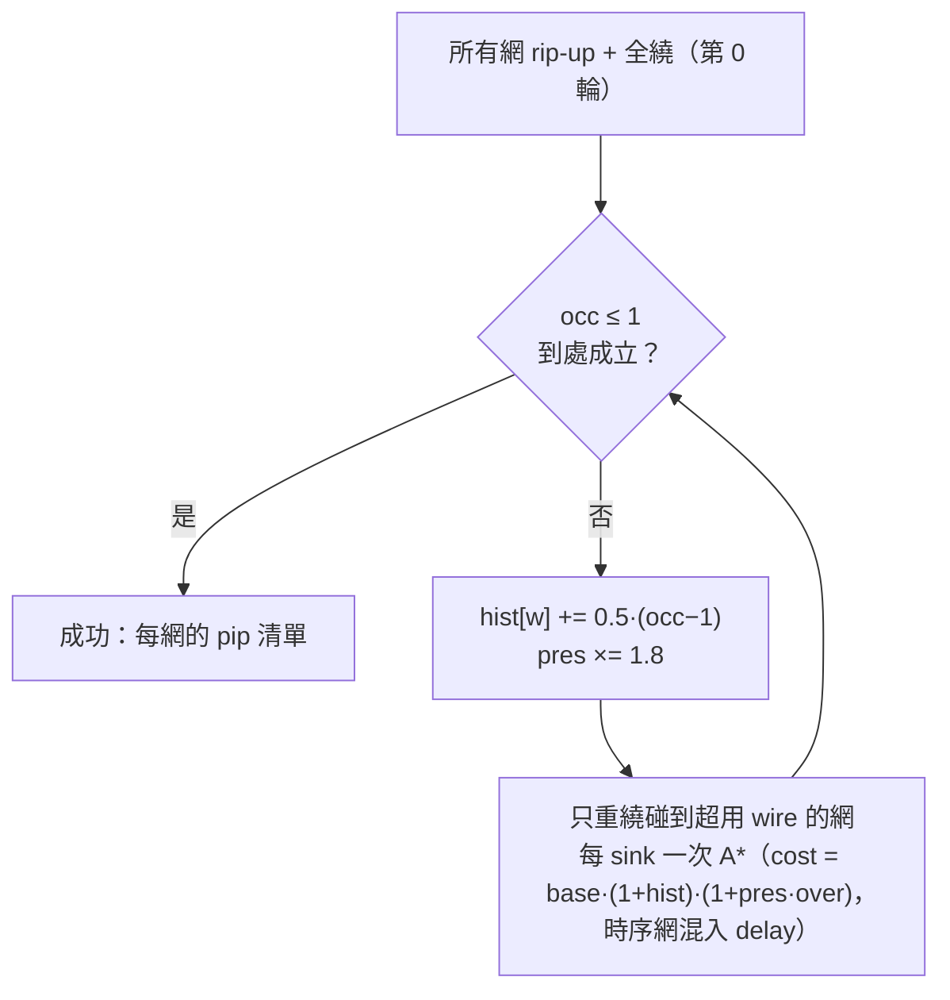

# 4.7 PathFinder 協商繞線：用「擁擠」收斂出可行解

> 對照原始碼：`veryl-eda/src/pnr/route.rs`（174 行，一個函式）。
> 佈局把 LC 放上了座標，但**一條訊號怎麼從 A 走到 B** 仍是開放問題：
> 晶片上的每一條 wire 每次只能載一個訊號。PathFinder（Betz & Rose,
> 1997, FPGA'96/97 論文体系）的洞見是：不要一開始就要求互斥——
> 先讓大家「超賣」，再用不斷加價的擁擠成本把重複的使用者**協商**開。

## 4.7.1 問題形式化

給定：

* 有向圖 $`G = (V, E)`$ ： $`V`$ 是 wires， $`E`$ 是 pips（每個 pip 是
  $`\text{src} \to \text{dst}`$ 的一個 mux 選擇）；
* 每個 wire $`v`$ 的容量 $`c_v = 1`$ ；
* 每個訊號網 $`n`$ ：一個源 wire $`s_n`$ 、一組目的 wire $`t_{n,1..k}`$ 。

目標：為每網找一棵以 $`s_n`$ 為根的樹（Steiner 樹），使

$$
\sum_{v \in V} \max\!\Bigl(0,\; \mathrm{occ}(v) - c_v\Bigr) \;=\; 0
$$

其中 $`\mathrm{occ}(v)`$ 是經過 $`v`$ 的網數。這是 NP-hard 的（多網、多終點、
容量約束），但 FPGA 的圖規律極強，所以啟發式夠用。

## 4.7.2 PathFinder 的核心：三項成本

PathFinder 給每條 wire 一個隨迭代變化的成本，本實作的版本在
`route.rs:114-123`：

```rust
for (p, v) in fan {
    let o = owner[v as usize];
    if o >= 0 && o != ni as i32 { continue; }
    let over = occ[v as usize] as f32;
    let cong = (1.0 + hist[v as usize]) * (1.0 + pres * over);
    // wire delay in units of a typical hop (~0.6 ns)
    let c = if crit > 0.0 {
        let d = super::sta::hop_delay(chip.kind[u as usize], chip.kind[v as usize]) as f32 / 0.6;
        crit * d + (1.0 - crit) * cong
    } else { cong };
    ...
}
```

拆開來：

$$
\mathrm{cost}(v) \;=\; \underbrace{\bigl(1 + h(v)\bigr)}_{\text{歷史}}
\;\cdot\;
\underbrace{\bigl(1 + p \cdot \max(0, \mathrm{occ}(v)-1)\bigr)}_{\text{當下擁擠}}
\qquad
\text{（時序網再混入） }
c \;=\; c_n \cdot \frac{d_{\text{wire}}}{0.6} + (1 - c_n)\cdot \mathrm{cost}(v)
$$

三個成分的角色：

| 項 | 符號 | 作用 | 本實作的參數 |
|---|---|---|---|
| base | $`1`$ | 每條 wire 都有底價 → 短路徑優先 | 常數 1 |
| history | $`h(v)`$ | **永久的記憶**：曾經被搶過的 wire 漲價不跌 | `hist[w] += 0.5*(occ-1)` |
| present | $`p\cdot\text{over}`$ | **當下的擁擠**：這一輪誰還擠著 | `pres` 從 0.5 起，每輪 ×1.8 |

為什麼要分「歷史」與「當下」兩項？這是演算法收斂的關鍵：

* 只用當下項：兩個網會在 A、B 兩條路之間**永遠對調**（每輪都換邊，
  誰也淘汰不了誰）——震盪。
* 加上歷史項：被搶過一次的 wire 永久漲價，於是有一方會被推去別的路，
  而且**不會回頭**。歷史項把「曾經的擁擠」轉成單調的壓力。

本實作在每輪結束時（`route.rs:170-171`）：

```rust
for w in over { hist[w] += 0.5 * (occ[w] - 1) as f32; }
pres *= 1.8;
```

$`p`$ 的指數成長（0.5, 0.9, 1.62, 2.92, …）是最後的鞭子：前期歷史項主導
（溫柔地分散），後期 present 項暴漲，直接禁止任何重疊存活。

## 4.7.3 主迴圈：rip-up and reroute

「Rip-up and reroute」的意思：每輪把（部分）網拆掉重繞，而不是增量修補。
`route.rs:71-76` 決定每輪重繞誰：

```rust
for iter in 0..200 {
    for &ni in &order {
        let crit = net.crit.clamp(0.0, 0.95);
        // reroute only nets touching an overused wire (all nets in the first pass)
        if iter > 0 && !nodes_of[ni].iter().any(|w| occ[*w as usize] > 1) { continue; }
        for &w in &nodes_of[ni] { occ[w as usize] -= 1; }
```

* 第 0 輪：全部網重繞（此時還沒有路）；
* 之後的輪：**只重繞碰到超用 wire 的網**——沒踩到別人的網不必動，
  這讓收斂後期的每輪成本快速下降；
* 拆網就是把它經過的每個 wire 的 `occ` 減一（rip-up）。

網的順序按**扇出由大到小**（`route.rs:68-69`）：高扇出網最難繞、
影響面最大，讓它先挑最好的路。

虛擬碼：

```text
route(nets):
    occ = 0 everywhere; hist = 0; pres = 0.5
    for iter in 0..200:
        for net in nets (高扇出優先):
            if iter > 0 and net 不碰任何超用 wire: skip
            rip up net（occ--）
            tree = { src }
            for sink in sinks（由近到遠）:
                path = A*(tree → sink, cost = cost(v) [+ 時序混入])
                tree ∪= path; 記錄 pips
            for pip in pips: occ[pip.dst]++
        if 無超用 wire: return 成功
        for w in overused: hist[w] += 0.5·(occ[w]−1)
        pres *= 1.8
    return 繞線未收斂
```

## 4.7.4 多終點網：一網一樹，逐 sink 生長

一個多扇出網不是 k 條獨立路徑，而是一棵樹。實作用
`tree`（成員集合）+ `tree_order`（插入順序，`route.rs:80-84`）：

```rust
// route tree: membership set + insertion order (keeps runs deterministic)
let mut tree: HashSet<u32> = HashSet::new();
let mut tree_order: Vec<u32> = vec![net.src];
```

每個 sink 依序做一次「從整棵樹的任何節點出發」的搜尋：把**樹上所有
節點**都當作起點放進 heap、距離設 0（`route.rs:101-107`）——

```rust
for &t in &tree_order {
    dist[t as usize] = 0.0;
    prev[t as usize] = u32::MAX;
    seen[t as usize] = gen;
    heap.push(Item(tdist(t, tx, ty) * 0.3, t));
}
```

找到 sink 後沿 `prev` 走回**任何一個已在樹上的節點**，把路上節點併入樹。
這等價於逐步建 Steiner 樹的經典啟發式：後面的 sink 可以搭前面已鋪好的
便車，重用中段導線。

sinks 的拜訪順序也整理過（`route.rs:91-96`）：**由離源最近的先連**
（曼哈頓距離排序）——近的先接，樹的形狀偏向星狀而非蛇狀。

## 4.7.5 A* 搜尋與啟發函數

Dijkstra 保證最短路但太慢；A* 加一個不超過真實剩餘成本的啟發值
$`h(v)`$ 就能直奔目標。本實作的啟發是**到目標 bounding box 的曼哈頓
距離**（`route.rs:60-66`）：

```rust
let center = |w: u32| { let b = chip.net_box[w as usize]; ((b.0 + b.2) as f32 / 2.0, (b.1 + b.3) as f32 / 2.0) };
let tdist = |w: u32, tx: f32, ty: f32| -> f32 {
    let b = chip.net_box[w as usize];
    let dx = if tx < b.0 as f32 { ... } else { 0.0 };
    let dy = ...;
    dx + dy
};
```

`chip.net_box[w]` 是 wire 所在 tile 的外框；`tdist(v, tx, ty)` 是「從 $`v`$
到目標 tile 中心，至少還要走幾格 tile」。因為每一格 tile 至少花一點
成本（base = 1 × 每個 hop 至少跨一 tile），這個下界是**可接納的**
（admissible），所以 A* 仍然找到相對該成本函數的最短路。放入 heap 時：

```rust
heap.push(Item(nd + tdist(v, tx, ty) * 0.3, v));
```

係數 0.3 把啟發縮到下界的 30%——**輕微加權**（weighted A*， $`h`$ 可略超
真實剩餘成本，理論上放棄一點最優性換大量速度）。實務上 FPGA 繞線
從來不追求絕對最短路（下一輪還要重繞），速度才是重點。

另一個加速細節：`seen[v] = gen` + `gen` 代數戳記（`route.rs:99, 125-130`）
——每次搜尋只加 1，就用 `seen[v] != gen` 判斷「本輪沒碰過」，
省掉每次清空 `dist`/`prev` 的 $`O(V)`$ 。

## 4.7.6 時序驅動：criticality 混入

`RNet.crit`（0..1，來自 4.8 的 STA `net_crit`）讓關鍵網**按延遲繞**、
非關鍵網**按擁擠繞**：

$$
c \;=\; c_n \cdot \frac{\mathrm{hop\_delay}(u \to v)}{0.6}
\;+\; (1 - c_n)\cdot \bigl(1+h(v)\bigr)\bigl(1+p\cdot\mathrm{over}(v)\bigr)
$$

```rust
let d = super::sta::hop_delay(chip.kind[u as usize], chip.kind[v as usize]) as f32 / 0.6;
crit * d + (1.0 - crit) * cong
```

為什麼除以 0.6？因為擁擠項的量綱是「每 hop 約 1」，把延遲也歸一到
「典型 hop（≈0.6 ns）的倍數」，兩項才能線性混合。`clamp(0.0, 0.95)`
刻意**不讓任何網變成純時序驅動**：留 5% 的擁擠意識，避免關鍵網
踩進剛被別的關鍵網佔用的 wire 而遲遲不收斂。

一個 wire 快不快由它的**型別**決定（`chipdb.rs` 的 `Kind`）：
`Sp4H`/`Sp4V`（span-4，短線）最便宜、`Sp12`（span-12，長線）貴、
`glb2local`（全域進本地）中等——同一個 mux 群裡「快線與慢線並存」，
正是時序驅動繞線的獲利來源。

## 4.7.7 兩種特殊網：全域與「不許別人用」

**全域網**（clock / set-reset）不走一般繞線：它們從 pad 或 LC 經
`fabout` 進全域緩衝 `glb_netwk_g`，再直接插進每個 tile 的 clock mux。
`route.rs` 把「fabout → global」做成偽 pip（`u32::MAX - i`，
`route.rs:40-43`），並在第一個 sink 連上後一次接好所有全域 sink：

```rust
if k == 0 {
    if let Some((fab, glb, gsinks)) = &net.global {
        let gp = extra_fanout.get(fab).and_then(|v| v.iter().find(|(_, d)| d == glb))...;
        routes[ni].push(gp);
        for &gs in gsinks {
            let p = chip.fanout[*glb as usize].iter().copied().find(|p| chip.pips[*p as usize].dst == gs)...;
            routes[ni].push(p);
        }
    }
}
```

**保留 wire**：訊號的源與目的 wire 被記在 `owner` 表裡（`route.rs:46-50`），
其他網的搜尋會跳過（`if o >= 0 && o != ni { continue; }`）——你的 LUT
輸入 wire 不可能讓別人的訊號經過，這些 wire 是端點，天生獨佔。

## 4.7.8 與 rigidity（固定剛性繞線）的比較

教科書上另一個極端是 **rigid routing**：每個邏輯單元能用的 wire 預先
限定（例如 iCE40 的「neighbour routing」），繞線器只做點對點搜索，
永不爭搶。比較：

| | rigid / 每網繞一次 | PathFinder（本實作） |
|---|---|---|
| 爭搶處理 | 無 → 失敗就重試整個流程 | 協商：hist + present 收斂 |
| 繞線品質 | 由佈局好壞決定，無全局視野 | 全局最短偏好，且迭代放寬 |
| 時間 | 單輪，快 | 多輪，但只重繞衝突網 |
| 適用 | 資源寬鬆、結構規則 | 一般情況，收斂可證（機率上） |

PathFinder 的妙處是**不需要全域最佳化**：每網貪婪地選自己眼中的最短路，
擁擠的代價由成本函數傳遞——這是「用價格機制代替中央規劃」在 EDA 的
教科書案例。收斂的直覺：每輪 history 只增不減，總成本有單調壓力；
當 $`p`$ 指數成長後，任何 $`\mathrm{occ} \ge 2`$ 的解成本暴增，
貪婪搜尋自然把它們拆開。上限 200 輪（`for iter in 0..200`）是防禦性
的：實務上小型設計 3–10 輪就收斂。



## 4.7.9 為什麼這樣設計？

* **一個函式 174 行**：整個演算法是一個 `route()`——因為 PathFinder 的
  狀態（`occ`、`hist`、`pres`、每網路徑）天然同構於一個迴圈體，
  拆模組反而要傳一堆可變狀態。
* **`u16` 的 `occ` 與 `f32` 的 `hist`**：UP5K 有約 1.4 萬條保留 wire，
  記憶體布局比型別的數學純度重要。
* **確定性**：`tree_order` 保留插入順序、`order.sort_by_key` 是穩定排序、
  RNG 不參與繞線——同一個輸入永遠產生同一個 .asc，這對測試
  （`pnr_test.sh` 逐設計比對）與教學都是必要條件。

## 本章重點

1. 繞線 = 容量 1 的多網 Steiner 樹問題；PathFinder 用「超賣 → 加價協商」
   的迭代把它化成一系列單網最短路。
2. 成本三分：base（短路徑）、history（永久記憶，防震盪）、present
   （當下擁擠，指數升壓逼收斂）；`hist += 0.5(occ−1)`、`pres ×= 1.8`。
3. rip-up and reroute 每輪只重繞**碰到超用 wire 的網**，收斂期成本銳減。
4. 多終點網用「樹上所有節點都是起點」的 A* 逐 sink 生長成 Steiner 樹；
   啟發值是縮放 0.3 的 bounding-box 曼哈頓距離。
5. 時序驅動 = criticality 線性混合延遲項與擁擠項，且 clamp 到 0.95 保留
   一點擁擠意識。
6. 全域網用 fabout → glb_netwk 的硬路徑 + 保留 wire 機制；確定性是設計
   目標之一。
