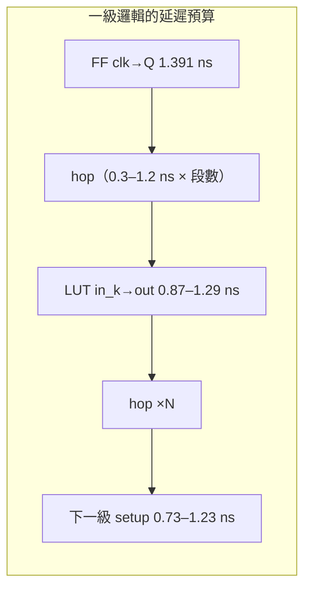
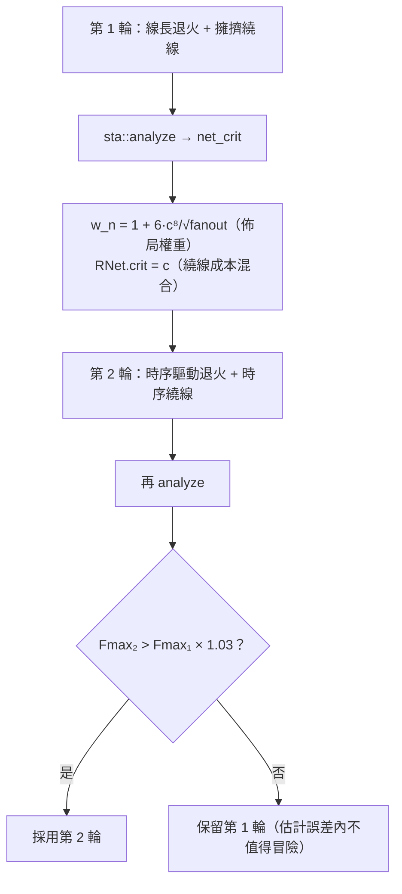

# 4.8 FPGA 靜態時序分析：從 pip 延遲到 Fmax

> 對照原始碼：`veryl-eda/src/pnr/sta.rs`（375 行）。繞線收斂之後，
> 我們手上有一份「每網走哪些 wire、每個 hop 接哪種線」的清單——
> 這正是算時序所需的一切。STA 的任務：不用任何模擬輸入，
> 純粹**用圖上的延遲模型**算出最壞路徑與 $`F_{max}`$ ，
> 並回頭告訴繞線器（4.7）與佈局器（4.6）誰該加權。

## 4.8.1 延遲從哪裡來

`sta.rs` 的延遲常數全部來自 IceStorm 的 `timings_up5k.txt`
（slow corner，1.2 V、最壞製程/溫度），分四類：

```rust
const CLK_Q: f64 = 1.391;                       // FF clk → Q
const LUT: [f64; 4] = [1.285, 1.232, 1.205, 0.874];  // in_k → lcout
const SETUP: [f64; 4] = [1.232, 1.060, 0.980, 0.728]; // in_k 的 setup
const CARRY_IN1: f64 = 0.675;  const CARRY_IN2: f64 = 0.609;  const CARRY_CIN: f64 = 0.278;
const RAM_CLK_Q: f64 = 1.179;   // BRAM RCLK → RDATA
const IO_IN: f64 = 1.105;  const IO_OUT: f64 = 0.187;
```

以及**路由 hop** 的延遲——這是最 FPGA 特有的一項（`sta.rs:45-62`）：

```rust
pub fn hop_delay(src: Kind, dst: Kind) -> f64 {
    let from_lc = src == Kind::LutOut;
    match dst {
        Kind::LutIn => 0.662,
        Kind::Local => 1.099,
        Kind::Ctrl => 0.636,
        Kind::Glb => 0.278,
        Kind::Sp4H => if from_lc { 0.649 } else { 0.543 },
        Kind::Sp12H => if from_lc { 1.232 } else { 1.231 },
        Kind::Carry => 0.556,
        ...
    }
}
```

模型：**每個 pip 一個延遲，由「被驅動的 wire 種類」決定**
（`dst` 的 `Kind`；從 LC 輸出第一跳用輸出驅動器的值，所以 `Sp4H` 有
`from_lc` 的分支）。iCE40 的線不是等長的：span-4 短、span-12 長、
全域網是專用樹——繞線器在 4.7 混入的 `hop_delay / 0.6` 就是這張表。



## 4.8.2 圖模型：endpoint 而非 cell

STA 的節點不是 cell，而是 **wire × 電路角色的交點**（`Ep` enum，
`sta.rs:34-43`）：

```rust
pub enum Ep {
    LcOut(usize),        // LC 的輸出 wire（起點）
    LcIn(usize, u8),     // LC 的 in_k wire（終點之一）
    IoIn(usize),         // 輸入腳
    IoOut(usize),        // 輸出腳
    RamOut(usize),       // BRAM 資料輸出
    RamIn(usize, f64),   // BRAM 輸入（帶各自的 setup）
}
```

`mod.rs` 的 `build()` 在組織繞線問題時順便填了 `eps: HashMap<u32, Ep>`
（wire → endpoint）。STA 先把它反查成兩張表：

* `lc_in_wire[(l, k)]`：LC $`l`$ 的 in $`k`$ 接到哪條 wire；
* `sink_route[w] = (net, delay, pips)`：這條 wire 是網 $`n`$ 的 sink，
  從網源頭到這裡的 hop 總延遲 $`d`$ 是多少（`sta.rs:92-109` 沿 pip 的
  `dst → src` 回溯累加）。

於是「一級組合」的到達時間遞迴非常乾淨：

$$
A_{\mathrm{out}}(l) \;=\;
\max_k \Bigl( A_{\mathrm{src}}(n_{l,k}) + d_{\mathrm{route}}(n_{l,k}) + L_k \Bigr)
$$

其中 $`A_{\mathrm{src}}`$ 依網源頭身分取值（`sta.rs:137`）：

```rust
let s = match net_src[*ni] { Ep::LcOut(j) => out_arr[j], Ep::IoIn(_) => IO_IN,
                             Ep::RamOut(_) => RAM_CLK_Q, _ => 0.0 };
Some(s + d)
```

——LC 輸出取該 LC 的到達時間、輸入腳取 `IO_IN`、BRAM 輸出取
`RAM_CLK_Q`。**FF 輸出的到達時間恆為 `CLK_Q`**（`sta.rs:182`）：
時脈是理想的（全域網，無 skew，見 4.8.6），所以所有 FF 同時翻轉，
$`A_{\mathrm{out}}`$ 重新歸零為 `CLK_Q`。

## 4.8.3 進位鏈：兩個並行的時鐘

進位鏈讓圖變複雜：一個 carry LC 有**兩個輸出**要分別追蹤——
LUT 輸出（sum）與 carry-out。實作用兩組陣列 `out_arr`/`cout_arr`
（`sta.rs:128-132`），LC 求值時同時算兩者（`sta.rs:164-181`）：

```rust
let cin = match chain_prev[l] { Some(pv) => cout_arr[pv], None => 0.0 };
let mut best = (0.0f64, From::None);
for k in 0..4u8 {
    if let Some(a) = input_arr(l, k, &out_arr) { ... v = a + LUT[k]; ... }
}
if lc.in3_chain && cin + LUT[3] > best.0 { best = (cin + LUT[3], From::Carry); }
if lc.carry {
    let mut c = (cin + CARRY_CIN, From::Carry);
    for (k, dl) in [(1u8, CARRY_IN1), (2u8, CARRY_IN2)] { ... }
    cout_arr[l] = c.0;  cout_from[l] = c.1;
}
```

carry-out 的到達時間：

$$
A_{\mathrm{cout}}(l) \;=\; \max\Bigl(
A_{\mathrm{cin}}(l) + \mathrm{CARRY\_CIN},\;
A_{\mathrm{in_1}}(l) + \mathrm{CARRY\_IN1},\;
A_{\mathrm{in_2}}(l) + \mathrm{CARRY\_IN2}
\Bigr)
$$

一個 32-bit 加法器的關鍵路徑幾乎總是進位鏈本身：

$$
T_{\text{chain}}(n) \;\approx\; \mathrm{CARRY\_CIN} \times (n-1) + \text{首級} + \text{末級}
$$

32 級的鏈約 $`0.278 \times 31 + \dots \approx 10`$ ns——這就是為什麼
pack（4.6.2）拚了命讓鏈不斷：鏈上一個中斷就得過繞線，
一個 hop 就是 0.5–1.2 ns，比 4 級 carry 還貴。

求值順序：LC 圖是 DAG（經 FF 切斷），但 Rust 不用拓撲排序庫，
而是**帶 memo 的顯式堆疊**（`sta.rs:151-185`）：`out_arr[l] = NaN`
表示未算，`(l, false)` 先壓棧收集依賴、`(l, true)` 再回來求值——
iterative post-order，避免深設計爆 recursion stack。

## 4.8.4 終點與 Fmax

到達時間算完後掃三種終點（`sta.rs:187-216`）：

1. **FF 的 setup**： $`A_{\mathrm{in}_k} + \mathrm{SETUP}[k]`$ ；
2. **BRAM 輸入**： $`A_{\mathrm{src}} + d_{\mathrm{route}} + \mathrm{ram\_setup}(\mathrm{pin})`$
   （每種 pin 的 setup 不同，`ram_setup` 查表：RADDR 0.384、WE 0.252…）;
3. **輸出腳**： $`A_{\mathrm{src}} + d_{\mathrm{route}} + \mathrm{IO\_OUT}`$ 。

$$
T_{\mathrm{clk}} \;\ge\; T_{cq} + T_{\mathrm{logic}} + T_{\mathrm{route}} + T_{su}
$$

$$
F_{max} \;=\; \frac{1000}{T_{\mathrm{worst}}}\;\;(\text{MHz},\; T\ \text{單位 ns})
\qquad \text{（`sta.rs:374`：`fmax: 1000.0 / period`）}
$$

注意這個不等式**不減去 clock skew**（見 4.8.6），也不含 clock-to-clock
jitter——它是理想時脈下的 FF-to-FF 週期下界。

## 4.8.5 關鍵路徑回溯與 net criticality

STA 的輸出不只是數字。求值過程記錄每個 LC 的 `out_from[l]: From`
（最佳輸入是哪一腳 / 來自 carry），終點確定後就能**沿記錄走回源頭**
（`sta.rs:219-288`），產生人類可讀的路徑報告：

```rust
match out_from[l] {
    From::Input(k) => {
        rev.push(Step { what: format!("{} in{}→out", loc(l), k), delay: LUT[k as usize], at: 0.0 });
        cur = lc_in_wire.get(&(l, k)).and_then(|w| route_step(*w, ...));
    }
    From::Carry => {
        rev.push(Step { what: format!("{} carry-in→out", loc(l)), delay: LUT[3], at: 0.0 });
        via_carry = chain_prev[l];   // 沿鏈往下追
    }
    ...
}
```

`route_step` 把每段繞線也寫進路徑（`繞線 n123（4 段）`），
最後 `at` 欄位累加出每步的絕對時間——IDE 的 ⓘ 彈窗就是吃這份 `Vec<Step>`。

**net criticality** 則需要一次**反向傳遞**：對每個網問「從源頭出發、
經過我、再加上我之後最壞還有多長」。實作先算每個 LC 的 tail
（`tail_out`/`tail_cout`：從此 LC 的輸出/carry-out 到任一終點的最長路，
`sta.rs:295-352`，同樣是 iterative post-order），然後：

$$
\mathrm{crit}(n) \;=\; \frac{1}{T_{\mathrm{worst}}}\;\max_{s \in \mathrm{sinks}(n)}
\Bigl( A_{\mathrm{src}}(n) + d_{\mathrm{route}}(n, s) + \mathrm{tail}(s) \Bigr)
$$

```rust
let net_crit: Vec<f32> = nets.iter().enumerate().map(|(ni, net)| {
    ...
    worst = worst.max(src + d + after);
    (worst / period).min(1.0) as f32
}).collect();
```

`crit` 回到兩處：繞線的 `RNet.crit`（4.7.6 的混合成本）與佈局的
$`w_n = 1 + 6 c_n^8/\sqrt{\mathrm{fanout}}`$ （4.6.3）。**這就是「兩輪
place & route」的資料閉環**：



## 4.8.6 模型假設與誤差來源

檔頭註明瞭簡化（`sta.rs:5-7`）：**時脈理想（無 skew）**、
**set/reset 路徑不計時**。這在 iCE40 上是合理的：全域緩衝樹是專用的、
平衡的，skew 遠小於 hop 延遲；set/reset 不是每個週期都要及時的路徑。
但要記得：

1. **無 skew 意味著 $`F_{max}`$ 略偏樂觀**。hold-time 檢查完全缺席——
   iCE40 同一 tile 內 FF 間的最短延遲由硬體保證，跨 tile 的 hold 靠
   路由延遲下界，工具不管它。
2. **hop 延遲是常數表**：真實延遲與扇出、相鄰訊號切換（串擾）有關，
   NLDM 查表（ASIC 後端那套）在 FPGA 繞線上不存在。
3. **icetime 用同一份晶片資料但獨立實作**，所以 `pnr_test.sh` 把它當
   第二意見（`pnr_test.sh:41-42`）：

```bash
fmax=$(icetime -C "$CHIPDB" -d up5k -P sg48 -p $B/$m.pcf -t $B/$m.asc 2>/dev/null \
       | sed -n 's/^Total path delay: .*(\(.*\) MHz)/\1 MHz/p')
```

   `-C "$CHIPDB"` 指定同一個 `chipdb-5k.txt`——icetime 的模型也是
   「wire 種類 → 延遲」的表，但它的表在 chipdb 的 `.timing` 區段
   （本工具則寫死在 `sta.rs` 常數）。兩者通常相差幾個百分點；
   差距大表示哪邊的 hop 分類出了錯。

## 4.8.7 虛擬碼

```text
analyze(chip, packed, placement, nets, routes, eps):
    # 1. 展開路由 → 每個 sink wire 的 (net, route_delay, pips)
    for net, route in zip(nets, routes):  對每個 sink 沿 pip 回溯累加 hop_delay

    # 2. 前向：LC 到達時間（DAG post-order，FF 輸出重置為 CLK_Q）
    A_out[l]  = max_k ( A_src(net of in_k) + d_route + LUT[k] )
    A_cout[l] = max( A_cin + CARRY_CIN, A_in1 + CARRY_IN1, A_in2 + CARRY_IN2 )

    # 3. 終點掃描
    worst = max( FF setup, RAM input setup, IO output )

    # 4. 回溯關鍵路徑（out_from / cout_from 記錄的決策）
    # 5. 反向：tail_out / tail_cout → net_crit = (src + d + tail) / period
    return Timing { period, fmax = 1000/period, path, net_crit, ... }
```

## 4.8.8 為什麼這樣設計？

* **STA 內建而不是外掛 icetime**：繞線器需要 `net_crit`（4.7.6），
  佈局器需要 `w_n`（4.6.3）——一個「在流程中間」的 STA 必須與
  pack/place/route 共享資料結構（`Packed`、`Placement`、`RNet`）。
  icetime 吃的是 .asc，餵不進這個迴圈。
* **常數寫死而非解析 timings 檔**：UP5K 一種裝置、一份 15 個數字的表，
  解析器與型別系統的成本不值；`hop_delay` 的 `Kind` 分類反而需要
  智慧（`chipdb::Kind::of` 用 wire 名字判斷），值得做成 enum。
* **`From` 記決策而非整條路**：回溯時只需要「這個輸出是從哪一腳來的」
  一個選擇，記整條路徑是 $`O(V^2)`$ 記憶體。

## 本章重點

1. 延遲四來源：cell arc（LUT/FF/carry/BRAM/IO，常數表）、routing hop
   （由被驅動 wire 的 `Kind` 查 `hop_delay`）、clock network（理想 = 0）、
   setup。
2. 圖模型以 wire 為節點、以 `Ep` 標記電路角色；FF 輸出重置 `CLK_Q`
   實現「理想時脈」假設。
3. 進位鏈需要雙時鐘（LUT 與 carry-out 分別追蹤）；鏈每級 0.278 ns，
   斷一鍊過一 hop 更貴。
4. $`T_{clk} \ge T_{cq}+T_{logic}+T_{route}+T_{su}`$ ； $`F_{max}=1000/T`$ （ns）。
5. `net_crit` 由後向 tail 傳遞算出，是時序驅動佈局/繞線第二輪的輸入；
   兩輪結果要快過 3% 才換。
6. 模型不含 skew/hold/jitter；icetime（`-C chipdb`）作為獨立第二意見。
