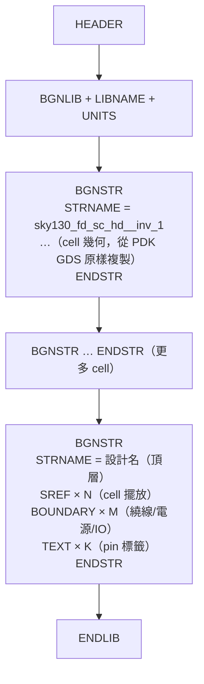
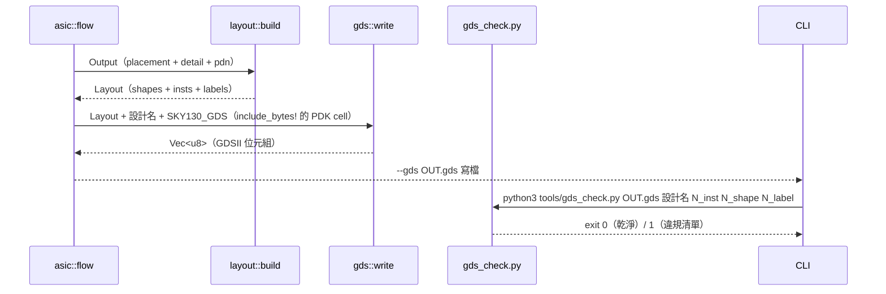

# 5.10 GDSII 輸出

> 原始碼：`veryl-eda/src/asic/gds.rs`（158 行）與 `tools/gds_check.py`（65 行）。
> GDSII（Calma GDS II Stream Format）是版圖交換的通用二進位格式：
> 晶圓廠的 tape-out、KLayout / Virtuoso 的讀入，全靠它。這一節從
> byte 層級拆解格式，再看 `gds.rs` 如何寫出它、`gds_check.py` 如何獨立驗證。

## 5.10.1 記錄格式：每筆記錄 = 長度 + 型別 + 資料

GDSII 檔案是一串記錄（record），沒有文字、沒有換行。每筆記錄：

```text
┌────────────┬────────────┬─────────────────────────┐
│ len: u16   │ rt: u16    │ payload（偶數 byte）      │
│ (big-end)  │ = 高 byte  │                         │
│  含自身 4B │  = 型別    │                         │
└────────────┴────────────┴─────────────────────────┘
```

`gds.rs` 的寫入器把這個封裝壓縮成三行：

```rust
// veryl-eda/src/asic/gds.rs
struct W(Vec<u8>);
impl W {
    fn rec(&mut self, rt: u16, data: &[u8]) {
        let len = (4 + data.len() + data.len() % 2) as u16;   // 補 pad 到偶數
        self.0.extend(len.to_be_bytes());
        self.0.extend(rt.to_be_bytes());
        self.0.extend(data);
        if data.len() % 2 == 1 { self.0.push(0); }            // pad byte
    }
    fn i16s(&mut self, rt: u16, v: &[i16]) { ... }   // 資料型別 0x02
    fn i32s(&mut self, rt: u16, v: &[i32]) { ... }   // 資料型別 0x03
    fn s(&mut self, rt: u16, s: &str) { ... }        // ASCII，型別 0x06
    fn real8(&mut self, rt: u16, v: &[f64]) { ... }  // 8-byte real，型別 0x05
}
```

記錄型別的高 byte 是**資料型別**（0x00 無資料、0x02 bit array、0x03
4-byte int、0x05 8-byte real、0x06 ASCII），低 byte 是**記錄種類**。
本節會用到的種類：

| 代碼 | 名稱 | 內容 |
|---|---|---|
| 0x00 | HEADER | 版本號 |
| 0x01 | BGNLIB | 程式庫開始（時間戳 ×2）|
| 0x02 | LIBNAME | 程式庫名 |
| 0x03 | UNITS | 兩個 real8：DB 單位與 user 單位 |
| 0x04 | ENDLIB | 程式庫結束 |
| 0x05/06/07 | BGNSTR / STRNAME / ENDSTR | structure（cell）開始/名/結束 |
| 0x08 | BOUNDARY | 一個多邊形開始 |
| 0x0C | TEXT | 一個文字標籤開始 |
| 0x0D | LAYER | 圖層號（i16）|
| 0x0E | DATATYPE | 資料型別號（i16，TEXT 用 TEXTTYPE 0x16）|
| 0x10 | XY | 座標序列（i32 對）|
| 0x11 | ENDEL | 元素結束 |
| 0x12 | SNAME | SREF 參照的 structure 名 |
| 0x1A | STRANS | 放置轉換（鏡射/旋轉）|
| 0x0A / 0x1B | SREF / END | cell 參照開始 / 結束 |

## 5.10.2 real8：GDS 專屬的浮點數

`UNITS` 記錄裡的單位不是 IEEE 754，而是 GDS 自有的 **8-byte real**：
1 位符號、7 位超 64 的 base-16 指數、56 位尾數：

$$
v = (-1)^s \times 0.m \times 16^{\,e-64}
$$

`gds.rs` 的實作：

```rust
// veryl-eda/src/asic/gds.rs
pub fn real8(v: f64) -> [u8; 8] {
    if v == 0.0 { return [0; 8]; }
    let (sign, mut m) = (v < 0.0, v.abs());
    let mut e: i32 = 64;
    while m >= 1.0 { m /= 16.0; e += 1; }
    while m < 1.0 / 16.0 { m *= 16.0; e -= 1; }
    let mant = (m * (1u64 << 56) as f64).round() as u64;
    let mut out = [0u8; 8];
    out[0] = (if sign { 0x80 } else { 0 }) | (e as u8 & 0x7f);
    for k in 0..7 { out[1 + k] = (mant >> (8 * (6 - k))) as u8; }
    out
}
```

測試鎖定了兩個「每份 GDS 檔都這樣寫」的數值：

```rust
// veryl-eda/src/asic/gds.rs（tests）
assert_eq!(super::real8(0.001), [0x3e, 0x41, 0x89, 0x37, 0x4b, 0xc6, 0xa7, 0xf0]);
assert_eq!(super::real8(1e-9),  [0x39, 0x44, 0xb8, 0x2f, 0xa0, 0x9b, 0x5a, 0x54]);
```

**為什麼會有兩個單位**：UNITS 記錄寫 `(0.001, 1e-9)`——第一個數字是
「一個 user 單位等於多少公尺」... 精確地說，GDS 慣例是：

- **database unit** = 1e-9 m（1 nm）——座標的最小刻度；
- **user unit** = 1e-6 m（1 µm）——工程師在 UI 裡看到的單位；
- XY 記錄裡的整數座標以 database unit 計。

`write()` 的開頭：

```rust
// veryl-eda/src/asic/gds.rs（節錄）
w.i16s(0x0002, &[600]);              // HEADER：GDS 版本 6.0
w.i16s(0x0102, &date);               // BGNLIB（修改/存取時間戳各 6 個 i16）
w.s(0x0206, design);                 // LIBNAME
w.real8(0x0305, &[0.001, 1e-9]);     // UNITS
```

這與 `layout.rs` 的決策呼應：形狀座標**已經**是 nm 整數，寫 GDS 時
`i32` 直接下筆，零轉換。

## 5.10.3 檔案結構總覽



注意頂層 structure 自己**不畫** cell 內部幾何——它用 SREF 指向下方的
cell structure。這是 GDS 的階層性：一個 10 萬 instance 的設計，檔案裡只有
幾百個 cell 定義 + 幾萬條 SREF 記錄，體積是攤平版的千分之一。

## 5.10.4 cell structure：從 PDK 的 GDS 原樣複製

`sky130_fd_sc_hd__inv_1` 的內部（電晶體、阱、contact）不是我們畫的——
它們在 PDK 發行的 `sky130_fd_sc_hd.gds` 裡。`gds.rs` 先把需要的
structure 整塊複製進來（`structures()` 用記錄掃描切出 BGNSTR..ENDSTR）：

```rust
// veryl-eda/src/asic/gds.rs
/// the structures of a GDS file by name (their raw records, BGNSTR .. ENDSTR)
pub fn structures(gds: &[u8]) -> HashMap<String, Vec<u8>> {
    let mut out = HashMap::new();
    let mut i = 0;
    let mut start = None;
    let mut name = String::new();
    while i + 4 <= gds.len() {
        let len = u16::from_be_bytes([gds[i], gds[i + 1]]) as usize;
        if len < 4 { break; }
        let rt = gds[i + 2];
        match rt {
            0x05 => start = Some(i),                       // BGNSTR
            0x06 => name = ...(STRNAME),                   // 0x0606
            0x07 => { if let Some(s) = start.take() { out.insert(name.clone(), gds[s..i + len].to_vec()); } }
            _ => {}
        }
        i += len;
    }
    out
}
```

然後用一個工作佇列把**遞迴依賴**也帶進來——cell 的 structure 內部可能
還有 SNAME（0x1206）引用別的 structure：

```rust
// veryl-eda/src/asic/gds.rs（節錄）
let mut need: Vec<String> = l.insts.iter().map(|i| i.cell.clone()).collect::<HashSet<_>>().into_iter().collect();
need.sort();
let mut done: HashSet<String> = HashSet::new();
while let Some(n) = need.pop() {
    if !done.insert(n.clone()) { continue; }
    let s = lib.get(&n).ok_or_else(|| format!("cell {} is not in the GDS library", n))?;
    let mut i = 0;
    while i + 4 <= s.len() {
        let len = ...;
        if s[i + 2] == 0x12 { need.push(...SNAME...); }   // 遞迴依賴
        i += len;
    }
    w.0.extend(s);                                        // 原樣複製
}
```

**為什麼原樣複製 record 而不重新解析**：cell 的幾何是 PDK 的資產，
位元組級複製保證 (a) 零資訊損失（包括我們解析器不懂的屬性記錄）、
(b) 與 PDK 的官方檔案可位元組對照、(c) 不需要實作完整的 GDS 讀取器
（只需要記錄邊界掃描 + 兩個型別的辨識）。

## 5.10.5 SREF：cell 的擺放

頂層 structure 裡，每個 cell instance 是一個 SREF：

```rust
// veryl-eda/src/asic/gds.rs（節錄）
for inst in &l.insts {
    w.rec(0x0A00, &[]);                 // SREF
    w.s(0x1206, &inst.cell);            // SNAME
    if inst.flip {
        // mirrored about the x axis, then moved up by the cell height
        w.rec(0x1A01, &0x8000u16.to_be_bytes());          // STRANS：bit15 = 鏡射
        w.i32s(0x1003, &[inst.x as i32, (inst.y + inst.h) as i32]);  // XY
    } else {
        w.i32s(0x1003, &[inst.x as i32, inst.y as i32]);
    }
    w.rec(0x1100, &[]);                 // ENDEL
}
```

鏡射的數學：row 的 FN 擺放是對**cell 的水平中線**鏡射（5.3 節），
GDS 的 STRANS 只支援對**放置原點**的鏡射，所以等價式是：

$$
(x, y)_{\text{fn}} = \text{mirror}_x \circ \text{translate}(x_{\text{inst}},\, y_{\text{inst}} + h_{\text{cell}})
$$

先對原點鏡射（STRANS bit 15 = 0x8000），再平移到 `y + h`——
鏡射把 cell 折到 $`-h \ldots 0`$ ，平移把它推回 $`y \ldots y+h`$ 。

## 5.10.6 BOUNDARY：繞線與電源的矩形

每個 `Shape` 變成一個 BOUNDARY，其 XY 記錄是**閉合多邊形的頂點序列**
（第一點在最後重複一次）：

```rust
// veryl-eda/src/asic/gds.rs（節錄）
for s in &l.shapes {
    let Some((layer, dt, _)) = sky130_layer(&l.layers[s.layer as usize]) else { continue };
    w.rec(0x0800, &[]);                              // BOUNDARY
    w.i16s(0x0D02, &[layer]);                        // LAYER
    w.i16s(0x0E02, &[dt]);                           // DATATYPE
    let (x0, y0, x1, y1) = (s.x0 as i32, s.y0 as i32, s.x1 as i32, s.y1 as i32);
    w.i32s(0x1003, &[x0, y0, x1, y0, x1, y1, x0, y1, x0, y0]);   // XY，5 點閉合
    w.rec(0x1100, &[]);                              // ENDEL
}
```

層號映射寫死在 `sky130_layer()`——SKY130 的 metal 編號（68/69/70/71/72）
與 datatype（drawing=20、pin=16、label=5）：

```rust
// veryl-eda/src/asic/gds.rs（節錄）
pub fn sky130_layer(name: &str) -> Option<(i16, i16, i16)> {
    Some(match name {
        "li1"  => (67, 20, 16),
        "mcon" => (67, 44, 44),
        "met1" => (68, 20, 16),
        "via"  => (68, 44, 44),
        "met2" => (69, 20, 16),
        ...
    })
}
```

**為什麼 datatype 有三種角色**：同一層金屬（如 met1 = 68）依 datatype
分成 drawing（20，真正的金屬）、pin（16，pin 形狀）、label（5，文字）。
DRC 工具只看 drawing；LVS 工具需要 pin 與 label 來辨識埠。IO pin 的
輸出同時畫 pin datatype 的方形與 TEXT：

```rust
// veryl-eda/src/asic/gds.rs（節錄）
w.i16s(0x0E02, &[pin]);      // pin datatype（16）
...
w.i16s(0x1602, &[5]);        // TEXTTYPE = 5（label）
w.i32s(0x1003, &[x, y]);
w.s(0x1906, name);           // STRING 記錄（0x1906）
```

檔案收尾兩筆：

```rust
w.rec(0x0700, &[]);          // ENDSTR（頂層 structure 結束）
w.rec(0x0400, &[]);          // ENDLIB
```

## 5.10.7 寫出流程與 CLI

整條鏈（`asic::flow` 的尾端）：



PDK 的 cell GDS 內建在程式裡：

```rust
// veryl-eda/src/pdk/mod.rs
pub const SKY130_GDS: &[u8] = include_bytes!("../../pdk/sky130hd/sky130_fd_sc_hd.gds");
```

## 5.10.8 獨立驗證：tools/gds_check.py

`gds_check.py` 用 **KLayout 的 Python 模組**（與 veryl-eda 完全不同的
程式碼、不同的解析器）讀回我們寫的檔案，檢查五件事：

```python
# tools/gds_check.py（節錄）
tops = [c for c in ly.top_cells()]
if len(tops) != 1 or tops[0].name != design: bad.append(...)
insts = list(top.each_inst())
if len(insts) != n_inst: bad.append(...)
for i in insts:
    c = ly.cell(i.cell_index)
    if c.bbox().empty(): bad.append("cell %s has no geometry" % c.name)
...
boxes = texts = 0
for li in ly.layer_indexes():
    for s in top.shapes(li).each():
        if s.is_text(): texts += 1
        elif s.is_box() or s.is_polygon(): boxes += 1
```

1. **單一頂層 cell**，名字 = 設計名；
2. **instance 數** = 呼叫端給的期望值；
3. **每個被參照的 cell 有幾何**（抓「SNAME 指向不存在/空的 structure」
   ——這正是 5.10.4 遞迴依賴邏輯寫錯時的典型症狀）；
4. **box / text 計數** = 期望的形狀數 + pin 形狀數 / 標籤數；
5. **instance 不重疊**（依標準單元面積層 81/4 的外框，逐 row 掃描）；
6. **KLayout 自己的 width / spacing DRC**（攤平 + merged，見 5.9.6）。

命令列契約：`python3 tools/gds_check.py OUT.gds DESIGN N_INST N_SHAPES N_LABELS`，
退出碼 1 表任何一項不符。`veryl-eda/test.sh` 用它當 ASIC 流程的最終驗收，
web 的 npm test 則逐位元組比對 CLI 與 wasm 的 GDS 輸出。

**為什麼需要一個「不是自己人」的檢查器**：寫二進位格式最大的風險是
「我以為我寫了」。長度算錯、pad byte 漏掉、real8 指數差一——這些錯誤
自家的解析器（若有）會一樣錯，錯誤互相抵消而測試全綠。KLayout 是
業界事實標準的第三方實作，它能讀懂就是正確性的操作性定義。

## 5.10.9 為什麼這樣設計

- **nm 整數 × 1 nm DB unit**：從 `layout.rs` 到 GDS 全程無單位轉換，
  捨入只發生一次（`layout::build` 進來時）。
- **raw record 複製 PDK cells**：解析面縮到最小（只認 0x05/06/07/12 四種
  記錄型別），卻保證 cell 幾何與 PDK 位元組一致。
- **不攤平**：攤平版可以把檔案放大幾個數量級；SREF + 階層是 GDS 存在
  的理由。代價是讀取端必須理解階層——這正是 `structures()` 的
  遞迴依賴收集要解決的問題。
- **兩種 datatype（drawing/pin）+ TEXT label**：DRC 只需要 drawing，
  但 tape-out 給晶圓廠、LVS 給驗證，pin/label 是契約的一部分，缺了
  會在下游炸掉。

## 5.10.10 本章重點

- GDSII = 二進位記錄流：`len(u16) + type(u16) + payload(偶數)`，
  big-endian，pad 到偶數 byte。
- 記錄骨架：HEADER / BGNLIB / LIBNAME / UNITS →（cell 的 BGNSTR..ENDSTR，
  從 PDK 原樣複製，SNAME 依賴遞迴收集）→ 頂層 structure（SREF 擺 cell、
  BOUNDARY 畫矩形、TEXT 貼標籤）→ ENDLIB。
- `real8` 是 1+7+56 的 base-16 浮點；UNITS 寫 `(0.001, 1e-9)`：
  user unit = µm、database unit = nm，座標全程 nm 整數。
- SREF 的 FN 擺放 = STRANS 0x8000 鏡射 + 平移 `y + h`。
- 層號 `sky130_layer()`：li1=67、met1..met5=68..72，datatype 20/16/5。
- 驗證 = `tools/gds_check.py`（KLayout，第三方解析器 + 數量/重疊/DRC
  五重檢查），「能被 KLayout 讀懂」是正確性的操作性定義。
