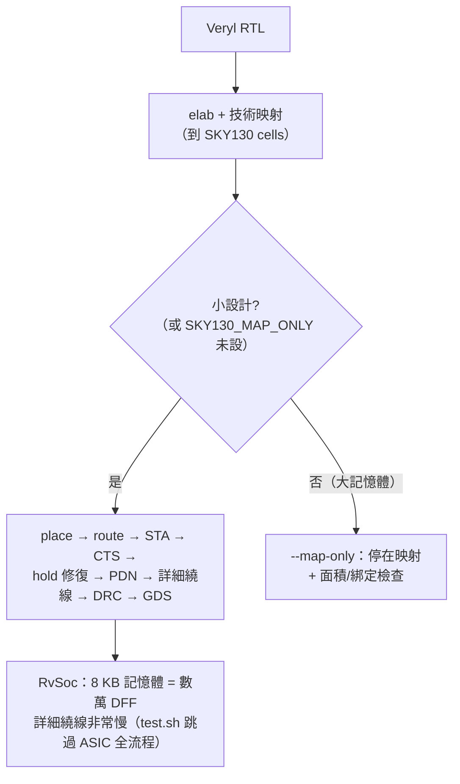

# 5.12 SKY130 實戰

> 原始碼/工具：`veryl-eda/pdk/sky130hd/`（內建子集）、
> `tools/sky130_subset.py`（88 行，裁切工具）、`tools/sky130.sh`（下載工具）、
> `veryl-eda/src/pdk/mod.rs` 的 `sky130_builtin()` / `sky130_from_dir()`。
>
> 前面各節講的是「有 Liberty 與 LEF 之後」的機械；這一節講這份
> **開源製程**本身：它是什麼、怎麼把它塞進 3 MB 的內建檔案、以及
> 用它跑真實設計（例如 RISC-V SoC）時會踩到的坑。

## 5.12.1 SKY130 是什麼

SKY130 是 SkyWater Technology 的 130 nm 開源 PDK（Google 贊助、
Apache-2.0 授權），也是開源 EDA 事實上的標準製程：OpenROAD、OpenLane、
KLayout 的流程與測試都以它為對象。veryl-eda 使用的子集是
**`sky130_fd_sc_hd`**（high-density 標準單元庫）：

| 參數 | 值 | 來源 |
|---|---|---|
| 製程節點 | 130 nm | — |
| 供電 | 1.8 V nominal（時序角 `tt_025C_1v80`：typical、25 °C、1.80 V）| Liberty 檔名 |
| site `unithd` | 寬 0.46 µm、高 2.72 µm | 技術 LEF |
| row 方向 | 交替 N / FN，奇偶邊界交錯 VDD/VSS | 5.8 節 |
| 繞線層 | met1–met4（met5 留給 strap/IO）、li1 為 cell pin 層 | `Tech::layers/pin_layer` |
| 每列繞線軌道 | 8 條（`row_h / met1 pitch(0.34 µm)`）| 5.11 節的測試 |

**為什麼選它當教學製程**：(1) 完全開源，可以放進 repo；
(2) 規模適中——row 高 2.72 µm、site 0.46 µm，在本專案的簡化 router 能
承受的範圍內；(3) Liberty/LEF/GDS 三件套齊全，5.11 節的每個解析器
都有真實資料可測。

## 5.12.2 內建子集：pdk/sky130hd/

完整 PDK 檔案很大（Liberty 400+ cells、數十 MB）；wasm 版（網頁）需要把
製程嵌進二進位。內建子集是一個**精選的細胞名單**：

```text
inv_1 inv_2 inv_4 buf_1 buf_2 buf_4 buf_8 clkbuf_1 clkbuf_2 clkbuf_4 clkbuf_8
nand2_1 nor2_1 and2_1 or2_1 xor2_1 xnor2_1 a21oi_1 o21ai_1 mux2_1
nand3_1 nor3_1 and3_1 or3_1 a22oi_1 o22ai_1 a21o_1 o21a_1 conb_1
dfxtp_1 dfrtp_1 dfstp_1 dfrtn_1
fill_1 fill_2 fill_4 fill_8 tapvpwrvgnd_1
decap_3 decap_4 decap_6 decap_8 decap_12
```

這份名單與第 5.11 節的 `SKY130_HD` 綁定表（邏輯 cell）一一對應，外加
filler / tap / decap（綁定表不需要它們，但 PDN 與 GDS 需要）。實際內建
檔案：

```text
veryl-eda/pdk/sky130hd/
├── LICENSE                              (Apache-2.0)
├── README.md
├── sky130_fd_sc_hd.tlef                 792 行（製程：SITE/LAYER/VIA）
├── sky130_fd_sc_hd.lef                4,442 行（42 個 MACRO）
├── sky130_fd_sc_hd__tt_025C_1v80.lib  6,240 行（42 個 cell 的時序）
└── sky130_fd_sc_hd.gds                3,743 行（二進位，cell 幾何）
```

`mod.rs` 用 `include_str!` / `include_bytes!` 把它們**編進程式**：

```rust
// veryl-eda/src/pdk/mod.rs
pub fn sky130_builtin() -> Result<Rc<Tech>, String> {
    thread_local! { static T: RefCell<Option<Rc<Tech>>> = const { RefCell::new(None) }; }
    if let Some(t) = T.with(|t| t.borrow().clone()) { return Ok(t); }
    let lib = liberty::library(&liberty::parse(include_str!("../../pdk/sky130hd/sky130_fd_sc_hd__tt_025C_1v80.lib"))?);
    let mut lef = lef::parse(include_str!("../../pdk/sky130hd/sky130_fd_sc_hd.tlef"))?;
    lef.merge(lef::parse(include_str!("../../pdk/sky130hd/sky130_fd_sc_hd.lef"))?);
    let t = Rc::new(sky130(lib, lef)?);
    T.with(|c| *c.borrow_mut() = Some(t.clone()));
    Ok(t)
}
pub const SKY130_GDS: &[u8] = include_bytes!("../../pdk/sky130hd/sky130_fd_sc_hd.gds");
```

**為什麼這樣設計**：網頁版（wasm）不能 fetch 檔案（`file://` 頁面無
伺服器，見 PLAN）；把子集嵌進二進位讓 `v2c asic --pdk sky130` 與
瀏覽器用**同一份資料**，npm test 才能逐位元組比對 CLI 與 wasm 的 GDS。
thread-local 快取讓「每條執行緒只解析一次」——解析 + 綁定驗證 +
access point 推導是幾十毫秒級的工作，不能每個測試重來。

## 5.12.3 子集的產生：tools/sky130_subset.py

完整檔案從 OpenROAD-flow-scripts 下載（`tools/sky130.sh`）：

```sh
# tools/sky130.sh（節錄）
R=https://raw.githubusercontent.com/The-OpenROAD-Project/OpenROAD-flow-scripts/master/flow/platforms/sky130hd
for f in lib/sky130_fd_sc_hd__tt_025C_1v80.lib lef/sky130_fd_sc_hd.tlef \
         lef/sky130_fd_sc_hd_merged.lef gds/sky130_fd_sc_hd.gds; do
    curl -sSfL -o "$D/$(basename $f)" "$R/$f"
done
```

然後 `sky130_subset.py` 做三種裁切：

### Liberty：只留 header + 名單內的 cell，去掉功耗群組

```python
# tools/sky130_subset.py（節錄）
def drop_groups(s, kinds):
    out, i = [], 0
    rx = re.compile(r"^\s*(%s)\s*\([^)]*\)\s*\{" % "|".join(kinds), re.M)
    while True:
        m = rx.search(s, i)
        if not m: out.append(s[i:]); break
        out.append(s[i:m.start()])
        i = group_end(s, m.start())      # 配對大括號（跳過字串內的 {}）
        ...
lib = open(...).read()
first = lib.index('cell ("')
head = lib[:first]                        # library header（單位、模板、操作條件）
cells = []
for n in names:
    m = re.search(r'^\s*cell \("%s"\)' % n, lib, re.M)
    body = lib[m.start():group_end(lib, m.start())]
    cells.append(drop_groups(body, ["internal_power", "leakage_power"]))
out = head + "\n".join(cells) + "\n}\n"
```

`group_end` 必須處理**字串內的大括號**（Liberty 的 `values` 表包在字串
裡、可能含任意字元），所以它逐字元掃描並跳過帶引號的區段。

**為什麼砍 `internal_power` / `leakage_power`**：veryl-eda 的功耗估算
（5.8 節的 `power.rs`）用的是常數係數模型，不讀這些表；而它們佔了
Liberty 體積的大頭。裁掉後 6,240 行，wasm 與 repo 都能承受。

### LEF：只留名單內的 MACRO

```python
# tools/sky130_subset.py（節錄）
tlef = open(...tlef).read()               # 製程檔原樣
lef = open(...merged.lef).read()
blocks = []
for n in names:
    m = re.search(r"^MACRO %s\n.*?^END %s\n" % (n, n), lef, re.M | re.S)
    if m: blocks.append(m.group(0))
hdr = "VERSION 5.7 ;\nBUSBITCHARS \"[]\" ;\nDIVIDERCHAR \"/\" ;\n\n"
open(..., "w").write(hdr + "\n".join(blocks) + "\nEND LIBRARY\n")
```

### GDS：只留名單內的 structure

```python
# tools/sky130_subset.py（節錄）
gds = open(..., "rb").read()
recs, i = [], 0
while i + 4 <= len(gds):
    ln, rt = struct.unpack(">HH", gds[i:i + 4])      # 與 gds.rs 同款的記錄掃描
    recs.append((rt >> 8, gds[i:i + ln]))
    i += ln
...
if t == 0x05:                                        # BGNSTR
    sname = recs[k + 1][1][4:].rstrip(b"\0").decode()
    if sname in keep_names:
        for r in recs[k:j + 1]: outb += r[1]         # BGNSTR..ENDSTR 原樣複製
```

與 5.10 節的 `gds::structures()` 完全同構——Python 版與 Rust 版各自
實作了一次「記錄邊界掃描」，互為對照。

## 5.12.4 完整檔案：VERYL_EDA_SKY130

內建子集夠跑教學設計，但 42 個 cell 會限制映射品質（只有一種驅動強度的
NAND2、沒有高的 adder 專用 cell）。完整庫（400+ cells）透過環境變數啟用：

```rust
// veryl-eda/src/pdk/mod.rs（節錄）
/// where the full SKY130 files are (VERYL_EDA_SKY130, else /Users/Shared/ccc/sky130hd, ~/sky130hd)
pub fn sky130_dir() -> Option<std::path::PathBuf> {
    let mut c: Vec<std::path::PathBuf> = vec![];
    if let Ok(d) = std::env::var("VERYL_EDA_SKY130") { c.push(d.into()); }
    c.push("/Users/Shared/ccc/sky130hd".into());
    if let Ok(h) = std::env::var("HOME") { c.push(std::path::Path::new(&h).join("sky130hd")); }
    c.into_iter().find(|d| d.join("sky130_fd_sc_hd.tlef").exists())
}

#[cfg(not(target_arch = "wasm32"))]
pub fn sky130_from_dir(d: &std::path::Path) -> Result<Tech, String> {
    let rd = |f: &str| std::fs::read_to_string(d.join(f)).map_err(|e| format!("{}: {}", f, e));
    let lib = liberty::library(&liberty::parse(&rd("sky130_fd_sc_hd__tt_025C_1v80.lib")?)?);
    let mut lef = lef::parse(&rd("sky130_fd_sc_hd.tlef")?)?;
    lef.merge(lef::parse(&rd("sky130_fd_sc_hd_merged.lef")?)?);
    sky130(lib, lef)
}
```

CLI 端 `--pdk sky130:DIR`（或環境變數）切換。注意兩份 LEF 檔名不同：
完整庫用 `sky130_fd_sc_hd_merged.lef`（OpenROAD 預先合併過的 cell LEF），
子集產生器則寫成 `sky130_fd_sc_hd.lef`——`sky130_from_dir` 與
`sky130_builtin` 各自對應。

`mod.rs` 的測試驗證完整庫：

```rust
// veryl-eda/src/pdk/mod.rs（tests 節錄）
let t = sky130_from_dir(&d).unwrap();
assert!(lib.cells.len() > 400, "{} cells", lib.cells.len());
assert!(lef.macros.len() > 400);
assert_eq!((t.row_h, t.site_w, t.tracks), (2.72, 0.46, 8));
let arc = &inv.pin("Y").unwrap().arcs[0];
// cell_fall at (0.01 ns, 0.0005 pF) is the table's first entry
assert!((arc.cell_fall.as_ref().unwrap().at(0.01, 0.0005) - 0.0143656).abs() < 1e-9);
for b in t.cells.values() { assert_eq!(b.access.len(), b.pins.len(), "{}", b.cell); }
```

## 5.12.5 關鍵後果：記憶體是 flip-flop

`Tech::sram` 欄位的註解一語道破：

```rust
// veryl-eda/src/pdk/mod.rs
/// memories become SRAM macros (vlib) or stay flip-flops
pub sram: bool,
```

vlib（教學庫）有自製的 SRAM 巨集模型；SKY130 的內建流程**沒有**
RAM 編譯器——陣列記憶體被映射成**一堆 DFF**。後果是二次的：

1. **面積**：一個 8 KB 的記憶體 = 65,536 個 DFF + 其 mux/clear 網路，
   cell 數輕易超過六位數；
2. **時序**：寫入路徑變成「D → DFF」的普通路徑，讀出變成 Q 直接可用
   （原本是同步讀的 RAM 週期），時序約束形狀不同；
3. **詳細繞線**：數萬顆 DFF 圍繞在 RAM 區域，繞線擁塞與 5.5 節的
   Pin order 演算法都吃緊。

因此 `veryl-eda/test.sh` 為大設計提供了降級開關：

```sh
# test.sh 的慣例（節錄自 AGENTS.md 的描述）
# SKY130_MAP_ONLY: 大設計只做到映射，不跑後段
# Memories are flip-flops in SKY130 (slow flow on the big ones:
# test.sh uses --map-only for SKY130_MAP_ONLY)
```

`--map-only` 執行 `map::map` 之後就停——驗證「這個設計能不能被映射到
SKY130 的 cell 集合」（綁定表覆蓋率、面积估算），跳過佈局/繞線/DRC。
**為什麼這樣設計**：映射正確性是純組合的問題（5.2 節的 cell cover），
與物理無關；把物理後段從大設計的迴歸中摘掉，讓 CI 的時間花在
「映射是否正確」而不是「router 跑了 20 分鐘」。



## 5.12.6 大專案例：RvSoc 的詳細繞線

`examples/src/rvsoc.veryl`（第 6 章）是本專案最大的 ASIC 案例：
RV32IMA 核心 + 4 lane 的 8 KB SyncRam + UART + VGA 文字模式。
在 SKY130 上它的問題不在邏輯（映射正常），而在物理：

- **DFF 海**：8 KB 記憶體映射成 DFF 陣列，cell 數壓垮退火與
  全域繞線的迭代次數；
- **詳細繞線的衝突迴圈**（5.5 節）：`asic::flow` 的對策是
  「detailed routing 留下 conflicts 就把 utilization 乘 0.85 重來」，
  對 RvSoc 這意味著整套退火 + 繞線從頭再跑，一次重試是分鐘級；
- **web 的取捨**：`examples/build.mjs` 的 `same_hw` / `asic: false` 標記
  讓 npm test 對 SoC 只跑一次合成並**跳過 ASIC 流程**——「detailed
  routing around 8 KB SRAM macros is very slow」（AGENTS.md 原文）。

教訓（也是本書第 5 章反覆出現的主題）：**每個演算法都有它的適用規模**。
本專案的 place/route 是為「數百到數千 cell」的教學規模設計的：
退火是 $`O(N \log N)`$ 級每次迭代、PathFinder 收斂靠迭代數、詳細繞線是
軌道級 A*。商用工具在這個規模用 multigrid 電源解、分層式佈局、
時序驅動的繞線拓撲預算——那些工程量正是「教學實作」與「生產工具」
的差距，而 SKY130 上的 RvSoc 恰好把這條界線演示出來。

## 5.12.7 實戰命令對照

```sh
# 內建子集（wasm 同款資料）
v2c synth --asic --pdk sky130 examples/counter.veryl

# 完整庫
tools/sky130.sh ~/sky130hd          # 下載（Apache-2.0）
export VERYL_EDA_SKY130=~/sky130hd
v2c synth --asic --pdk sky130:~/sky130hd examples/counter.veryl

# 大設計：只驗映射
SKY130_MAP_ONLY=1 ./test.sh

# GDS 獨立驗證（5.10 節）
GDS_PY=python3 ./test.sh            # 需要 pip install klayout
```

`web` 端：IDE 的 flowTarget 選 `sky130` 後，wasm 的 `asic` 命令帶
`pdk: "sky130"`，回傳 `pdk / layers / drc` 欄位，GDS 保留給 `asic_gds`
供下載——同一份 `include_bytes!` 的子集在瀏覽器裡重演 5.10–5.11 的
整條鏈。

## 5.12.8 本章重點

- SKY130 hd：130 nm、1.8 V、site 0.46 µm × row 2.72 µm、met1–met4 繞線、
  li1 pin 層；Apache-2.0，開源 EDA 的標準製程。
- 內建子集 = 42 個 cell 的 Liberty/LEF/GDS，由 `tools/sky130_subset.py`
  從完整檔案裁切（砍 `internal_power`/`leakage_power`、只留名單 MACRO、
  GDS 記錄掃描複製），`include_str!`/`include_bytes!` 編進程式，
  CLI 與 wasm 共用同一份資料。
- 完整庫（400+ cells）走 `VERYL_EDA_SKY130` 或 `--pdk sky130:DIR`，
  LEF 用 OpenROAD 的 `_merged` 檔；測試鎖定幾何常數與 NLDM 首項。
- **記憶體是 flip-flop**（`Tech::sram = false`）：8 KB 陣列 = 數萬 DFF，
  面積/時序/繞線全受影響；大設計用 `--map-only`（`SKY130_MAP_ONLY`）
  把迴歸停在映射階段。
- RvSoc 案例展示規模邊界：邏輯可映射，物理後段（尤其詳細繞線）在
  教學級演算法上非常慢——web 測試因此跳過它的 ASIC 全流程。
