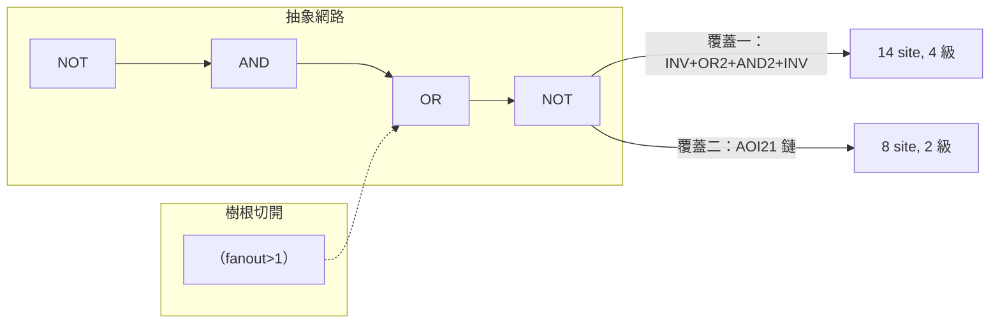
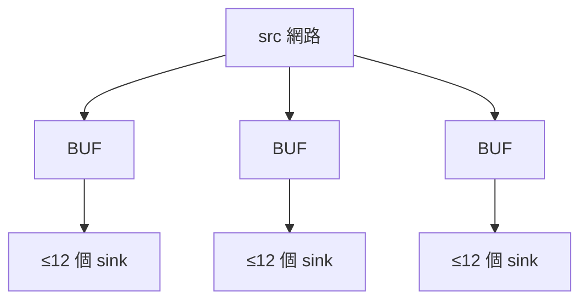

# 5.2 樹覆蓋技術映射

> 原始碼：`veryl-eda/src/asic/map.rs`（298 行）。輸入是 `netlist::optimize` 產生的
> 抽象閘網路（`$_NOT_ / $_AND_ / $_OR_ / $_XOR_ / $_MUX_` + flip-flop），輸出是
> 標準單元網路（`NAND2 / AOI21 / DFFR / BUF…`）。

## 5.2.1 問題：從布爾閘到單元庫

技術映射（technology mapping）在形式上是一個**子圖匹配 + 覆蓋**問題：
給定 DAG（邏輯網路）與單元庫（每個單元對應一個小布爾函式 pattern），
把 DAG 完全覆蓋，最佳化目標通常是總面積或關鍵路徑深度。這是 NP-hard 問題，
但有一個經典的化簡：**把 DAG 在多扇出節點處切開，變成一片 fanout-free 樹，
樹上的最佳覆蓋可以用動態規劃在多項式時間解到最佳**（FlowMap／Chatterjee-
Mishchenko 一脈的樹覆蓋理論）。代價是切點處的解不再是全域最佳——但實務上
面積損失很小，速度收益巨大。

本專案走這條路。切樹的判準在 `map.rs` 中：

```rust
// veryl-eda/src/asic/map.rs
// a gate absorbed into its single user's pattern
let internal = |x: Bit| -> Option<usize> {
    let &i = node.get(&x)?;
    (fanout.get(&x) == Some(&1) && !seq_use.contains_key(&x)).then_some(i)
};
```

一條網路若**只被一顆組合閘使用**（fanout == 1 且不是 flip-flop 的 CK/D/R、
不是輸出埠、不是 SRAM 輸入），它就是「內部節點」——可以被吸收進使用者的
pattern。反之（fanout ≥ 2 或有時序用途）就是樹根。`seq_use` 的來源：

```rust
for (_, ck, d, r, _) in &ffs {
    for x in [Some(*ck), Some(*d), *r].into_iter().flatten() {
        *fanout.entry(x).or_default() += 1; seq_use.insert(x, true);
    }
}
for p in nl.ports.iter().filter(|p| p.dir == Dir::Out) {
    for x in &p.bits { *fanout.entry(*x).or_default() += 1; seq_use.insert(*x, true); }
}
```

## 5.2.2 DP 的結構：候選 pattern + 子樹成本

每個閘節點列舉若干「以自己為根」的候選映射；每個候選的成本是

$$
\text{cost}(m) = \text{area}(\text{cell}) + \sum_{\ell \in \text{leaves}(m)} \text{cost}(\ell)
$$

其中 leaf 的成本查 memo 表——這就是 DP。程式以「根據當前閘型別產生候選」的
方式寫出，例如 `$_NOT_`（反相器）節點：

```rust
// veryl-eda/src/asic/map.rs（節錄）
"$_NOT_" => {
    let a = pin(g, "A");
    cands.push(mk("INV", vec![("A", a)], &best));                     // 只剩一顆 INV
    if let Some(x) = sub(a, "$_AND_") {
        cands.push(mk("NAND2", vec![("A", pin(x, "A")), ("B", pin(x, "B"))], &best));
        // !(p & q & c)、!((p|q) & (r|s))：NAND3 / OAI22，僅當 PDK 有
        for (o, c) in [(pin(x, "A"), pin(x, "B")), (pin(x, "B"), pin(x, "A"))] {
            if let Some(y) = sub(o, "$_AND_").filter(|_| has("NAND3")) {
                cands.push(mk("NAND3", ...));
            }
        }
        if let (Some(p), Some(q)) = (sub(pin(x, "A"), "$_OR_"), sub(pin(x, "B"), "$_OR_")) {
            if has("OAI22") { cands.push(mk("OAI22", ...)); }
        }
        // !((p|q) & c)：OAI21
        ...
    }
    if let Some(x) = sub(a, "$_OR_") { /* NOR2 / NOR3 / AOI22 / AOI21 */ }
    if let Some(x) = sub(a, "$_XOR_") { cands.push(mk("XNOR2", ...)); }
}
```

`mk`/`leaf_cost` 是 DP 的心臟：

```rust
let leaf_cost = |x: Bit, best: &HashMap<usize, Match>| -> f64 {
    internal(x).map(|j| best[&j].cost).unwrap_or(0.0)   // 輸入埠/FF/常數成本 0
};
let mk = |cell_name, leaves, best: &HashMap<usize, Match>| -> Match {
    let cost = area(cell_name) + leaves.iter().map(|(_, x)| leaf_cost(*x, best)).sum::<f64>();
    Match { cell: cell_name, leaves, cost }
};
```

遍歷順序是拓撲序（`topo()`，inputs first），所以算到節點 $`i`$ 時所有候選的
leaf 成本都已定案；最後取 `min_by(cost)`。整體複雜度
$`O(n \cdot C)`$ ， $`C`$ = 每節點候選數上限（常數）。

**為什麼反相器是 pattern 的核心？** 因為 CMOS 靜態邏輯天然是反相輸出
（NAND、NOR、AOI、OAI 都是「反相的複合閘」），而且它們**比「正閘 + INV」更小更快**。
抽象網路裡 `!(A & B)` 是兩顆閘；單元庫裡它是一顆 NAND2（面積 3 site 對
AND2 4 + INV 2 = 6）。這就是映射器最大宗的面積收益來源。

| 布爾式 | 抽象閘 | 映射結果 | 面積（site） |
|---|---|---|---|
| `~(A&B)` | `NOT(AND)` | NAND2 | 3 |
| `~((A&B)\|C)` | `NOT(OR(AND,..))` | AOI21 | 4 |
| `~((A\|B)&(C\|D))` | `NOT(AND(OR,OR))` | OAI22（有 PDK 時） | 5 |
| `A&B` | `AND` | AND2（或 NOR2 + INV） | 4 |

## 5.2.3 面積 vs 深度

`area()` 是 `width × site_w × row_h`（`lib.rs`），所以本 DP 是**面積最佳化**。
深度（delay）沒有直接進成本函式，但有兩個間接管道：

1. `EXTRA`/綁定表讓更「陡」的複合閘（AOI22、NAND3）出現，合併兩級為一級；
2. 後續 STA（5.1）的 timing-driven 佈局與 hold 修復在物理層補救關鍵路徑。

教科書會做雙目標（FlowMap 用 height-constrained labeling 同時壓深度）；
本專案選面積單目標，因為延遲要等佈局/繞線後的線長才準，映射期再聰明的
延遲模型也只是猜測。這是一個「**最佳化要放在資訊足夠的階段**」的取捨。



## 5.2.4 flip-flop 的映射：同步/非同步 reset 的翻譯

抽象層的 `$_SDFF_*`（同步 reset）與 `$_DFF_*R/S`（非同步）被翻成不同單元：

```rust
// veryl-eda/src/asic/map.rs（節錄）
if t.starts_with("$_SDFF") {
    // 同步 reset 不是 DFF 的功能 → 化為 D 前的邏輯
    let act = if active_high { r } else { b.not(r) };
    let d2 = if one { b.or(d, act) } else { let na = b.not(act); b.and(d, na) };
    ffs.push((if neg { "DFFN" } else { "DFF" }, ck, d2, None, q));
} else {
    // 非同步 → DFFR / DFFS（主動低 pin；主動高 reset 補一顆 INV）
    let rn = if active_high { b.not(r) } else { r };
    let name = match (neg, one) {
        (false, false) => "DFFR", (false, true) => "DFFS",
        (true, false) => "DFFNR", (true, true) => "DFFNS",
    };
    ffs.push((name, ck, d, Some(rn), q));
}
```

這是語義等價改寫：同步 reset $`q \leftarrow r{=}0\ ?\ 0 : d`$ 即
$`d' = d \cdot \overline{act}`$ （reset-to-0）或 $`d' = d + act`$ （reset-to-1）。
非同步 reset 若用邏輯實現會破壞「非同步」語義，所以必須用帶 `RN/SN` pin 的
單元。另外，PDK 若沒有負緣觸發器，就**在時鐘上串一顆 INV**（每個時鐘網路一顆，
memo 化避免重複）：

```rust
if tech.binding(name).is_none() && (name == "DFFN" || name == "DFFNS") {
    ck = *inv_clk.entry(ck).or_insert_with(|| { /* push INV */ });
    name = if name == "DFFN" { "DFF" } else { "DFFS" };
}
```

## 5.2.5 常數的落實：TIEH/TIEL

最佳化器常把某些輸入證明為常數（stuck-at）。真實晶片上不能「接空」，要
**物理接地/接電源**。`map.rs` 用 TIEL/TIEH 單元（每個值共用一顆）實現：

```rust
let mut tie = |v: Bit, cells: &mut Vec<Cell>, next_wire: &mut u32| -> Bit {
    *ties.entry(v).or_insert_with(|| {
        cells.push(Cell { typ: if v == Bit::C1 { "TIEH" } else { "TIEL" }.into(),
                          conns: vec![("Y", w)], params: vec![] });
        w
    })
};
```

## 5.2.6 fanout > 12：BUF 樹

映射後還有一件事：一條網路可能接 200 個 pin。物理上這會讓延遲與轉換率
（slew）失控，繞線也不好分。`buffer()` 把超過 `MAX_FANOUT` 的資料網路切成
BUF 樹：

```rust
// veryl-eda/src/asic/map.rs
pub const MAX_FANOUT: usize = 12;

fn buffer(cells: &mut Vec<Cell>, next_wire: &mut u32) {
    ...
    for b in order {
        let mut level = sinks.remove(&b).unwrap();
        while level.len() > MAX_FANOUT {
            let mut next = vec![];
            for group in level.chunks(MAX_FANOUT) {
                let w = Bit::W(*next_wire); *next_wire += 1;
                for &(i, k) in group { cells[i].conns[k].1 = w; }
                next.push((cells.len(), 0));
                cells.push(Cell { typ: "BUF".into(), conns: vec![("A", b), ("Y", w)], params: vec![] });
            }
            level = next;
        }
    }
}
```

注意三個細節：

1. **時鐘與非同步 set/reset 不在此列**（`matches!(*p, "CK" | "RN" | "SN")` 被
   跳過）——它們歸 CTS 管（5.6），因為需要**平衡**的樹，而不是分組就好的 BUF 樹。
2. 樹是**逐層**建：12 個 sink 一組接一顆 BUF，BUF 們再成為下一層的 sink。
   fanout $`F`$ 的網路需要 $`\lceil \log_{12} F \rceil`$ 層。
3. sink 依「netlist order」分組——映射後的 cells 是拓撲序，**相連的邏輯會被
   分進同一組**，之後佈局退火（5.3）的初始擺放就依這個順序蛇形鋪排，天然把
   BUF 樹的子群放近。



## 5.2.7 為什麼樹狀分解有效

把 DAG 切成樹看似保守，實則有三重理由：

- **理論**：fanout-free 樹上的 pattern 覆蓋有多項式時間最佳解；DAG 上的
  最佳覆蓋是 NP-hard。切樹是把指數問題換成線性問題的標準代價。
- **統計**：數位電路中多扇出節點稀疏（大多數閘只餵一個用戶），切點數量
  相對節點數是小常數倍，全域性損失有限。
- **工程**：切點恰是「一條線要餵多處」的位置，正是緩衝/複製（buffering/
  duplication）最該發生的地方；樹根成為後端各階段（佈局加權、繞線 Steiner、
  CTS 分組）的天然單位。

## 5.2.8 一個完整的映射走查

以四選一選擇器的前半段為例。設邏輯為 $`Y = (S' \cdot A + S \cdot B)`$ ，
抽象網路（`optimize` 之後）是：

```text
n1 = AND(A, NOT(S))     →  $_AND_(A, $_NOT_(S))
n2 = AND(B, S)
Y  = OR(n1, n2)
```

假設 `n1/n2/Y` 都單一用途（一顆 MUX2 的輸入），拓撲序 DP：

1. `$_NOT_(S)`（S 是輸入埠，fanout 2 → 它自己是樹根，先被處理）：
   候選只有 INV（面積 2）。
2. `$_AND_(A, n1')`：候選 AND2（4）；因 A 是葉，無更深 pattern。
3. `$_OR_(n1, n2)`：候選 OR2（4）；
   若 `n1` 內部且 `sub(pin(x,"A"), "$_AND_")` 成功 → AO21
   （`(A&B)|C`，5）——AO21(5) 比 OR2(4)+AND2(4)=8 省一半。
4. 整棵樹若以 `$_.MUX_` 表達則直接 MUX2（7）一顆收工。

最終 emit（`order.iter().rev()` 由樹根往回展開）只產生一顆 MUX2。
`done` 陣列防止已被父 pattern 吸收的節點重複 emit；`internal(out)` 為
`Some` 的節點（有多個用戶）則跳過——它們是被切開的樹根，已由別的樹處理。

## 5.2.9 映射與後端其他階段的互動

映射的決定會一路傳播到物理階段：

- **面積 → 利用率**：`area()` 決定 die 大小（5.3 的 `need`）。pattern
  選得差 10%，退火的搜尋空間與繞線容量需求就放大 10%。
- **節點數 → 佈局初始解**：映射後的 cells 是拓撲序（`topo` 重排，
  常數 TIE 最先、flip-flop 最後），`place()` 的初始蛇形鋪排直接吃這個
  順序——**相連邏輯天然相鄰**，退火的起點已經不差。
- **樹根 → 繞線/CTS 單位**：`buffer()` 的 BUF 樹根與時鐘 sink 清單
  （5.6 的 `special_nets`）都是映射期輸出的資料結構。
- **TIE/TIEH → PDN**：常數單元也是真實 cell，要佔 site、要接電源軌。

反向的影響也存在：`has()`（綁定表）讓映射「知道」PDK 有哪些單元，
所以換一個 PDK 會改變映射結果本身——這是 5.1.3 雙層結構的第一次分岔，
之後 DEF/GDS 的名稱翻譯只是最後一次。

## 本章重點

- 技術映射 = 切 fanout-free 樹（`internal()` 判準：fanout==1 且無時序用途）
  + 樹上 DP（`mk`/`leaf_cost`），目標函式是單元面積和。
- 面積收益主要來自把 INV 吸進 NAND/NOR/AOI/OAI/MUX pattern；三、四輸入
  pattern 由 `has()`（PDK 綁定表）決定是否候選。
- 同步 reset 化為 D 前邏輯、非同步 reset 用 DFFR/DFFS；缺負緣觸發器時
  在時鐘上補 INV。常數用 TIEH/TIEL 物理化。
- `buffer()` 把 fanout>12 的資料網路切成逐層 BUF 樹（時鐘/set-reset 除外，
  留給 CTS）；分組依 netlist 順序，讓後續佈局天然聚攏。
