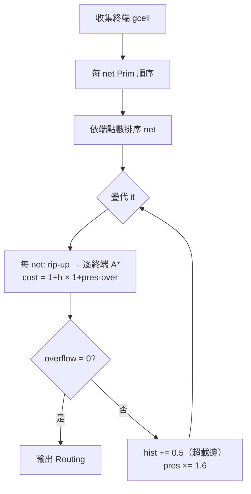

# 5.4 全域繞線

> 原始碼：`veryl-eda/src/asic/route.rs`（212 行）。輸入：網路 + 佈局；
> 輸出：`Routing`（每 net 的 gcell 段、線長、vias、overflow、demand）。

## 5.4.1 為什麼要兩段式繞線

詳細繞線（5.5）在軌道級（0.5 µm 網格、四層）工作。一顆 1000 cell 的晶片
有上萬節點 × 4 層，若每條 net 都在整個 die 上 A*，既慢又會互相拆台。
業界標準解法是**兩段式**：

1. **全域繞線（global routing）**：把 die 切成粗格（gcell），只在粗格上
   決定「每條 net 走哪些 gcell」——解析度低但全域視野完整，可以協商擁塞；
2. **詳細繞線**：在自己的走廊（其 gcell 集合）內找實際軌道。

兩段的分工：全域階段做**資源分配的仲裁**（哪裡擠、哪裡讓），詳細階段做
**幾何落實**（真實座標、via、設計規則）。

## 5.4.2 gcell 模型與容量

```rust
// veryl-eda/src/asic/route.rs
/// tracks per gcell edge and direction: two layers × 10 tracks
pub const CAP: u16 = 12;

// gcells: one row高、TRACKS 列寬
let (gw, gh) = (super::detail::TRACKS as f64 * tech.site_w, tech.row_h);
// tracks per gcell edge and direction (80 % of what the layers hold): vlib CAP;
// SKY130 horizontal met1 (6 free of 8) + met3 (4), vertical met2 (8) + met4 (4)
let (cap_h, cap_v) = if tech.is_vlib() { (CAP, CAP) } else { (6u16, 8u16) };
let gx = ((pl.w / gw).ceil() as u32).max(1);
let gy = pl.rows.max(1);
```

gcell = 高度恰一列、寬度 `TRACKS`(=8) 個 site（vlib 4 µm 見方）。每個
**gcell 邊**（相鄰兩 gcell 之間的介面）有容量：vlib 每方向 12 條
（水平邊上跑 M2/M4 水平線、垂直邊上跑 M3/M5 垂直線，見 5.4.6 的層方向性）；
SKY130 依 Liberty/LEF 的實際可用軌道定為水平 6、垂直 8。容量是**硬資源**：
`use_h[e] > cap_h[e]` 就是 overflow。

## 5.4.3 每個 net 的 Steiner 樹：Prim 順序

一條 $`k`$ 端點的 net 的最佳連接是 Steiner 最小樹（NP-hard）；工業慣例用
**MST 順序 + 逐端點併入**近似：先以 Prim 演算法在端點間建最小生成樹的
加入順序，然後依此順序把每個終端 A* 連到「目前為止的樹」。

```rust
// Prim order of each net's terminals: (terminal, its tree parent)
let md = |a: u32, b: u32| (a % gx).abs_diff(b % gx) + (a / gx).abs_diff(b / gx);
let prim: Vec<Vec<(u32, u32)>> = terms.iter().map(|(_, t, _)| {
    ...
    let mut done = vec![false; k];
    let mut best: Vec<(u32, usize)> = (0..k).map(|i| (md(t[0], t[i]), 0)).collect();
    done[0] = true;
    for _ in 1..k {
        let (j, _) = (0..k).filter(|&i| !done[i]).map(|i| (i, best[i].0)).min_by_key(|x| x.1).unwrap();
        done[j] = true;
        out.push((t[j], t[best[j].1]));
        for i in 0..k { if !done[i] { let d = md(t[j], t[i]); if d < best[i].0 { best[i] = (d, j); } } }
    }
    out
}).collect();
```

這就是教科書 Prim 的 $`O(k^2)`$ 陣列實作，距離是曼哈頓距離（gcell 網格上
等價於最短走線）。`terms` 的收集：標準 cell 端點取 cell 中心的 gcell；
巨集（多列高）取其 pin 的實際位置所在 gcell；IO pin 取其邊上 gcell。

```rust
let pts: Vec<(u32, u32)> = if dims[c].1 > 1 {
    nl.cells[c].conns.iter().enumerate().filter(|(_, x)| x.1 == p.bit).map(|(k, _)| {
        let (x, y) = super::detail::pin_point(nl, pl, c, k);
        ((x / super::detail::TRACKS).min(gx - 1), (y / super::detail::TRACKS).min(gy - 1))
    }).collect()
} else { vec![gcell_of_cell(c)] };
```

## 5.4.4 A*：把新終端接到樹上

每個（迭代, net）用 stamp（`mark`/`in_tree`）標記「已在樹中」的 gcell，
A* 的目標就是**任何一個在樹中的節點**（早停）：

```rust
while let Some(Item(_, u)) = heap.pop() {
    if in_tree[u as usize] == mark { goal = u; break; }
    ...
    for v in nb {
        let (h, e) = edge(u, v);
        let (us, hi) = if h { (use_h[e], hist_h[e]) } else { (use_v[e], hist_v[e]) };
        let over = (us + 1).saturating_sub(if h { cap_h } else { cap_v }) as f32;
        let nd = du + (1.0 + hi) * (1.0 + pres * over);
        ...
    }
}
```

成本函式是 PathFinder 的靈魂：

$$
c(e) = (1 + h(e)) \times (1 + p \cdot \text{over}(e))
$$

- $`h(e)`$ ：**history cost**，這條邊歷史上被擠爆過幾次（每輪 `hist += 0.5`），
  讓 net 學會「永久讓路」；
- $`p`$ （`pres`）：**present cost 係數**，本輪 overflow 的即時懲罰，
  每輪 `pres *= 1.6` 指數上升，逼著衝突收斂；
- $`\text{over}(e)`$ ：`use - cap` 的飽和值（`saturating_sub`）。

啟發函式 `hd` 是到**樹上父節點**的曼哈頓距離（可採納的下界），保持 A* 的
最優性同時剪枝。

## 5.4.5 PathFinder 疊代與 rip-up

PathFinder（Betz & Rose，FPGA 布線器的經典演算法）的核心：**初輪允許共擠，
之後逐輪 rip-up-and-reroute 超載 net，用 history + present cost 談判出
不衝突的分配**。本實作的疊代主迴圈：

```rust
for it in 0..max_iters {
    for &ni in &order {
        ...
        if it > 0 {
            // 只重繞目前有觸到超載邊的 net（省時）
            let over = trees[ni].iter().any(|&(a, b)| { ... use > cap ... });
            if !over { continue; }
        }
        // rip-up：先把這條 net 從所有邊的計數中拿掉
        for &(a, b) in &trees[ni] { let (h, e) = edge(a, b); if h { use_h[e] -= 1 } else { use_v[e] -= 1 } }
        trees[ni].clear();
        ... Prim 順序逐終端 A* ...
        // 重新計入
        for &(a, b) in &trees[ni] { let (h, e) = edge(a, b); if h { use_h[e] += 1 } else { use_v[e] += 1 } }
    }
    let mut over = 0u32;
    for e in 0..ne {
        if use_h[e] > cap_h { over += (use_h[e] - cap_h) as u32; hist_h[e] += 0.5; }
        if use_v[e] > cap_v { over += (use_v[e] - cap_v) as u32; hist_v[e] += 0.5; }
    }
    iters.push(over);
    if over == 0 { break; }
    pres *= 1.6;
}
```

三個工程細節值得注意：

1. **先繞小 net**：`order.sort_by_key(|i| terms[*i].1.len())`——端點少的
   net 選擇自由度小，先給它們定案；大 net 彈性大，後繞可繞開。
2. **只 rip-up 受害者**：`it > 0` 時只重繞「有段落在超載邊上」的 net，
   讓疊代後期近乎收斂時非常便宜。這也是 5.1 的 route probe
   （`route_with(..., 8)`）敢用來快速探測 die 是否夠大的原因。
3. **history 不歸零**：跨越疊代累積，是「談判記憶」。



## 5.4.6 層的方向性：水平/垂直交替

gcell 邊分兩方向，對應實體層的**優先方向**（preferred routing direction）：

- 水平線（沿列走）→ M2/M4；
- 垂直線（跨列走）→ M3/M5；
- 進出 cell pin → M1（`detail::pin_point` 的存取點，5.5 處理）。

```rust
/// horizontal wires on M2/M4, vertical wires on M3/M5
/// horizontal edge h(x,y) between (x,y)-(x+1,y); vertical v(x,y) between (x,y)-(x,y+1)
```

**為什麼要分方向？** 同層兩條平行線只需保持間距，垂直交叉則要靠不同層。
若兩條線都在 M2 又一橫一豎，交點必須打 via 換層繞，又擠又貴。製程把每層
金屬做成「梳齒」——M2 全部橫軌、M3 全部豎軌——交換方向時打一顆 via 即可，
via 數被壓到最低。`route()` 末段統計的 via 也反映這點：**只在轉彎與接 pin 處
打 via**：

```rust
let turns = dirs.values().filter(|d| d.0 && d.1).count() as u32;
let v = turns + npins;   // 轉彎 via + 每個 cell pin 一顆 M1 via
```

方向交替也是容量的來源：一條水平 gcell 邊能容納的線數 = M2 軌數 + M4 軌數，
兩層疊加，所以 vlib 給 CAP=12（兩層各 ~6，留 20% 給局部短線）。

## 5.4.7 輸出的統計量與它們的用途

```rust
pub struct Routing {
    ...
    pub iters: Vec<u32>,    // 每輪結束的總 overflow（收斂曲線）
    pub wirelength: f64,
    pub vias: u32,
    pub overflow: u32,      // 最後一輪的 overflow；0 = 成功
    pub demand: f64,        // 邊的平均使用率 / (cap_h + cap_v)
}
```

`demand` 在 `physical()` 的 probe 中當「這顆 die 繞不繞得動」的訊號
（>0.5 就放大 die 重佈局，見 5.1.2）。`overflow` 是下游詳細繞線能否收斂的
前置條件——全域階段沒清乾淨的擁塞，到了軌道級只會更糟。線長與 via 數
則直接餵給 STA 的線延遲估計（`sta::analyze` 的 wire RC）。

## 5.4.8 複雜度

每輪的成本 = Σ_net Σ_終端 一次 A*。A* 在 gcell 網格上的最壞情況是
$`O(gx \cdot gy)`$ ，但啟發函式（到目標的曼哈頓距離）把實際展開限制在
起訖點間的橢球帶。加上「只重繞受影響 net」，收斂後的疊代近乎免費。
這是「全域粗格 + 協商」相對「直接軌道級」的數量級優勢。

## 5.4.9 全域繞線的失敗模式與防護

 PathFinder 不是萬能的。兩種典型失敗與本實作的防線：

1. **容量根本不夠**（die 太小）：無論談判幾輪，總需求 > 總容量。
   防線在 `physical()` 的 probe：8 輪內 overflow 收不掉或 `demand > 0.5`
   就 `util *= 0.8` 重佈局，不讓無意義的疊代燒時間。
2. **局部死結**（兩三條 net 為同一狹窄通道互不相讓）：history 會把
   該通道的通行費抬到天價，逼某一方繞遠路；若通道真的是唯一的
   （例如兩顆 SRAM 之間），全域繞線救不了，只能靠詳細繞線的 hard
   輪或 die 重試。這是「全域階段解不了的問題，退回資源分配」的
   一致哲學。

`iters` 向量（每輪 overflow）是判斷屬於哪一種的線索：前兩三輪就
崩平不降 → 容量問題；逐步下降但收不到 0 → 局部死結。

## 5.4.10 虛擬碼

```text
global_route(nl, placement, max_iters):
    建 gcell 網格（gx × gy），每邊容量 cap_h / cap_v
    收集每 net 的終端 gcell（巨集用 pin_point、IO pin 用邊上 gcell）
    每 net 算 Prim（MST）加入順序
    net 依端點數升序排（小 net 先定案）
    for it in 0..max_iters:
        for net in 排序後的 nets:
            if it > 0 and net 沒踩到超載邊: continue     # 只重繞受害者
            rip-up：從 use_h/use_v 扣掉自己的所有邊
            in_tree ← {起點}
            for (src, parent) in prim_order:
                A*：cost(e) = (1+hist[e])·(1+pres·max(0, use−cap))
                    goal = 任何 in_tree 節點（早停）
                把路徑併入樹、計入 use
        over ← Σ 邊的 max(0, use − cap)
        iters.push(over)
        if over == 0: break
        超載邊 hist += 0.5；pres ×= 1.6
    輸出：每 net 的 gcell 段、線長、via（轉彎 + pin 數）
```

與 `route.rs` 逐行對照：`edge()` 判斷水平/垂直邊、`hd()` 是 A* 啟發、
`mark`/`in_tree` 用「每（輪, net）一個蓋章」避免每輪清空整個陣列——
這個 stamp 技巧同樣出現在 5.3 的 `stamp`/`gen` 與 5.5 的 `gen`/`seen`，
是整個 codebase 反覆使用的增量狀態管理慣用法。

## 本章重點

- 兩段式繞線：gcell 全域階段做擁塞仲裁（全域視野、低解析度），軌道級
  詳細階段做幾何落實。
- net 內連接 = Prim（MST）順序 + 每終端一次 A* 接入現有樹（`in_tree`
  stamp 早停）；這是 Steiner 樹的工業級近似。
- PathFinder 談判： $`c(e) = (1+h(e))(1+p\cdot\text{over}(e))`$ ，history 累積
  記憶、`pres ×1.6` 指數施壓；只 rip-up 觸到超載邊的 net，先繞小 net。
- 容量按層方向性分配（水平 M2/M4、垂直 M3/M5），via 只出現在轉彎與
  pin 接入處。
- `overflow`/`demand` 不只是品質指標，它們回頭驅動 5.1 的 die 重試迴圈。
