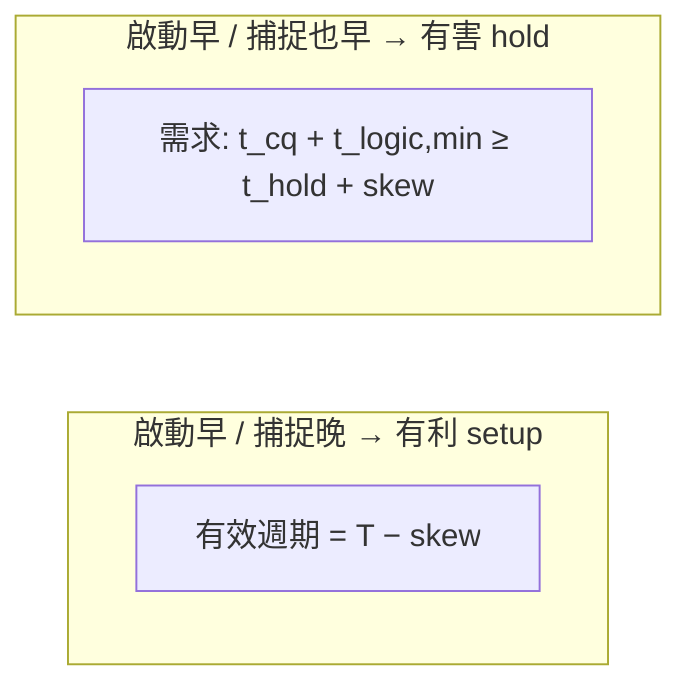
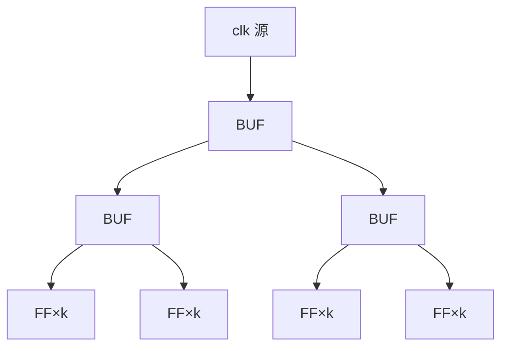

# 5.6 時鐘樹合成

> 原始碼：`veryl-eda/src/asic/cts.rs`（143 行）。輸入：定案佈局上的網路
> （原地修改插入 CLKBUF）；輸出：`Cts { trees, buffers }` 統計。

## 5.6.1 問題：時鐘偏移 skew

同步設計假設「所有 flip-flop 在同一瞬間看到時鐘邊緣」。現實中時鐘訊號
從時鐘源（PLL/pad）出發，經過長短不一的金屬線與緩衝器到達每顆 FF：

$$
t_{CK\to FF_i} = t_{\text{src}} + \sum_j (\text{buf delay}_j + \text{wire RC}_j)
$$

**時鐘偏移（clock skew）** 定義為兩顆 FF 到達時間之差：

$$
\text{skew}(i, j) = t_{CK\to FF_i} - t_{CK\to FF_j}
$$

skew 的雙面效應（設 $`T`$ 為週期， $`t_{cq}`$ 為 CK→Q， $`t_{logic}`$ 為 FF 間
組合延遲， $`t_{su}`$ 為 setup）：



- **正 skew**（資料從早的 FF 流向晚的 FF）借走時間，setup 反而鬆了；
- 但 skew 同時是 **hold 的敵人**：hold 檢查發生在同一個時鐘邊緣，
  $`t_{cq} + t_{logic,\min} \ge t_{hold} + \text{skew}`$ ——skew 大到蓋過最短
  路徑延遲就是硬體錯誤（無法靠降頻修復）。
- 更根本地，skew 讓 **STA 的時序模型失真**：若 STA 用「理想時鐘」（每顆
  FF 同時觸發），報出的 Fmax 與硬體行為脫節。

所以 CTS 的目標是：把 skew 壓到遠小於週期的程度（教學級設計目標是
「近零 skew」），讓 STA 可以用傳播時鐘精確建模。

## 5.6.2 樹狀時鐘分布：H-tree 的想法

最淺的分布是星狀（一個驅動器直接餵所有 FF），但驅動器負載無上限。
最對稱的是 **H-tree**：從中心出發，每級把區域**等分**再各放一顆緩衝器，
遞迴下去。每片葉子的緩衝級數相同、每段線長相同 → 理論 skew 為 0：



真實晶片上 FF 不均勻分布，嚴格幾何 H-tree 會浪費大量線長。工程折衷是
**「平衡分組的緩衝器樹」**：遞迴把 sink 集合對半分，直到每組 ≤ 葉容量；
每個樹節點的緩衝器放在它所驅動組的**質心**附近。級數

$$
\text{levels} = \lceil \log_2 (N_{\text{sinks}} / N_{\text{leaf}}) \rceil
$$

只要每級的兩半 sink 數相同（平衡切分），每片葉的緩衝級數就相同——
這是近零 skew 的關鍵性質，與葉子的地理距離無關。

## 5.6.3 本專案的實作

```rust
// veryl-eda/src/asic/cts.rs
pub const MAX_LEAF: usize = 16;

/// buffer trees for every clock / asynchronous set-reset net with more than MAX_LEAF sinks
pub fn build(nl: &mut Netlist, pl: &mut RowPlacement) -> Cts {
    let mut nets: Vec<Bit> = special_nets(nl).into_iter().collect();
    nets.sort();
    let mut grid = Grid::of(nl, pl);
    ...
    for net in nets {
        // sinks: (cell, connection index, position)
        let mut sinks = vec![];
        for (i, c) in nl.cells.iter().enumerate() {
            for (k, (p, b)) in c.conns.iter().enumerate() {
                if *b == net && matches!(*p, "CK" | "RN" | "SN") {
                    sinks.push((i, k, center(nl, pl, i)));
                }
            }
        }
        if sinks.len() <= MAX_LEAF { continue; }
        ...
        // (parent net, sinks, level), top-down
        let mut work = vec![(net, sinks, 1u32)];
        while let Some((parent, group, level)) = work.pop() {
            levels = levels.max(level);
            // 樹節點緩衝器：驅動這一組，放在組的質心
            let (cx, cy) = group.iter().fold((0.0, 0.0), |a, s| (a.0 + s.2 .0, a.1 + s.2 .1));
            let (cx, cy) = (cx / group.len() as f64, cy / group.len() as f64);
            let y = Bit::W(wire); wire += 1;
            nl.cells.push(Cell { typ: "CLKBUF".into(), conns: vec![("A", parent), ("Y", y)], params: vec![] });
            pl.pos.push(grid.take(cx, cy, bw));       // 合法化到最近的空 site
            if group.len() <= MAX_LEAF {
                for (i, k, _) in group { nl.cells[i].conns[k].1 = y; }   // 葉：改接緩衝器輸出
                continue;
            }
            // split at the median of the longer extent（平衡切分）
            let mut g = group;
            let (x0, x1) = ...; let (y0, y1) = ...;
            if x1 - x0 >= y1 - y0 { g.sort_by(|a, b| a.2 .0.partial_cmp(&b.2 .0).unwrap()); }
            else { g.sort_by(|a, b| a.2 .1.partial_cmp(&b.2 .1).unwrap()); }
            let right = g.split_off(g.len() / 2);     // 對半：數量相等
            work.push((y, right, level + 1));
            work.push((y, g, level + 1));
        }
    }
}
```

逐點解讀：

1. **哪些 net 需要樹**：`special_nets()`（place.rs）——驅動 `CK/RN/SN`
   pin 的網路，加上 CLKBUF 自己的輸出（含 `fix_hold` 插的 BUF 前身）。
   時鐘與**非同步 set/reset** 一起處理，因為兩者同樣不容許任意 BUF 樹
   的到達時間差（非同步 reset 若不同時到達，各 FF 的重置時刻不一致，
   會讓狀態機在重置釋放時走岔）。
2. **≤16 個 sink 不建樹**：`MAX_LEAF = 16`；小 fanout 時樹的級數收益
   抵不過額外 CLKBUF 的本徵延遲與面積。vlib 的 CLKBUF 比普通 BUF 強：
   `load: 0.004` 對 `BUF` 的 `0.007`（lib.rs），即每多一個 fanout 只加
   4 ps，是為時鐘網路的重負載設計的。
3. **平衡切分**：在 sink 較長的那個維度（extent 比較）上排序後
   `split_off(len/2)`——**按數量對半**，不是按位置對半。這保證同級的
   兩棵子樹 sink 數差 ≤1，級數差 ≤1，就是 5.6.2 說的「平衡」。
4. **緩衝器位置**：組質心，`grid.take()` 掃到最近的整段空 site（按列距
   加權的最近搜尋，`best` 提早剪枝）。**CTS 在佈局定案之後**，因為
   (a) sink 座標才有意義，(b) 緩衝器要佔真實空位並參加後續繞線。
5. **級數**：`levels` 記最深的葉，`out.trees.push((net, n_sinks, nb, levels))`
   給報告。

## 5.6.4 時鐘網路為什麼不能走一般優化

回顧整條流程，時鐘網路被**三度排除**在一般處理之外：

| 階段 | 一般 net 的待遇 | 時鐘 net 的待遇 | 為什麼 |
|---|---|---|---|
| 映射後緩衝（map.rs `buffer()`） | fanout>12 切 BUF 樹 | 跳過（`"CK" \| "RN" \| "SN"` 被排除） | 一般切法**不平衡**，skew 失控 |
| 佈局退火（place.rs） | 進 HPWL 成本 | `special_nets()` 過濾掉 | HPWL 會把所有 FF 拉成一團；且樹形未定，成本模型失真 |
| 時序驅動權重（mod.rs `timing_weights`） | 依 criticality 加權 | 不在 `net_crit` 的關心範圍 | 時鐘路徑由 CTS/STA 的時鐘傳播建模，不是資料路徑 |

一般 BUF 樹（5.2.6）按「netlist order 每 12 個一組」切，組內 sink 的
幾何分布是隨機的：有的組全在 die 左邊、有的橫跨全 die，到達時間差可以
比一個週期還大。**平衡樹用「級數相同」換「到達時間相近」**，這是 CTS
與普通 buffering 的本質差別。

## 5.6.5 CTS 前後 STA 的差別

`mod.rs::physical()` 的次序把 STA 分成三個版本：

```rust
let fmax_ideal = timing.fmax;                 // CTS 前：理想時鐘
let cts = cts::build(&mut mapped, &mut placement);
let mut routing = route::route(&mapped, &placement);   // 時鐘樹一起繞
let mut timing = sta::analyze(&mapped, &placement, &routing, extra_hold);  // 傳播時鐘
```

- **理想時鐘模型**（CTS 前）：所有 FF 的時鐘到達時間 = 0。setup 檢查
  $`\text{arrive}_{Q} + t_{logic} + t_{su} \le T`$ 。這是樂觀上界，因為真實
  skew 只會讓捕捉端更晚。
- **傳播時鐘模型**（CTS 後）：STA 對 CLKBUF 樹逐級累加延遲
  （`CLKBUF` 的 `delay + load × fanout`，加上繞線長度的 RC），每顆 FF
  得到自己的 $`t_{CK\to FF}`$ ；setup 用捕捉端到達時間、hold 用啟動與捕捉端
  的差。**skew 從此是顯式量**，`Output.fmax_ideal` 與最終 Fmax 的差距
  就是時鐘樹的代價。

hold 檢查只有在傳播時鐘下才有意義（理想時鐘 skew=0，hold 幾乎永遠過）。
CTS 之後的 STA 產生 `hold_viol` 清單，交給 `fix_hold`：

```rust
/// delay buffers in front of the flip-flop / macro inputs that violate hold:
/// (cell, pin, buffers to insert)
pub fn fix_hold(nl: &mut Netlist, pl: &mut RowPlacement, fixes: &[(usize, &'static str, usize)]) -> usize {
    ...
    for &(i, pin, count) in fixes {
        let (cx, cy) = center(nl, pl, i);          // 緊貼違規的 FF 輸入放 BUF
        let mut prev = nl.cells[i].conns[k].1;
        for _ in 0..count {
            let y = Bit::W(wire); wire += 1;
            nl.cells.push(Cell { typ: "BUF".into(), conns: vec![("A", prev), ("Y", y)], params: vec![] });
            pl.pos.push(grid.take(cx, cy, bw));
            prev = y; n += 1;
        }
        nl.cells[i].conns[k].1 = prev;
    }
}
```

緩衝數量由 `mod.rs` 依違規量估計：每顆 BUF ≈ 50 ps
（`((-s + 0.01) / 0.05).ceil()`），最多三輪收斂。**注意 CTS 之後還要再繞
一次線**（`route::route(&mapped, ...)`）——時鐘樹的 CLKBUF 是新 cell、
新網路，必須參與繞線，而且它們的線長會回饋進時鐘到達時間，這是
「傳播時鐘」四個字的實體內容。

## 5.6.6 為什麼「理想時鐘」在實體設計中站不住

可以用一個數字練習：200 個 FF 的設計、`MAX_LEAF = 16`，樹深
$`\lceil \log_2(200/16)\rceil = 4`$ 級。vlib CLKBUF 本徵延遲 55 ps，帶 2 個
fanout 加 8 ps，四級 ≈ 260 ps——這是**所有** FF 共同的到達延遲（好，
它不影響週期），但若樹不平衡、某片葉多一級，就是 55–60 ps 的 skew。
對 2 ns 週期是 3%；對 500 MHz（2 ns 之下）的設計，再不對稱一點 skew
就能吃掉整個時序裕量，而 hold 違規更是**當場算錯資料**。這就是為什麼
流程把 CTS 放在「佈局定案後、時序收斂前」——它是時序模型從理想走向
真實的分水嶺。

## 5.6.7 虛擬碼

```text
cts_build(nl, placement):
    nets ← special_nets(nl) 的 CK / RN / SN 驅動網路（排序）
    grid ← 佈局的佔用圖（每 site true/false）
    for net in nets:
        sinks ← 所有 (cell, pin index, 中心座標)
        if |sinks| ≤ 16: continue
        work ← [(net, sinks, level=1)]
        while work 非空:
            (parent, group, level) ← work.pop()
            (cx, cy) ← group 的質心
            y ← 新 wire
            插入 CLKBUF(A=parent, Y=y) 到 nl.cells
            (r, s) ← grid.take(cx, cy, width("CLKBUF"))   # 最近整段空 site
            placement.pos.push((r, s))
            if |group| ≤ 16:
                把 group 中每個 sink pin 改接 y            # 葉層
            else:
                在 group 較長的維度排序
                (left, right) ← 按數量對半 split_off(len/2)
                work.push((y, left, level+1)); work.push((y, right, level+1))
    return 統計（每 net 的 sinks / buffers / levels）
```

與原始碼的對照：質心計算在 `cts.rs:95-96`、插入 CLKBUF 與合法化在
`:99-100`、葉層改接在 `:101-103`、平衡切分在 `:105-113`。`Grid::take`
的搜尋是「先同列、再逐列外擴」的環狀掃描（`:39-52`），並用「更遠的列
不可能比當前最佳更近」提早剪枝——緩衝器數量可能上百，這個
$`O(\text{rows} \times \text{sites})`$ 的每次搜尋也要省著用。

## 5.6.8 CTS 之後的漣漪

插入 CLKBUF 不只是「多幾顆 cell」，它會沿流程向下游丟出三件事：

1. **新網路**：每個樹節點一條新 net（`Bit::W(wire)`），下一輪
   `route::route` 必須繞它們；時鐘網路的線長進入時鐘到達時間的 RC。
2. **新佈局座標**：`pl.pos.push(...)`——之後若有人再做佈局相關的
   操作（PDN 的 taps、`fix_hold` 的 `grid.take`），緩衝器佔掉的 site
   已被 `Grid::of` 重新計入，不會重疊。
3. **新的 STA 節點**：CLKBUF 是組合 cell，STA 會沿它累加延遲；
   `sta::analyze` 對時鐘網路的處理（傳播到達時間）正是 5.7 章的內容。

也解釋了為何 `fix_hold` 之後流程**再跑一次完整的 route + STA**
（`mod.rs:130-136`）：插入的延遲 BUF 同樣是新 cell、新網路、新路徑，
時序必須用最新的幾何重算。物理設計的後半段就是這樣的「小改動 →
全量重估」循環，直到違規清空。

## 本章重點

- skew 同時影響 setup（借/還時間）與 hold（$t_{cq}+t_{logic,\min} \ge
  t_{hold}+\text{skew}$，不可靠降頻修復）；CTS 的目的是把 skew 壓到
  時序模型可忽略。
- 本專案做法 = 平衡緩衝器樹：sink 按較長維度排序後**按數量對半**
  （`split_off(len/2)`），遞迴到 ≤16 個 sink；每節點一顆 CLKBUF 放在
  組質心、`grid.take` 合法化到最近空 site。
- 時鐘與非同步 set/reset 網路在映射緩衝、佈局退火、時序權重三處都被
  特殊處理——它們要的是**到達時間一致**，不是線長或 criticality。
- CTS 前 STA 用理想時鐘（樂觀），CTS 後用傳播時鐘（每 FF 的真實到達
  時間），hold 違規才第一次變得可見；`fix_hold` 在違規 FF 輸入前插入
  延遲 BUF（每顆 ≈50 ps），之後**必須重新繞線再 STA**。
- `Output` 的 `fmax_ideal` ↔ 最終 Fmax 之差，就是時鐘樹的量化代價。
