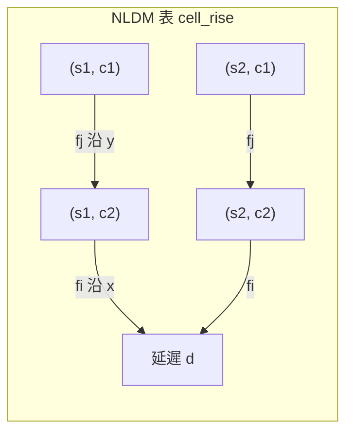
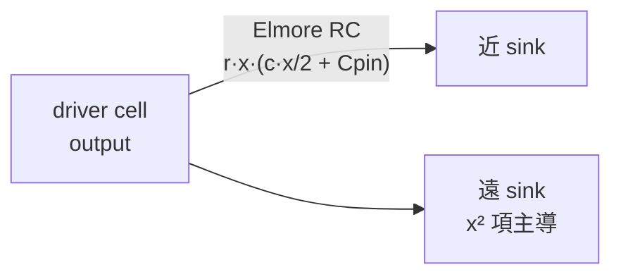
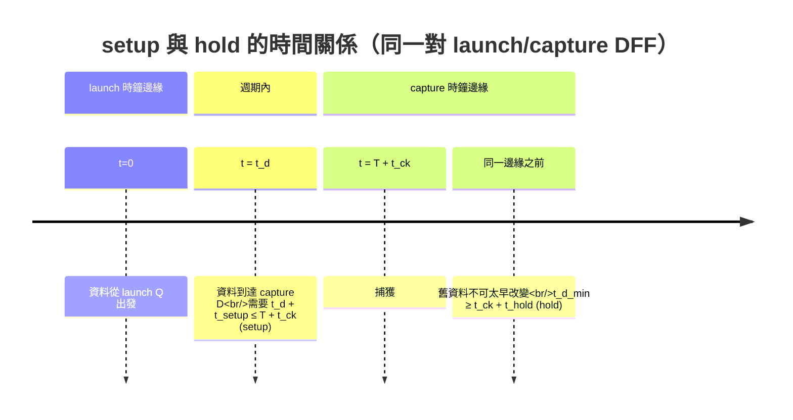
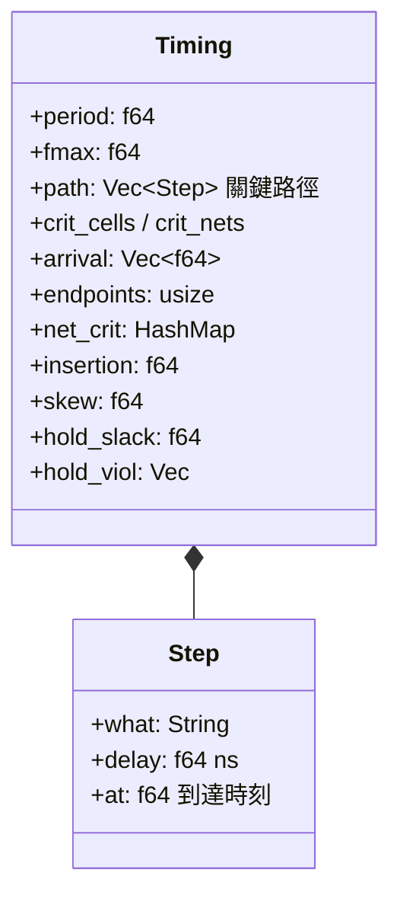

# 5.7 靜態時序分析（ASIC）

> 原始碼：`veryl-eda/src/asic/sta.rs`（約 266 行）。本節假定你已讀過 5.1–5.6：
> 我們手上有一份**映射後的標準單元網路**（`Netlist`）、一份**佈局**（`RowPlacement`，
> 每 cell 的 (row, site)）、一份**繞線**（`Routing`，每 net 的長度），以及（在 SKY130 上）
> 一份 **Liberty 庫**（NLDM 時序表，第 5.11 節）。
>
> 操作面（怎麼跑、報表怎麼看）見 `manual/09-asic.md`；這裡講原理與原始碼。

STA（Static Timing Analysis）不需要任何輸入向量：它把電路當成有向圖，
節點是 cell 的輸出 net，邊是 cell 的延遲，然後對**所有**路徑做最長路徑分析。
這正是它能取代「跑十萬個 testbench 找最壞情況」的原因——最壞情況就是最長路徑。

## 5.7.1 延遲模型：兩套並存

`sta.rs` 支援兩種延遲來源，由「有沒有 Liberty 庫」決定：

```rust
// veryl-eda/src/asic/sta.rs
let tech = crate::pdk::tech();
let nldm = tech.liberty.is_some();
let (rpu, cpu) = tech.wire_rc();
```

1. **vlib 教學庫**（無 Liberty）：延遲 = 本質延遲 + 負載係數 × 扇出：

```rust
// veryl-eda/src/asic/sta.rs
let out_delay = |i: usize| {
    let c = &nl.cells[i];
    if c.typ == "SRAM" { return super::lib::SRAM_CLK_Q; }
    let l = cell(&c.typ);
    l.delay + l.load * *fanout.get(&c.out()).unwrap_or(&0) as f64
};
```

   這是一階線性模型： $`d = d_0 + k \cdot FO`$ 。它足夠讓退火與 CTS 有方向感，
   但不能宣稱是奈秒級的精確數字。

2. **Liberty / NLDM**（SKY130）：每個 cell 的每個 timing arc 是一張
   二維表（輸入 slew × 輸出負載），查表用 `Tech::arc`（見 5.11 節）：

$$
d_{\text{cell}} = \text{NLDM}\big(t_{\text{slew,in}},\; C_{\text{load}}\big)
$$

負載 $`C_{\text{load}}`$ 由三部分組成（`sta.rs` 中 `load` 的建構）：

```rust
// veryl-eda/src/asic/sta.rs（節錄）
let mut load: HashMap<Bit, f64> = HashMap::new();
if nldm {
    for c in &nl.cells { for (p, b) in &c.conns { if !is_out(p) { *load.entry(*b).or_default() += tech.pin_cap(&c.typ, p); } } }
    for p in nl.ports.iter().filter(|p| p.dir == Dir::Out) { for b in &p.bits { *load.entry(*b).or_default() += 0.002; } }
    for (b, l) in &len { *load.entry(*b).or_default() += cpu * l; }
}
```

$$
C_{\text{load}} = \sum_{\text{sinks}} C_{\text{pin}} + C_{\text{wire}} + C_{\text{port}}
$$

其中 $`C_{\text{wire}} = c_{pu} \cdot \ell`$ 來自 LEF 的線電容（pF/µm）× 繞線長度，
   `$cpu * l` 那一行。**為什麼這樣設計**：NLDM 表的橫軸就是「負載」，
   把金屬電容併進去，等於假設分佈 RC 線可以用一個集總電容近似——
   這是 short-net 近似，在 130 nm 的晶片尺寸上是合理的；殘餘的分佈效應
   另外用 Elmore 項補（下節）。

## 5.7.2 NLDM 查表與線性內插

`Tech::arc`（`pdk/mod.rs`）對每個輸出腳的 arcs 找 `related == from` 的組合弧，
取 rise 與 fall 兩張表的**較大值**（worst case）：

```rust
// veryl-eda/src/pdk/mod.rs（節錄）
pub fn arc(&self, logical: &str, pin: &str, slew: f64, load: f64) -> Option<(f64, f64)> {
    ...
    for a in o.arcs.iter().filter(|a| a.related == from && !a.kind.starts_with("setup") ...) {
        let d = [&a.cell_rise, &a.cell_fall].iter().filter_map(|t| t.as_ref().map(|t| t.at(slew, load))).fold(0.0, f64::max);
        let s = [&a.rise_transition, &a.fall_transition]...;
        if best.map(|x| d > x.0) != Some(false) { best = Some((d, s)); }
    }
    best
}
```

內插本身在 `liberty::Table::at`（第 5.11 節有完整程式碼），是雙線性：



數學上，令查詢點落在格子 $`(i, j)`$ 內，正規化座標
$`0 \le f_i, f_j \le 1`$ ：

$$
d = (1-f_i)\big[(1-f_j)T_{i,j} + f_j T_{i,j+1}\big] + f_i\big[(1-f_j)T_{i+1,j} + f_j T_{i+1,j+1}\big]
$$

**為什麼線性而不是樣條**：查表發生在 STA 的內層迴圈（每 cell 每弧一次），
且 Liberty 表本身是由 HSPICE 掃出來的離散點；線性內插在相鄰點之間的誤差
小於製程漂移本身的誤差，樣條只會增加不確定的「平滑假象」。
表尾用線性外插（`seg` 函式的 clamp 行為），避免 slew 超出表範圍時直接報錯。

## 5.7.3 線延遲：Elmore RC

`sta.rs` 的 `wire` 閉包計算「driver 到某 sink」的線延遲。NLDM 模式下：

```rust
// veryl-eda/src/asic/sta.rs
let wire = |b: Bit, to: (f64, f64)| {
    let s = src(b);
    let dist = (s.0 - to.0).abs() + (s.1 - to.1).abs();
    // Elmore: the driver-to-sink resistance charging half its own wire and a typical pin (Ω·pF = ps)
    if nldm { rpu * dist * (cpu * dist / 2.0 + 0.002) * 1e-3 } else { wire_delay(*len.get(&b).unwrap_or(&0.0), dist) }
};
```

對應的公式（Manhattan 距離 $`x`$ ）：

$$
t_{\text{wire}} = r_{pu}\, x \left( \tfrac{1}{2} c_{pu}\, x + C_{\text{pin,typ}} \right)
$$

這正是**單端 Elmore 延遲**：一段長 $`x`$ 的線，其自身電阻
$`r_{pu} x`$ 對「半段線的電容 + 一顆典型 pin 電容」充電的時間常數。
距離越遠，二次項 $`\propto x^2`$ 越主導——這解釋了為什麼 STA 的 critical path
報告裡，同一條長 net 到不同 sink 的 wire delay 不同（far sink 更差）。

vlib 模式用經驗式 `wire_delay`（`0.00015*len + 0.0004*dist + 1e-6*dist²`），
形式相同、係數手調，只是為了讓教學流程的 Fmax 有合理量級。



## 5.7.4 slew 的傳播

NLDM 模式下 slew（輸出轉換時間）跟延遲一樣是「會傳染」的：
一級的輸出 slew 是下一級查表的橫軸。`sta.rs` 維護 `slew: HashMap<Bit, f64>`，
每級輸出取該 cell 所有輸入弧輸出 slew 的最大值：

```rust
// veryl-eda/src/asic/sta.rs（節錄，組合 cell 的推進迴圈）
let mut so_max = 0.0f64;
for (p, b) in &c.conns {
    if is_out(p) || b.is_const() { continue; }
    let (d, so) = gate(i, p, slew_of(b, &slew));
    so_max = so_max.max(so);
    ...
}
net_at.insert(c.out(), arrival[i]);
slew.insert(c.out(), so_max);
```

輸入腳與常數 net 的 slew 定為 50 ps（`slew_of` 的 fallback）。
**為什麼要帶 slew**：NLDM 的遞迴性質——slew 劣化 → 下一級更慢 → slew 更劣化。
若固定 slew 只查一次表，長鏈會系統性樂觀。代價是 STA 必須照拓撲序推進
（`netlist` 的 cells 恰好已按拓撲排序、flip-flop 在最後，見 5.2 節的映射輸出），
不能反覆迭代到收斂——這裡接受單遍近似。

## 5.7.5 時鐘傳播：insertion delay 與 skew

CTS（5.6 節）插入 CLKBUF 之後，時鐘不再是「瞬時到達每個 DFF」。
`sta.rs` 先把 CLKBUF 依樹序推進（它們在建入時保證父先於子）：

```rust
// veryl-eda/src/asic/sta.rs（節錄）
let propagated = nl.cells.iter().any(|c| c.typ == "CLKBUF");
for (i, c) in nl.cells.iter().enumerate().filter(|(_, c)| c.typ == "CLKBUF") {
    let a = c.port("A").unwrap();
    let (d, so) = gate(i, "A", slew_of(&a, &slew));
    let t = clk_at.get(&a).copied().unwrap_or(0.0) + wire(a, at(i)) + d;
    clk_at.insert(c.out(), t);
}
let ck_arr = |i: usize| -> f64 {
    if !propagated { return 0.0; }
    let Some(ck) = nl.cells[i].port("CK") else { return 0.0 };
    clk_at.get(&ck).copied().unwrap_or(0.0) + wire(ck, at(i))
};
```

每個 DFF 的時鐘到達時間 $`\text{clk}_i`$ = buffer 鏈延遲 + 線延遲。由此定義：

$$
t_{\text{insertion}} = \max_i \text{clk}_i, \qquad
t_{\text{skew}} = \max_i \text{clk}_i - \min_i \text{clk}_i
$$

**虛擬時鐘處理 IO**：外部世界不知道你晶片裡的時鐘樹。`sta.rs` 用
「樹的平均延遲」當 IO 的參考時鐘（`io_clk`）：輸入埠假設在 `io_clk` 時刻
被外部時鐘發射、輸出埠假設在 `io_clk` 被捕獲。這樣 IO 路徑與內部路徑
用同一把尺量，不會因為樹的深度而系統性偏樂觀或偏悲觀。

## 5.7.6 setup 與 hold：constraint 表與 slack

setup/hold 需求來自 Liberty 的 `setup_rising` / `hold_rising` constraint 表
（雙橫軸：clock slew × data slew），由 `Tech::constraint` 查出：

```rust
// veryl-eda/src/pdk/mod.rs（節錄）
pub fn constraint(&self, logical: &str, pin: &str, setup: bool, clk_slew: f64, d_slew: f64) -> Option<f64> {
    ...
    p.arcs.iter().filter(|a| a.kind.starts_with(want))
     .flat_map(|a| [&a.rise_constraint, &a.fall_constraint])
     .filter_map(|t| t.as_ref().map(|t| t.at(clk_slew, d_slew))).reduce(f64::max)
}
```

`sta.rs` 在每個 endpoint（DFF 的資料腳、輸出埠）上檢查：

```rust
// veryl-eda/src/asic/sta.rs（節錄）
let w = wire(*d, at(i));
let t = net_at.get(d).unwrap_or(&0.0) + w + su - ck;      // setup
if t > worst.0 { worst = (t, Some(*d), ...); }
let slack = min_at.get(d).copied().unwrap_or(0.0) + w - (ck + ho + extra_hold);  // hold
hold_slack = hold_slack.min(slack);
```

兩條公式。令資料到達時間為 $`t_d`$ （沿**最長**路徑）、最早資料到達為
$`t_d^{\min}`$ （沿**最短**路徑）、捕獲時鐘到達為 $`t_{ck}`$ 、週期 $`T`$ ：

$$
\text{setup slack} = T + t_{ck} - (t_d + t_{\text{setup}})
$$

$$
\text{hold slack} = t_d^{\min} - (t_{ck} + t_{\text{hold}})
$$

`sta.rs` 的 `t` 實際上累積的是 `T + slack`（period = worst.0），同一件事的
另一種寫法。注意 setup 用 `net_at`（最長），hold 用 `min_at`（最短）——
`min_at` 在推進迴圈裡同步維護：常數（tie cell）永不切換，所以它的
最早到達是 $`+\infty`$ （永不違反 hold）：

```rust
// veryl-eda/src/asic/sta.rs
min_at.insert(c.out(), if early == f64::MAX { f64::INFINITY } else { early });
```

`extra_hold` 參數是測試鉤子：給每個 hold 需求加一個人工數值，
用來「製造」hold 違規，以測試 `cts::fix_hold`（5.6 節）的修復迴路。



## 5.7.7 late / early 雙軌分析

推進迴圈同時維護兩個陣列，這是整個檔案的核心結構：

| 陣列 | 語意 | 用途 |
|---|---|---|
| `arrival` / `net_at` | 最晚到達（late，max 遞迴） | setup、Fmax、critical path |
| `min_at` | 最早到達（early，min 遞迴） | hold |

虛擬碼：

```text
net_at[b] = 0        對所有輸入埠（以 io_clk 發射）
min_at[b] = io_clk
for cell in cells（拓撲序，flip-flop 在最後）:
    for (pin, b) in cell 輸入:
        t_late  = net_at[b] + wire(b, cell) + d(cell, pin, slew[b])
        t_early = min_at[b] + wire(b, cell) + d(cell, pin, slew[b])
    arrival[cell] = max(t_late)
    min_at[cell.out] = min(t_early)
endpoints（DFF 資料腳、輸出埠）:
    setup: arrival + wire + setup_req − ck_arr
    hold:  min_at + wire − (ck_arr + hold_req + extra_hold)
```

## 5.7.8 關鍵路徑回溯與 criticality

找出 worst endpoint 後，用 `pred[]`（每 cell 記住「是哪個輸入腳最晚」）
往回走，把路徑逐段寫成 `Step`（wire 段、cell 段、launch/capture clock）：

```rust
// veryl-eda/src/asic/sta.rs（節錄）
match driver.get(&b) {
    Some(&i) => {
        steps.push(Step { what: label, delay: w, at: arrival[i] + w });
        let name = if nldm { tech.cell_name(&c.typ)... } else { c.typ.clone() };
        steps.push(Step { what: format!("{}{}", name, ...), delay: cell_d[i], at: arrival[i] });
        crit_cells.push(i);
        ...
    }
    None => { /* 走到輸入埠：IO 路徑起點 */ }
}
```

除了單一 critical path，最佳化迴路（5.3 節的 timing-driven placement）
需要的是**每一條 net 的 criticality**——不是「最糟的一條路」，而是
「每條 net 有多接近成為最糟」。`sta.rs` 用一次反向掃描算
`tail[b]` = 從 net b 的輸出端出發、到達任何 endpoint 的最長剩餘延遲：

```rust
// veryl-eda/src/asic/sta.rs（節錄）
let tail_of = |b: Bit, ...| -> f64 {
    for &j in users.get(&b)... {
        let after = if c.is_ff() { cell(&c.typ).setup } else if is_macro(j) { ... } else { cell_d[j] + tail[c.out()] };
        t = t.max(wire(b, at(j)) + after);
    }
    if let Some(pa) = out_pins.get(&b) { t = t.max(wire(b, *pa)); }
    t
};
```

然後

$$
\text{crit}(b) = \min\left(1,\; \frac{t_{\text{arrival}}(b) + \text{tail}(b)}{T_{\text{period}}}\right)
$$

這個比值存在 `Timing::net_crit`，`place::place` 拿去當退火的移動權重
（把 critical net 的 cell 拉近，縮短它的 wire 延遲）。
**為什麼不對每條路徑都回溯**：回溯是 $`O(\text{path})`$ ，全路徑回溯是指數的；
`tail` 陣列一次反向 DP 就把所有 net 的「後果」算完， $`O(N)`$ 換全域視野。

## 5.7.9 Timing 結構總覽



## 5.7.10 本章重點

- STA = 最長路徑分析，不需向量；`sta::analyze(nl, pl, rt, extra_hold)` 一次
  算出 setup（late）與 hold（early）兩軌。
- 延遲模型雙軌：vlib 用 $`d_0 + k\cdot FO`$ 線性式；Liberty 用 NLDM 查表
  （`Tech::arc`，雙線性內插，rise/fall 取 max），負載 = pin 電容 + 線電容。
- slew 隨路徑傳播（遞迴 NLDM），單遍拓撲推進，接受近似換速度。
- 線延遲用單端 Elmore： $`r x (cx/2 + C_{pin})`$ ，遠 sink 的 $`x^2`$ 項主導。
- 時鐘傳播給出 insertion delay 與 skew；IO 用樹平均延遲的虛擬時鐘。
- setup slack $`= T + t_{ck} - (t_d + t_{su})`$ ，hold slack $`= t_d^{min} - (t_{ck} + t_{ho})`$ ；
  hold 檢查的是**最短**路徑，所以兩軌必須並行維護。
- criticality 用一次反向 DP（`tail`）覆蓋所有 net，餵給 timing-driven
  placement；單一 critical path 只留給報告。
