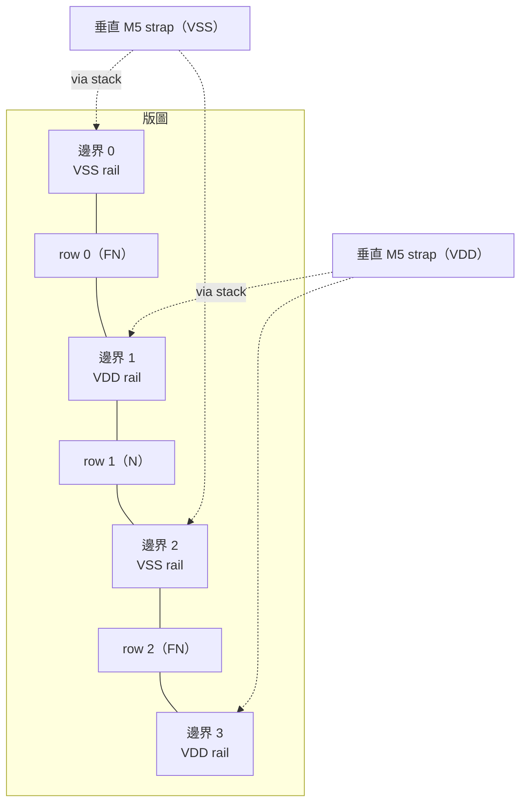
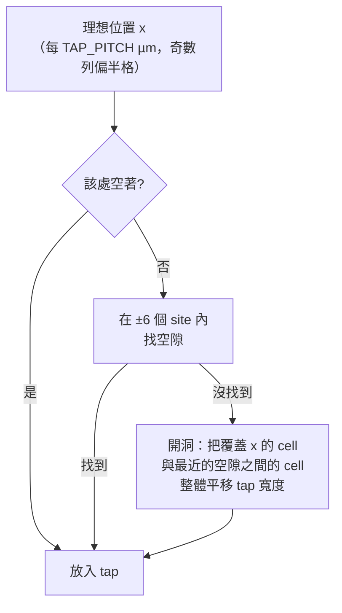
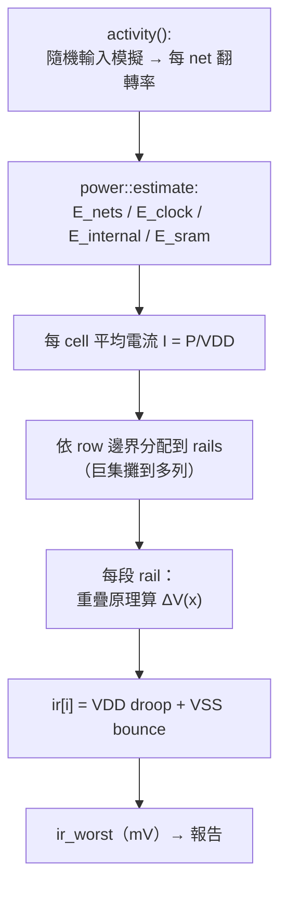

# 5.8 電源網路（PDN）

> 原始碼：`veryl-eda/src/asic/pdn.rs`（191 行）、`veryl-eda/src/asic/power.rs`
> （157 行，功耗與 IR drop 估算）。
>
> 訊號把「0 或 1」送到對的地方；電源網路把「恆定的 1.2 V」送到**每一個** cell。
> 它沒有邏輯功能，但它是版圖上最大的金屬結構，也是詳細繞線必須繞開的障礙物。

## 5.8.1 為什麼電源是個問題：IR drop

理想上每個 cell 的 VDD 都是 1.2 V。實際上電流要流過有電阻的金屬：

$$
V_{\text{drop}} = I \cdot R
$$

一段電阻 $`R`$ 的金屬載送電流 $`I`$ ，兩端電壓差 $`IR`$ 。對 cell 來說，這意味著：

$$
V_{\text{cell}} = V_{\text{DD}} - I\cdot R_{\text{VDD 路徑}} + I \cdot R_{\text{VSS 路徑（VSS 反彈）}}
$$

VDD 從電源流向 cell 會**掉壓**（droop），VSS 從 cell 流回電源會**反彈**
（bounce）。兩者疊加，cell 看到的實際供電擺幅變小，驅動力下降、延遲變長、
雜訊餘量縮小。`power.rs` 開頭的註解就寫明了這個模型：

```rust
// veryl-eda/src/asic/power.rs（模組註解節錄）
//! IR drop: each cell draws its average current from the VDD rail of its
//! row (and returns it on the VSS rail); a rail segment between two straps
//! is a resistive line fed at both ends (only one end before the first /
//! after the last strap), so a load I at distance x0 from one end of a
//! segment of length L drops the voltage at x by r·I·min(x,x0)·(L−max(x,x0))/L.
```

## 5.8.2 結構：row 邊界上的 power rail

標準單元放在 row 裡，row 交替翻轉（N / FN 方向，5.3 節），所以每條 row
邊界恰好是「一排 cell 的 VDD 腳貼著另一排的 VSS 腳」。這給了最自然的
電源結構——**沿邊界的水平 rail**：



`pdn.rs` 的實作就是一個交錯表：

```rust
// veryl-eda/src/asic/pdn.rs
pub struct Pdn {
    /// row boundaries 0..=rows: VDD on odd ones, VSS on even ones
    pub rails: u32,
    /// straps: (first track x, VDD?)
    pub straps: Vec<(u32, bool)>,
    /// via stacks: (track x, track y, VDD?)
    pub vias: Vec<(u32, u32, bool)>,
    /// filler cells: (row, site, width in sites)
    pub fillers: Vec<(u32, u32, u32)>,
    /// well taps: (row, site)
    pub taps: Vec<(u32, u32)>,
    pub tap_viol: usize,
}
```

`build()` 中 rail 的極性：

```rust
// veryl-eda/src/asic/pdn.rs（節錄，build）
for r in 0..=pl.rows {
    let vdd = r % 2 == 1;
    for &(x, sv) in &straps {
        if sv == vdd { ... vias.push((x + dx, r * TRACKS, vdd)); }
    }
}
```

## 5.8.3 垂直 strap 與 via stack

水平 rail 只有一層金屬（M1/met1），電阻不低；且每個 rail 只餵自己那一列
cell。要從 die 邊緣把電流搬進來，需要**垂直 strap**：

```rust
// veryl-eda/src/asic/pdn.rs
/// strap pair pitch in tracks (40 µm)
pub const STRAP_PITCH: u32 = 80;
pub const STRAP_W: u32 = 2;
```

規則（`build()`）：

1. 每 `STRAP_PITCH` 條軌道放一**對** strap：VDD 一條、VSS 一條，中間隔 2 軌；
2. strap 的 x 座標避開 IO pin 所在的欄位（IO pins 在頂層 metal 的 die 邊緣）：

```rust
// veryl-eda/src/asic/pdn.rs（節錄）
let io_cols: Vec<u32> = pl.pins.iter().map(|p| (p.x / site_w()).round() as u32).collect();
let side = if crate::pdk::tech().is_vlib() { 0 } else { 3 };
let clear = |x: u32| (0..STRAP_W * 2 + 2 + 2 * side).all(|d| !io_cols.contains(&(x + d).wrapping_sub(side)));
```

3. strap 落在自己的每一條 rail 上時，打一疊 via（M1-M2-M3-M4-M5）：

```rust
// veryl-eda/src/asic/pdn.rs（節錄）
let mut vias = vec![];
for r in 0..=pl.rows {
    let vdd = r % 2 == 1;
    for &(x, sv) in &straps {
        if sv == vdd { for dx in 0..STRAP_W { if lib && (x + dx) % 2 == 1 { continue; } vias.push((x + dx, r * TRACKS, vdd)); } }
    }
}
```


**為什麼 via stack 要疊這麼多層**：一顆 via 的電阻在先進製程可達數歐姆，
電流若只靠一顆 via 垂直下鑽，那一點就是局部的 $`IR`$ 熱點。疊兩條軌寬的
strap 加多顆 via，等於把「垂直電源的等效電阻」攤平。

## 5.8.4 strap 是障礙物：blocked()

詳細繞線（5.5 節）在訊號網格上跑 A*，所以 PDN 必須告訴它哪些格點不能用：

```rust
// veryl-eda/src/asic/pdn.rs
pub fn blocked(&self, ny: u32) -> Vec<(usize, u32, u32)> {
    let lib = !crate::pdk::tech().is_vlib();
    let mut v = vec![];
    for &(x, _) in &self.straps {
        // a library's wide straps keep the neighbouring met4 tracks clear too
        let (a, b) = if lib { (x.saturating_sub(2), x + STRAP_W + 2) } else { (x, x + STRAP_W) };
        for xx in a..b { for y in 0..ny { v.push((LAYERS - 1, xx, y)); } }
    }
    for &(x, y, _) in &self.vias {
        for l in 0..LAYERS - 1 { v.push((l, x, y)); }
        if lib { /* via stack 的 met2/met3 pad 佔掉鄰近節點 */ ... }
    }
    v
}
```

注意兩件事：

- **頂層全部封鎖**：strap 在最上層（`LAYERS - 1`）是連續的金屬片，訊號
  不得穿越；下層只封 via stack 所在的節點。
- **vlib 與 PDK 的差異**：SKY130 的 strap 較寬、via stack 的 pad 較大，
  所以還要封鎖鄰近節點（`lib` 分支）。這就是「`tech.is_vlib()` 守門」原則
  （第 5.11 節）的一個例子——教學庫的簡化規則不能污染真實製程的行為。

## 5.8.5 Filler cells：把軌道焊起來

電源 rail 是**cell 自己**畫的（Liberty/LEF 的 POWER/GROUND pin）。
兩顆 cell 之間的空隙會把 rail 切斷，所以每段空隙必須用 filler cell 補滿：

```rust
// veryl-eda/src/asic/pdn.rs
pub const FILLERS: [u32; 4] = [8, 4, 2, 1];
...
let mut left = run;
let mut x = s;
while left > 0 {
    let w = *FILLERS.iter().find(|&&f| f <= left).unwrap();
    fillers.push((r, x, w));
    x += w;
    left -= w;
}
```

虛擬碼：對每段長 `run` 的空隙，用貪婪的 8/4/2/1 分解塞滿
（如同二進位表示法，任何長度都能湊出）。

**為什麼這樣設計**：filler 有第四個功能——**阱的連續性**。CMOS 的
n-well / p-well 必須連續且有正確偏壓；filler 內部畫著阱與襯底接觸，
讓所有 cell 的阱連成一片。

## 5.8.6 Well tap：SKY130 才有的煩惱

vlib 是教學庫，假設阱永遠沒問題。真實製程要求**每格一段距離**必須有
tap cell（把阱接到電源軌），否則閂鎖效應（latch-up）風險：

```rust
// veryl-eda/src/asic/pdn.rs
/// tap spacing (µm) and the largest allowed distance to one
pub const TAP_PITCH: f64 = 20.0;
pub const TAP_MAX: f64 = 14.0;
```

`insert_taps()` 是整個檔案最複雜的函式：它要在**已排好的 row 裡**騰出
tap 的位置。策略（三級遞進）：



```rust
// veryl-eda/src/asic/pdn.rs（節錄）
if let Some(s) = (0..6).flat_map(|d| [x - d, x + d]).find(|&s| fits(s, &row, &tap_x)) { tap_x.push(s); continue; }
// open a gap: the cell edge nearest x, the nearest free run of tw sites to its right (or left), shift between
let free_right = (x..n - tw + 1).find(|&s| fits(s, &row, &tap_x));
```

插入 tap 之後，`tap_violations()` 驗證「沒有任何 cell 的任何 site 距離
同列的 tap 超過 `TAP_MAX`」，違規數存進 `Pdn::tap_viol`，寫進流程報告。
注意它只檢查**同列**的 tap——tap 是 per-row 的資源，跨列不算數。

## 5.8.7 power.rs：功耗估算的三個成分

PDN 的大小取決於電流，所以 `power.rs` 先估功耗。三個成分：

1. **開關功耗**（dynamic switching）：net 以活動率 $`a`$ 切換，每次切換
   對負載電容充放電：

$$
E_{\text{net}} = \tfrac{1}{2}\, C\, V_{\text{DD}}^2 \quad\text{每次切換}, \qquad
P = \tfrac{1}{2} C V^2 f \cdot a
$$

活動率 $`a`$ 來自 `crate::power::activity()`——對最終網路跑一段
   隨機輸入模擬，記下每個 net 的翻轉率。時鐘樹固定 $`a=2`$ （每週期兩次切換）：

```rust
// veryl-eda/src/asic/power.rs（節錄）
let rate = if clock.contains(b) { 2.0 } else { act.rate.get(b).copied().unwrap_or(0.0) };
let e = 0.5 * c * v2 * rate;
if clock.contains(b) { e_clock += e } else { e_nets += e }
```

2. **內部功耗**：cell 輸出翻轉一次在 cell 內部（短路電流 + 內部節點）耗的
   能量，與 cell 寬度成正比；每顆 DFF 每週期固定 3 fJ 時鐘能量：

```rust
if c.is_ff() { e += 3.0; } // clocking every cycle
if c.typ == "CLKBUF" { e += 0.4 * w * 2.0; } else {
    let rate = act.rate.get(&c.out()).copied().unwrap_or(0.0);
    e += 0.4 * w * rate;
}
```

   SRAM 例外：一次存取驅動字線、位線、感測放大器，能量
   $`\propto \text{width} \times \sqrt{\text{depth}}`$ ：

```rust
let ea = 0.08 * width * depth.sqrt();
let es = (r + wr) * ea;
```

3. **漏電功耗**（leakage）：與 cell 面積成正比，SRAM 每位元 0.02 nW：

```rust
let leak_nw: Vec<f64> = nl.cells.iter().map(|c| if c.typ == "SRAM" {
    0.02 * (param(c, "DEPTH") * param(c, "WIDTH")) as f64
} else { 0.25 * dims(c).0 as f64 }).collect();
```

**為什麼是常數係數而不是查表**：這是一階估算（power intent/計畫階段的
精度），其用途是 (a) 給 IR drop 提供電流分佈、(b) 給報告一個量級正確的
mW 數字。真實的功耗簽核要 Liberty 的 `internal_power` 表——注意
`tools/sky130_subset.py` 恰好把這些表**裁掉**了（第 5.12 節），因為
內建子集要壓體積。

## 5.8.8 IR drop 的數值解：分段的電阻線

`power.rs` 把每條 rail 分成 strap 之間的段。每段是「兩端（或一端）饋電、
沿線掛多個電流負載」的電阻線。重疊原理下的壓降：負載 $`I_j`$ 在位置 $`x_0`$ ，
對位置 $`x`$ 貢獻

$$
\Delta V_j(x) = r \cdot I_j \cdot
\frac{\min(x, x_0)\,\big(L - \max(x, x_0)\big)}{L}
\qquad\text{（兩端饋電段，長 } L\text{）}
$$

（單端饋電段取對應的半式。）每個 cell 的總壓降 = 它 VDD rail 的 droop
+ 它 VSS rail 的 bounce：

```rust
// veryl-eda/src/asic/power.rs（節錄）
drop += if a.is_infinite() { amp * RAIL_R * (b - x.max(x0)) }       // fed at b only
    else if b.is_infinite() { amp * RAIL_R * (x.min(x0) - a) }      // fed at a only
    else { let l = b - a; amp * RAIL_R * (x.min(x0) - a) * (b - x.max(x0)) / l };
...
ir[i] += drop * 1e3;   // mV
```

巨集（多列 SRAM）把電流攤到它跨的所有 rails：

```rust
let rails: Vec<u32> = (r..=r + h).collect();
for k in &rails { rail_loads.entry(*k).or_default().push((i, amps / rails.len() as f64 * 2.0)); }
```

每個 cell 的平均電流由它的功耗算出： $`I = P / V_{\text{DD}}`$ （`amps =
cell[i] * 1e-6 / VDD`）。rail 電阻常數 `RAIL_R = 0.2 Ω/µm`（0.08 Ω/□ 的
M1、0.4 µm 寬）。



## 5.8.9 為什麼這樣設計

- **rail 在 row 邊界而不是 cell 裡再畫一條**：這利用了 cell 翻轉擺放的
  現成結構，一行程式碼（`r % 2`）就得到正確的極性，且 cell 的電源腳
  「貼牆」即可，不需要在每個 cell 內部做垂直金屬。
- **strap 用最上層**：頂層金屬最厚、電阻最低，且與訊號繞線的下四層
  不衝突（只封鎖自己的欄位）。
- **IR drop 用解析式而不是解線性系統**：全晶片的電源網路電阻矩陣是
  $`O(N^2)`$ 的稀疏系統，商用工具用 multigrid 解它。這裡 rail 是一維結構
  （strap 等電位），解析解只要 $`O(\text{loads}^2)`$ per segment，夠準也夠快。
- **tap 插入會搬動 cell**：這是 PDN 模組裡唯一會「改變佈局」的操作。
  它必須在詳細繞線**之前**做（搬動會 invalidate 繞線），在 fillers
  **之前**做（tap 佔位也是佔位）。

## 5.8.10 本章重點

- $`V_{drop} = IR`$ ：VDD droop + VSS bounce 疊加，直接吃掉雜訊餘量。
- 結構 = row 邊界的水平 M1 rail（奇偶交錯 VDD/VSS）+ 每 `STRAP_PITCH`
  一對垂直頂層 strap + 每條 rail 上的 via stack。
- `Pdn::blocked()` 把 strap / via stack 變成詳細繞線的封鎖節點；
  PDK 下要連鄰近節點一起封（pad 更大）。
- Filler cells（8/4/2/1 貪婪分解）補滿空隙，接通 rail 與阱。
- SKY130 需要 well tap（`TAP_PITCH = 20 µm`、`TAP_MAX = 14 µm`）：
  `insert_taps` 用「找空隙 → 開洞平移」三級策略，`tap_violations` 驗收。
- `power.rs`： $`P = \tfrac12 CV^2 f a`$ （活動率來自模擬）+ cell 內部 + 漏電；
  IR drop 用「分段饋電電阻線」的解析解，不用解矩陣。
