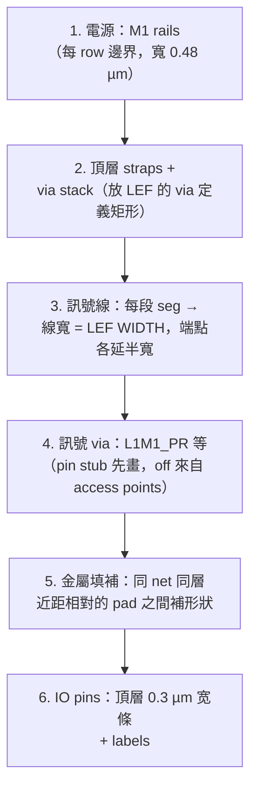
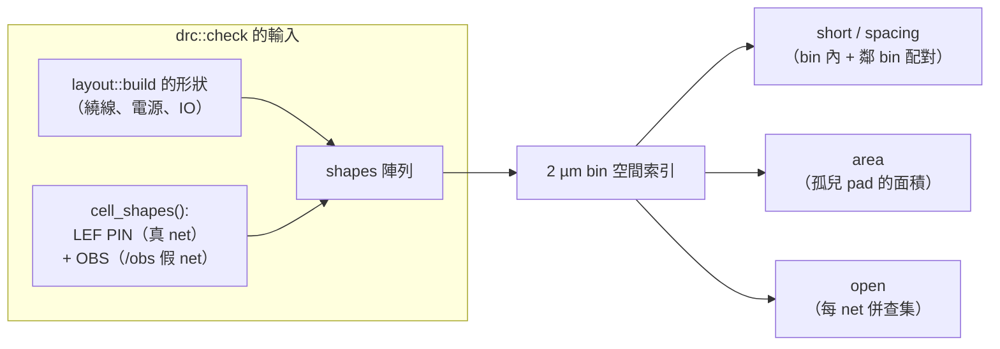
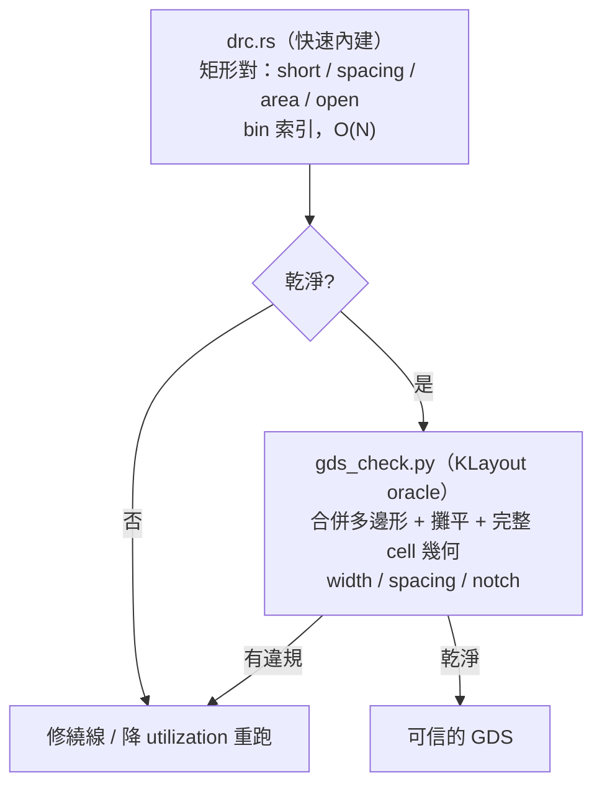

# 5.9 版圖建構與 DRC

> 原始碼：`veryl-eda/src/asic/layout.rs`（188 行）與 `veryl-eda/src/asic/drc.rs`
> （185 行）。詳細繞線（5.5 節）結束時，我們只有「軌道座標上的線段與 via
> 名稱」；`layout::build` 把它們變成**奈米座標的矩形**（形狀 + net），
> `drc::check` 再檢查這些矩形是否違反製程規則。
>
> 本節也解釋一個微妙的問題：為什麼 `drc::check` 乾淨的版圖，
> `tools/gds_check.py`（KLayout）仍可能抓到內部 notch。

## 5.9.1 Layout 資料結構：矩形 + net

```rust
// veryl-eda/src/asic/layout.rs
/// a rectangle (nm) on a layer; net: index into `Layout::nets` (usize::MAX = none)
pub struct Shape { pub layer: u8, pub x0: i64, pub y0: i64, pub x1: i64, pub y1: i64, pub net: usize }

pub struct Layout {
    pub layers: Vec<String>,          // ["li1", "mcon", "met1", "via", "met2", ..., "met5"]
    pub shapes: Vec<Shape>,
    pub insts: Vec<Inst>,             // cell instances（DEF 的 components）
    pub nets: Vec<String>,            // 0 = VDD, 1 = VSS
    pub net_of: HashMap<Bit, usize>,
    pub labels: Vec<(u8, i64, i64, String)>,   // IO pin 標籤
    pub die: (i64, i64),
}

pub const LAYERS: [&str; 11] = ["li1", "mcon", "met1", "via", "met2", "via2", "met3", "via3", "met4", "via4", "met5"];
```

座標全部是**奈米整數**（`fn nm(x: f64) -> i64 { (x * 1000.0).round() }`）。
**為什麼整數**：DRC 要比較「間距是否 ≥ 0.14 µm」這種臨界值；浮點的
`0.1399999` vs `0.14` 會產生抖動的判決。整數奈米讓所有比較是確定的，
也讓 GDS 輸出（5.10 節）零轉換成本（GDS 資料庫單位恰好 1 nm）。

## 5.9.2 build()：從軌道到形狀的六個步驟



### 1–2. 電源形狀

```rust
// veryl-eda/src/asic/layout.rs（節錄）
let rail_w = 480;                                  // nm，0.48 µm 寬的 M1 rail
let (rail, top) = (li(&tech.layers[0])?, li(&tech.layers[3])?);
for r in 0..o.pdn.rails {
    let net = if r % 2 == 1 { 0 } else { 1 };
    let y = nm(r as f64 * rh);
    shapes.push(Shape { layer: rail, x0: 0, y0: y - rail_w / 2, x1: nm(pl.w), y1: y + rail_w / 2, net });
}
```

### 3. 訊號線：軌道座標 → 奈米矩形

軌道網格的節點座標由 `tech.track_x0 / track_y0`（LEF 的 LAYER OFFSET，
5.11 節）定位；每段 wire 以中心線畫矩形、兩端各延伸半寬：

```rust
// veryl-eda/src/asic/layout.rs（節錄）
let (ux, uy) = (|x: u32| nm(x as f64 * sw + tech.track_x0), |y: u32| nm(y as f64 * tk + tech.track_y0));
let width = |n: &str| lef.layer(n).map(|l| nm(l.width)).unwrap_or(140);
...
let wire = |shapes: &mut Vec<Shape>, l: u8, w: i64, x0, y0, x1, y1, net| {
    let h = w / 2;
    shapes.push(Shape { layer: l, x0: x0.min(x1) - h, y0: y0.min(y1) - h,
                        x1: x0.max(x1) + h, y1: y0.max(y1) + h, net });
};
```

### 4. via：查 LEF 的 via 定義

via 不是一個點，而是一組矩形（cut + 上下層 pad），全部來自技術 LEF 的
`VIA` 定義（5.11 節）：

```rust
// veryl-eda/src/asic/layout.rs（節錄）
let put_via = |shapes: &mut Vec<Shape>, name: &str, x: i64, y: i64, net: usize| -> Result<(), String> {
    let v = lef.via(name).ok_or_else(|| format!("via {} not in the LEF", name))?;
    for r in &v.rects {
        let l = li(&r.layer)?;
        shapes.push(Shape { layer: l, x0: x + nm(r.x0), y0: y + nm(r.y0), x1: x + nm(r.x1), y1: y + nm(r.y1), net });
    }
    Ok(())
};
```

到 cell pin 的接觸特殊：pin 在 li1，via 落點可能從 pin 存取點（access
point，5.11 節的 `access_points`）偏移一段，先畫一小段 li1 stub 再放
`pin_via`（`L1M1_PR`）：

```rust
// veryl-eda/src/asic/layout.rs（節錄）
if l == 255 {
    let off = stub.get(&(x, y)).copied().unwrap_or(0.0);
    let off = nm(off);
    if off != 0 { wire(&mut shapes, gl[0], gw[0], ux(x), uy(y), ux(x) + off, uy(y), ni); }
    put_via(&mut shapes, &tech.pin_via, ux(x) + off, uy(y), ni)?;
}
```

### 5. 金屬填補（notch 預防）

相鄰兩個 via 的 pad 在同一 net 上彼此靠近（比該層 spacing 近）時，
兩者之間會形成一道縫——這就是 notch。`build()` 直接把縫補掉：

```rust
// veryl-eda/src/asic/layout.rs（節錄）
// fill: pieces of one net on a metal layer that face each other closer than its
// spacing (neighbouring via pads) get the gap between them filled ...
if gy < 0 && gx > 0 && gx < sp {
    fills.push(Shape { layer: li, x0: p.x1.min(q.x1), x1: p.x0.max(q.x0),
                       y0: p.y0.min(q.y0), y1: p.y1.max(q.y1), net: p.net });
}
```

`sp` 是 LEF 的該層 SPACING。判斷式：兩塊形狀在 y 上**重疊**（`gy < 0`）
但 x 方向有 `0 < gx < spacing` 的縫 → 補一塊蓋住縫的矩形（反之亦然）。

### 6. IO pins 與 labels

IO pin 是頂層上一個 0.3 µm 寬、伸進 die 0.8 µm 的條（0.24 µm²，滿足
met4 最小面積），加一個文字標籤（GDS 的 TEXT，5.10 節）。

## 5.9.3 DRC 檢查什麼

`drc.rs` 的模組註解就是規則清單：

```rust
// veryl-eda/src/asic/drc.rs（註解節錄）
//! Rules from the technology LEF:
//! - short: two nets' shapes overlap on a layer
//! - spacing: two nets' shapes on a routing layer closer than its SPACING
//!   (notches inside one net's merged metal: `tools/gds_check.py`, KLayout)
//!   (cut layers: any two different cuts closer than the cut spacing)
//! - area: a via landing pad on a routing layer that no wire of its net
//!   extends, smaller than the layer's minimum AREA
//! - open: a net whose shapes (with the cells' pins) are not one piece
//! Wide-metal spacing tables, end-of-line and antenna rules are not checked.
```

四類規則：

| 規則 | 數學 | 資料來源 |
|---|---|---|
| **short** | 兩個 **不同 net** 的形狀重疊 | `overlap(a, b)` |
| **spacing** | 不同 net 間距 < SPACING；同 net 的**分離塊**也照算 | LEF `LAYER ... SPACING` |
| **area** | 無線延伸的 via pad < 該層最小面積 | 硬表（met1 0.083 µm² …） |
| **open** | 一個 net 的形狀（含 cell pin）不止一塊連通分量 | 併查集 |

間距的量測是**歐幾里得**（角落到角落）：

```rust
// veryl-eda/src/asic/drc.rs
fn gap(a: &Shape, b: &Shape) -> i64 {
    let dx = (b.x0 - a.x1).max(a.x0 - b.x1).max(0);
    let dy = (b.y0 - a.y1).max(a.y0 - b.y1).max(0);
    if dx > 0 && dy > 0 { ((dx * dx + dy * dy) as f64).sqrt() as i64 } else { dx.max(dy) }
}
```

**為什麼同 net 的分離塊也檢查 spacing**：一個 net 的兩塊金屬若在同一層
被隔開小於 spacing，當它們最終在別處相連時就形成 **notch**（內角距離）。
`drc.rs` 對此的態度寫在註解裡：它把這類情況**留給 KLayout**（見 5.9.6），
自己只檢查不同 net 之間——程式碼中的 `if same { continue; }` 一行。
（注意：`layout::build` 的填補步驟已經把最常見的 via-pad notch 預先補掉，
所以兩道防線通常都乾淨。）

## 5.9.4 cell 的形狀：LEF pin 與 OBS

訊號形狀只是版圖的一半；cell **內部**的金屬（單元內繞線、電源）也佔著
位置。`drc::check` 用 `cell_shapes()` 把 LEF MACRO 的 PIN 與 OBS 矩形
實例化進來：

```rust
// veryl-eda/src/asic/drc.rs（節錄）
let own = nets.len();
nets.push(format!("{}/obs", inst.name));       // OBS：每個 instance 一個專屬「net」
for r in &m.obs {
    let Some(li) = layer_index(&r.layer) else { continue };
    let (x0, y0, x1, y1) = place(r);
    out.push(Shape { layer: li, x0, y0, x1, y1, net: own });
}
for p in &m.pins {
    let net = match p.usage.as_str() {
        "POWER" => 0, "GROUND" => 1,
        _ => { /* 綁定表：library pin → 邏輯 pin → 訊號 net */ ... }
    };
    ...
}
```

三個細節值得注意：

1. **翻轉行的鏡射**：`place()` 在 `inst.flip` 時對 y 鏡射
   （`(inst.h - nm(r.y1), inst.h - nm(r.y0))`）——row 的 FN 擺放。
2. **OBS = 專屬 net**：每個 instance 的 obstruction 得到一個
   `{name}/obs` 的假 net，於是「訊號線穿過 cell 的 OBS」自動變成
   short 違規，不需要特別規則。
3. **PIN 的 net 來自綁定表**：LEF 的 pin 名是庫名（`A1`、`RESET_B`），
   經 `tech.binding(&c.typ)`（5.11 節的 `Binding::pins`）映射回邏輯腳名，
   再查 `net_of` 得到訊號 net。POWER/GROUND 直接接 0/1 號 net——
   這讓「訊號線撞上 cell 電源腳」也會被報告。



## 5.9.5 速度：2 µm bin 的空間索引

樸素的兩兩配對是 $`O(N^2)`$ ——大型版圖有數萬矩形。`drc.rs` 把每層切成
2 µm 見方的 bin，每個矩形登記進它覆蓋的所有 bin，檢查只做
「bin 內 + 八鄰」：

```rust
// veryl-eda/src/asic/drc.rs（節錄）
const BIN: i64 = 2000;
for (i, s) in shapes.iter().enumerate() {
    for bx in s.x0.div_euclid(BIN)..=s.x1.div_euclid(BIN) {
        for by in s.y0.div_euclid(BIN)..=s.y1.div_euclid(BIN) { bins.entry((s.layer, bx, by)).or_default().push(i); }
    }
}
```

三道去重與剪枝：

- `seen: HashSet<(a, b)>`：同對形狀跨 bin 重複出現只檢一次；
- `a >= b`：只檢有序對；
- `(a >= routed && b >= routed)`：兩個 cell 內部形狀互相不檢
  （cell 自己的設計已由 PDK 保證乾淨，我們只檢**跨 cell / 繞線**的關係）。

**為什麼 bin 是 2 µm**：必須 ≥ 最大 spacing（0.3 µm）+ 最大形狀尺寸的
覆蓋需求。bin 內配對用鄰 bin 擴張保證了不漏；bin 太大只是變慢。

## 5.9.6 `gds_check.py`（KLayout）看到而 `drc::check` 看不到的：內部 notch

`drc.rs` 的 spacing 規則只比較**形狀矩形**（`Shape`）對，且
`if same { continue; }` 跳過同 net。但金屬在 GDS 裡是**合併後的多邊形**：
一個 net 的許多矩形合併成一塊多邊形後，內部可能出現狹縫——
兩個矩形各自合法、合併成的單一多邊形卻有一個內凹角距離小於 spacing。
這就是 **notch 規則**：它量測的是*同一個 net 的合併金屬內部*的狹縫。

`tools/gds_check.py` 對**攤平後**的版圖做 KLayout 的 width/space 檢查：

```python
# tools/gds_check.py（節錄）
rules = {(67, 20): ("li1", 170, 170), (68, 20): ("met1", 140, 140), (69, 20): ("met2", 140, 140),
         (70, 20): ("met3", 300, 300), (71, 20): ("met4", 300, 300),
         (67, 44): ("mcon", 0, 190), (68, 44): ("via", 0, 170),
         (69, 44): ("via2", 0, 200), (70, 44): ("via3", 0, 200)}
for (ln, dt), (name, width, space) in rules.items():
    li = ly.find_layer(ln, dt)
    r = db.Region(top.begin_shapes_rec(li)).merged()   # ← 合併！
    n = r.space_check(space).count() if space else 0
    w = r.width_check(width).count() if width else 0
```

關鍵是 `merged()`：KLayout 先把所有形狀（含 cell 內部的 li1/met1！）合併成
每 net 的實際多邊形，再檢查。此時：

- 同 net 兩矩形間的縫（`drc.rs` 跳過的 `same` 情形）→ 合併後是
  **一塊多邊形的內凹缺口** → `space_check` 抓到；
- cell 內部金屬與繞線之間的交互作用 → `drc.rs` 用 `(a >= routed && b >= routed)`
  跳過「cell 內部兩兩」，但 cell pin/OBS 與繞線有檢——而 KLayout
  看的是**完整的 cell 幾何**（LEF 只記了抽象矩形，cell 真實的多餘金屬、
  陰影形狀只在 GDS 裡）。

`layout::build` 的填補步驟（5.9.2 第 5 步）正是為此存在的第一道防線：
它把「繞線自己產生的、近距面對面的 via pad」之間的縫補掉，所以
`gds_check.py` 的實測結果才能維持乾淨。AGENTS.md 的說法是：這個獨立檢查
「包括 notches inside one net that `asic::drc` does not see」——它是一個
**比內建檢查更嚴格的 oracle**，兩者能力差異是有意的分工：



## 5.9.7 為什麼這樣設計

- **版圖與 DRC 共用 `Shape`**：GDS 寫出（5.10 節）也從 `Layout` 出發，
  三個消費者一個來源，不會出現「檢查的版圖」與「輸出的版圖」不一致。
- **不檢 width / EOL / antenna**：這些需要合併多邊形的幾何分析，交給
  KLayout；內建檢查的目標是**在繞線階段就攔住 90% 的問題**，把
  「重跑整條 flow」的成本擋在迴圈內，而不是等 KLayout 揭曉。
- **OBS 當假 net**：讓「短路到 obstruction」重用 short 規則的程式碼，
  而且錯誤訊息自然包含 net 名（`c3/obs`），可直接對照 LEF。
- **open 用併查集**：連通性是等價類問題，併查集是標準解；cut layer 的
  「同位置接上下層」規則（`cut_pair`）讓 via 的 cut 形狀把 met1 與 met2
  的塊併在一起。

## 5.9.8 本章重點

- `layout::build` = 六步：rails → straps/via stacks → 訊號線（半寬延伸）→
  via（LEF 定義的矩形組）→ 同 net 近距填補 → IO pins + labels。
- 座標全程 1 nm 整數，判決確定、GDS 免轉換。
- DRC 四規則：short（異 net 重疊）、spacing（異 net 間距 + 同 net 分離塊）、
  area（孤兒 pad）、open（併查集連通）。
- cell 形狀來自 LEF：PIN 帶真 net（綁定表回查）、OBS 帶 `{inst}/obs`
  假 net，翻轉行做 y 鏡射。
- 速度靠 2 µm bin 索引 + `seen` 去重 + 「cell 內部兩兩不檢」。
- 內部 notch 是 `drc::check` 的盲點：它看矩形對，KLayout 看合併多邊形；
  `layout::build` 的填補步驟 + `tools/gds_check.py` 的 `merged().space_check()`
  組成兩道防線。
