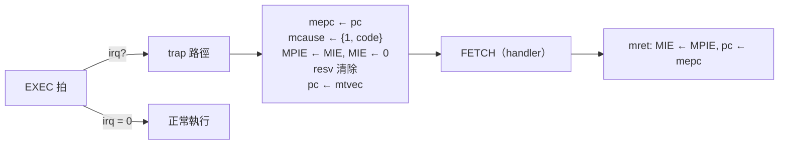

# 6.3 RV32IMA 與中斷

> 原始碼：`examples/src/rvsoc.veryl`（`RvCore`）。
> 與 6.1 的微架構章互補：這裡聚焦 A 擴充、Zicsr 與中斷的硬體細節，
> 以及「為什麼 12 MHz 是設計的硬指標」。

## 6.3.1 A 擴充：LR / SC 與 AMO

RV32A 共四類指令（`rvsoc.veryl:105-107`）：

```veryl
let is_lr    : logic = op_amo && funct5 == 5'b00010;
let is_sc    : logic = op_amo && funct5 == 5'b00011;
let is_amo   : logic = op_amo && !is_lr && !is_sc; // 讀、改、寫
```

### LR / SC 與保留集

單核、無 DMA 的 SoC 其實只需要很弱的原子性，實作也簡單：

```veryl
var resv_v : logic    ;
var resv_a : logic<32>;
let sc_ok  : logic     = resv_v && resv_a == rs1_data;
```

- `lr.w`：照 load 走（3 拍），MEM 拍記下 `resv_v = 1`、
  `resv_a = lsaddr`；
- `sc.w`：EXEC 拍比較 `resv_a == rs1_data`，成立才送出 store，
  寫回值是 `{31'd0, !sc_ok}`（0 = 成功）；
- 任何 trap 或另一次 `sc` 都清掉 `resv_v`（`rvsoc.veryl:550, 559`）。

在單核上這等價於完整規格——只有本核會破壞保留，
而本核在 LR 與 SC 之間唯一能改記憶體的就是自己。

### AMO 的讀改寫

AMO 走和 load 一樣的 3 拍路徑，差別在 MEM 拍**再寫回**：

```veryl
MEM: {
    o_re    = 1'b1;
    rf_we   = rd_idx != 5'd0;
    rf_wd   = load_data;                 // 回寫舊值
    o_waddr = lsaddr;
    o_wdata = amo_new;
    o_wstrb = if is_amo ? 4'b1111 : 4'd0;
}
```

新值的計算全在 EXEC→MEM 之間的組合邏輯：

```veryl
let amo_x  : logic<32> = {i_rdata[31] ^ !funct5[3], i_rdata[30:0]};
let amo_y  : logic<32> = {rs2_data[31] ^ !funct5[3], rs2_data[30:0]};
let amo_old: logic     = (amo_x <: amo_y) ^ funct5[2]; // 選舊值
case funct5 {
    5'b00001: amo_new = rs2_data;             // swap
    5'b00000: amo_new = i_rdata + rs2_data;   // add
    ...
    default : amo_new = if amo_old ? i_rdata : rs2_data; // min/max/minu/maxu
}
```

min/max 只用一個比較器：把最高位元依有號/無號反相後
統一用無號比較（`funct5[2]` = max、`funct5[3]` = 無號），
再決定選舊值或新值。

### rs1_data 位址比較在 store 致能路徑上：為何 12 MHz 關鍵

`sc_ok` 決定 `o_wstrb`：

```veryl
o_wstrb = if op_store || (is_sc && sc_ok) ? store_strb : 4'd0;
```

這條路徑是：

$$
\text{rs1\_data} \xrightarrow{\text{32 位元比較}} \text{sc\_ok}
\xrightarrow{\text{多工}} \text{o\_wstrb}
\xrightarrow{} \text{RAM 的 } i\_we
$$

注意比較對象是 **`rs1_data`（暫存器檔讀出的位址）**，
而不是 ALU 輸出。AMO 的位址本來就等於 rs1（無偏移），
直接比較可以讓這個 32 位元比較器與 ALU **平行**運作；
如果改成對 `alu_out`（rs1 + imm）比較，比較器就會被串在
ALU 之後，成為 store 致能路徑上多一層的 32 位元加法 +
比較。AGENTS 記錄的原話：

> Keep the A-extension address compare on `rs1_data` (not the ALU
> output): it is on the store-enable path and RvBoard / RvVgaBoard
> only just make 12 MHz.

12 MHz 是 iCEBreaker 的板上時脈。RvBoard（含 8 KB block RAM、
UART、VGA 文字模式）的 timing 只剛好過線——任何一層邏輯的
加深都會讓 nextpnr 的 STA 失敗。這是本專案裡
「演算法選擇 = 時序收斂」最直接的例子。

## 6.3.2 Zicsr：CSR 的實作

機器模式 CSR 全集與編號（`rvsoc.veryl:212-233`）：

| 位址 | CSR | 值 |
|---|---|---|
| 0x300 | mstatus | `{MPP=11, MPIE, MIE}` |
| 0x301 | misa | `0x4000_1101`（RV32 IMA） |
| 0x304 | mie | MSIE/MTIE/MEIE |
| 0x305 | mtvec | Direct mode only |
| 0x340 | mscratch | 任意 |
| 0x341 | mepc | 2 位元對齊 |
| 0x342 | mcause | **只存 5 bits** |
| 0x343 | mtval | **唯讀 0** |
| 0x344 | mip | 三個 pending 位元 |
| 0xB00/C00/C01 | mcycle/cycle/time | SoC 的 mtime（寫入忽略） |
| 0xB02/C02 | minstret | 每個 retired 指令 +1 |
| 0xB80/C80/C81/C82/F11-F14 | 常數 0 | |

兩個刻意的簡化：

- **mtval = 0**：規格容許（mtval 是 optional），省下保存
  出錯位址的觸發器與 mux。
- **mcause 只存 5 bits**：`{interrupt, code[3:0]}`，因為
  本核心的可能原因只有 8 種（見下表）；讀出時
  `csr_old = {mcause[4], 27'd0, mcause[3:0]}`。

### 讀與寫

讀：12 位元位址 → 4 位元編號 → 32:1 值多工器（`csr_old`）。
寫：`funct3[1:0]` 決定 csrrw / csrrs / csrrc 的語義，
csrrs/c 在 rs1（或 zimm）為 0 時不寫：

```veryl
let csr_writes: logic = funct3[1:0] == 2'b01 || rs1_idx != 5'd0;
let csr_bad   : logic = !csr_ok || (csr_addr[11:10] == 2'b11 && csr_writes);
let csr_src   : logic<32> = if funct3[2] ? {27'd0, rs1_idx} : rs1_data;
```

`csr_bad` 的第二項是規格的 read-only CSR 寫入必須陷入
（位址 bit 11:10 = 11 是 read-only 區）。實際寫入在 EXEC 拍
分發給各個觸發器（`rvsoc.veryl:561-578`），
`mcycle/time` 的寫入直接忽略。

## 6.3.3 中斷：優先權與取樣

三個中斷源、固定的優先權（`rvsoc.veryl:296-301`）：

```veryl
// --- 中斷：外部 > 軟體 > 計時器 ---
let pend_ext  : logic = i_irq_ext && ie_meie;
let pend_soft : logic = i_irq_soft && ie_msie;
let pend_timer: logic = i_irq_timer && ie_mtie;
let pending   : logic = pend_ext || pend_soft || pend_timer;
let irq       : logic = st_mie && pending;
```

| 來源 | mip 位元 | mie 位元 | 優先權 |
|---|---|---|---|
| 外部（UART 收到位元組） | MEIP (11) | MEIE (11) | 最高（code 11） |
| 軟體（msip） | MSIP (3) | MSIE (3) | 中（code 3） |
| 計時器（mtime ≥ mtimecmp） | MTIP (7) | MTIE (7) | 最低（code 7） |

陷阱原因編碼（`trap_cause`）：

```veryl
trap_cause = {1'b1, if pend_ext ? 4'd11 : if pend_soft ? 4'd3 : 4'd7};
```

### 在哪一拍取樣？

RvCore 在 **EXEC 拍**取樣中斷：`i_mtime`、`i_irq_*` 是 SoC
在同一拍給的組合訊號。執行中的指令若被中斷打斷：

- `trap_fast` 成立 → 不寫暫存器、不寫記憶體、不寫 CSR；
- pc 不再走 `exec_pc`，改走 `mtvec`；
- `mepc ← pc`、`mcause ← {1, code}`、`mstaus.MPIE ← MIE`、
  `MIE ← 0`。



### trap 額外一週期與 mtvec 跳轉

正常指令 2 拍（EXEC→DECODE）。trap 路徑是 EXEC→**FETCH**
（pc = mtvec），再 FETCH→DECODE，所以：

$$
\text{trap 的指令} = 3 \text{ 拍} \quad (\text{ISS：`self.cycles += 3`})
$$

多出的一拍就是「改道到 mtvec 重新取指」的那一拍——
`o_raddr` 在 EXEC 拍已經送出了投機位址，
trap 不能回收，只能讓它讀回的東西作廢，
下一拍重新從 mtvec 讀。這與 speculative fetch（6.1.4）
是同一枚硬幣的兩面。

`mtvec` 只支援 Direct mode（寫入時強制 `csr_new[1:0] = 00`，
跳轉時 `{mtvec[31:2], 2'b00}`），不支援 Vectored——
handler 用軟體分派即可。

### 計時器與 WFI

mtime 是 SoC 的 32 位元自由計數器（12 MHz 下約 357 秒繞一圈），
`mtimecmp` 與 `msip` 是 MMIO 暫存器。`wfi` 的行為：

```veryl
WFI    : o_re = pending;
...
WFI: if pending {
    state = DECODE;
}
```

`wfi` **不是睡眠關時脈**（iCE40 上也辦不到），而是：
停在 WFI 狀態、不再取指，直到任一 `pending` 位元（含未
被 mie 致能的？不——`pending` 已含 mie 致能條件，
`irq` 才含全域 MIE）成立。規格要求 wfi 之後可以因任何
中斷（即使不被致能）喚醒並照常陷入或繼續；本實作選擇
「只在致能的 pending 時喚醒」，與 ISS 的 `mip_at(t) & self.mie`
一致（6.4 節）。

## 6.3.4 trap 的完整清單

| cause | 來源 | 判定位置 |
|---|---|---|
| 0 | 指令位址未對齊（jal/jalr/branch 目標） | EXEC（`bad_jal`、`bad_branch`） |
| 2 | 非法指令（含 read-only CSR 寫入、未定義 CSR） | DECODE 記 `legal_r` + EXEC 的 `csr_bad` |
| 3 | ebreak / 軟體中斷 | EXEC |
| 4 | load 位址未對齊 | EXEC（`mis_load`） |
| 6 | store/AMO 位址未對齊 | EXEC（`mis_store`） |
| 7 | 計時器中斷 | EXEC |
| 11 | ecall / 外部中斷 | EXEC |

注意 `mcause` 編碼把「ebreak（3）」和「軟體中斷（code 3,
interrupt=1）」用最高位元區分——5 bits 正好
`{interrupt, code[3:0]}`。

## 6.3.5 為什麼這樣設計

1. **保留集一個觸發器 + 一個比較器**：單核夠用；
   完整規格的 multi-core reservation 需要匯流排監聽，完全不必要。
2. **AMO 與 load 共用 3 拍路徑**：不需要新的記憶體協定，
   只多一組回寫多工器。
3. **固定優先權、無中斷控制器**：PLIC 對 3 個來源是殺雞用牛刀；
   優先權用 if-else 鏈編進 `trap_cause`。
4. **中斷取樣在 EXEC**：與 ISS 的取樣週期完全一致
   （`mip_at(e)`，e 是 Exec cycle），否則 timer 驅動的程式
   在 RTL 和 ISS 上行為會分叉。
5. **mcycle = mtime**：軟體常假設 mcycle 是牆上時間的倍數；
   共用一個計數器讓 `sleep(ms)` 之類的程式碼簡單可靠。

## 6.3.6 本章重點

- A 擴充：LR/SC 用單一保留觸發器；AMO 走 load 的 3 拍路徑
  加一拍寫回；min/max 一個比較器。
- `sc_ok` 的位址比較**必須**在 `rs1_data` 上（不經 ALU），
  因為它在 store 致能路徑上——12 MHz 的最後一哩。
- Zicsr：13 個 CSR、mtval=0、mcause 5 bits、
  mcycle/time 讀 SoC mtime、read-only 寫入陷入。
- 中斷優先 ext > soft > timer，EXEC 拍取樣，trap 3 拍
  （speculative fetch 的代價），mtvec Direct mode。
- wfi：停在 WFI 直到致能的 pending；與 ISS 的取樣語義一致。
