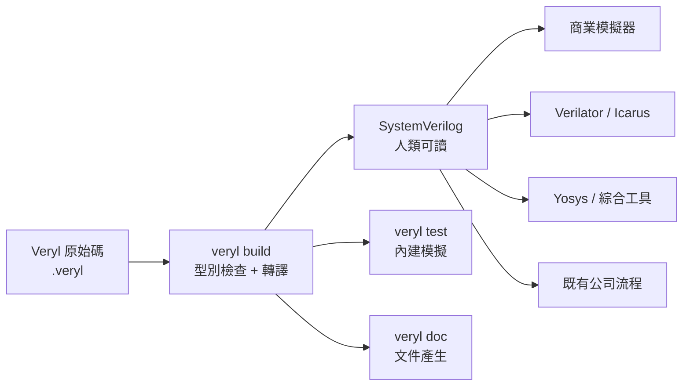

# Veryl 的定位與哲學：零額外成本的可讀轉譯

了解 HDL 三十年的演化之後，我們終於可以準確定位 Veryl：它是什麼、不是什麼、以及它用哪些哲學取捨回答了前幾章留下來的問題。

## Veryl 的出身

Veryl 是由日本工程師 dalance（Naoya Hatta）從 2022 年開始開發的開源硬體描述語言，專案位於 GitHub 的 veryl-lang/veryl，編譯器本身以 Rust 撰寫，2023 年起公開發展並快速累積社群。dalance 是長年在高效能儲存與系統軟體領域工作的 Rust 開發者，這解釋了 Veryl 的兩個鲜明特徵：語法深深吸收 Rust 的設計語彙，工具鏈直接複製 Rust 生態的成功制度（版本管理器、格式化、測試內建）。Veryl 的動機非常務實：作者在實際硬體專案中受夠了 SystemVerilog 的樣板與陷阱，想要一種「寫起來舒服、但不必放棄既有工具鏈」的語言。

## 哲學一：零額外成本的可讀轉譯

Veryl 不是新的模擬器或綜合器，它是一個 transpiler：Veryl 原始碼經 `veryl build` 編譯後，輸出的是人類可讀的 SystemVerilog。這個決策是整個專案最重要的取捨。它意味著三件事。第一，零 overhead：輸出的 SV 幾乎就是你在 Veryl 裡寫的東西的一對一翻譯，不會產生暴肥的中間碼，模擬與綜合的行為可以直接推理。第二，生態相容：任何吃 SystemVerilog 的工具——商業模擬器、Verilator、開源 FPGA 工具鏈、你公司十年来累積的 script——全部直接可用，不必等 Veryl 生態長大。第三，審查友善：輸出的 SV 可以 code review、可以放進既有流程、可以在需要時手工微調。這與宿主語言路線（Chisel 等）輸出不可讀中間碼形成對比：Veryl 的轉譯是「給人看的」，不是「給機器吃剩的」。

## 哲學二：強型別，位寬進入型別系統

SystemVerilog 最惡名昭彰的陷阱之一是位寬錯誤：把 8 位元訊號指給 3 位元，工具靜默截斷或發出難以理解的 warning。Veryl 把位寬納入型別系統：`logic<8>` 與 `logic<3>` 是不同的型別，寬度不符需要明確的轉換，位寬不匹配在編譯期就變成錯誤。時脈與重置也有獨立型別 `clock`、`reset`，訊號不能混用——把資料接上時脈 port 這種經典錯誤在 Veryl 裡根本寫不出來。這是 VHDL 強型別哲學的現代化重演，但語法負擔遠比 VHDL 輕。

## 哲學三：現代工程體驗內建

Veryl 把軟體界的回頭浪潮直接內建到語言工具裡：`veryl fmt` 統一格式（rustfmt 的對應物）、`veryl check` 做靜態檢查（clippy 的對應物）、`veryl doc` 從 `///` 文件註解產生 HTML 文件（rustdoc 的對應物）、`veryl test` 內建模擬測試（cargo test 的對應物）、`veryl publish` 管理發布。搭配 verylup 版本管理器與完整的 LSP（veryl-ls），跳轉、補全、即時錯誤一應俱全。工程師不必再拼湊各家 script，一個語言工具鏈就是完整的開發環境。

## 哲學四：語法像 Rust

Veryl 的語法刻意接近 Rust：`let`（單一賦值）與 `var`（可變）區分、`if_reset` 表達重置分支、`for i: u32 in 0..W` 的 range 語法、`Enum::Variant` 的存取方式、module param 的預設值寫法。對熟悉 Rust 的工程師幾乎零學習成本；對不熟悉 Rust 的硬體工程師，這套語法也比 SystemVerilog 的歷史包袱一致得多。方向可以省略由編譯器推導、輸出入意圖清晰，減少了大量樣板。

## Veryl 刻意不做的事

同樣重要的是 Veryl 的減法：它不做物件導向驗證、不做約束隨機、不做 covergroup——這些是 UVM 的領域，Veryl 不與之競爭，而是透過輸出的 SystemVerilog 與既有驗證方法學無縫銜接。驗證可以用 cocotb（Python）或傳統 SV testbench，透過 `embed (cocotb) sv` 等機制整合。這種「專注 RTL、把驗證留給生態」的取捨，正是從 SystemVerilog 膨脹的教訓學來的。

## 本章小結

- Veryl 由 dalance 於 2022 年開始開發，GitHub veryl-lang/veryl，Rust 實作，2023 年起公開發展。
- 核心哲學：轉譯為人類可讀的 SystemVerilog，零 overhead、非宿主語言、與任何既有工具鏈相容。
- 強型別設計，位寬、clock、reset 皆進入型別檢查。
- 內建 fmt/check/doc/test 與 LSP、verylup，完整複製 Rust 的工程體驗。
- 語法像 Rust，刻意避開 SystemVerilog 的驗證功能爆炸，專注把 RTL 做好。
