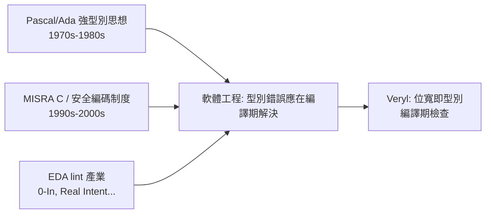

# 位寬與型別：讓 width 進入型別檢查

## Verilog 弱型別之痛

自 1984 年 Verilog 誕生以來，硬體設計師享受到的是一種「什麼都能連」的自由，但這份自由的代價極高。Verilog 的型別系統基本上只有向量寬度（bit width）而沒有真正的型別：一個 `reg [7:0]` 和一個 `wire [15:0]` 之間的賦值不會被編譯器阻擋，而是默默進行隱式截斷（implicit truncation）或隱式零擴展。設計師如果在一個 16 位元的計數器上不小心指派了一個 8 位元的訊號，綜合結果與模擬結果都可能「看起來會動」，直到某個邊界條件觸發才在測試台上爆出難以追蹤的錯誤。

更麻煩的是 4-state 語意。Verilog 的 `reg`/`wire` 預設攜帶 `0/1/x/z` 四種狀態，`x`（未知）在邏輯運算中會像瘟疫一樣傳播：一個未初始化的訊號可以讓整條資料路徑變成 `x`，而 `if (x)` 在多數模擬器中被視為假，導致模擬行為與真實電路（上電時的隨機狀態）不一致。設計師必須靠紀律而非工具來避免這些陷阱。

不同工具對同一份 Verilog 的寬容度還各自為政：某些綜合器接受這種隱式轉換、某些 lint 工具報 warning、某些模擬器乾脆忽略。同一段程式碼在 A 公司工具下通過、在 B 公司工具下報錯的例子屢見不鮮。這種「工具間語意漂移」讓大型團隊不得不制定內部編碼準則，並額外購買 lint 工具來把關。

## Veryl 的答案：位寬即型別

Veryl 從語言設計層面直接處理這個問題：位寬是型別的一部分。`logic<8>` 與 `logic<16>` 是兩個不同的型別，彼此賦值需要顯式的寬度轉換意圖，編譯器在編譯期就會檢查並報錯，而不是留給下游工具或測試台去發現。這帶來三個好處：

- 錯誤提早到編譯期。設計師按下 build 的瞬間就知道寬度不匹配，不必等到模擬波形出現 `x` 或綜合報 warning。
- 位寬可以參數化。`logic<W>` 讓型別隨參數 `W` 變化，generic 的資料路徑（例如可設定位寬的 FIFO）可以在型別系統內表達，而不是靠字串巨集拼湊。
- 意圖明確化。需要截斷或擴充時，設計師必須寫出顯式的轉換，程式碼審查者一眼就能看到「這裡有意識地犧牲了位元」。

```veryl
module Adder (
    param W: u32 = 8,
    port a: input  logic<W>,
    port b: input  logic<W>,
    port c: output logic<W>,
) {
    let sum: logic<W + 1> = a + b;
    assign c = sum[W:1];
}
```

在這個例子裡，`sum` 的型別是 `logic<W + 1>`，位寬運算本身就是型別運算。如果要省略中間訊號直接賦值給 `c`，寬度不符就會被編譯器攔下，設計師必須明確地寫出截斷的動作。這種體驗對習慣了 Verilog 的老工程師一開始可能覺得囉唆，但寫過幾萬行之後會發現：省下的 debug 時間遠多於多打的幾個字。

## 歷史脈絡：強型別思想從何而來

Veryl 的這個設計並非憑空發明，而是軟體工程界花了五十年才沉澱出來的教訓在硬體領域的補課。

1970 年代，Niklaus Wirth 設計 Pascal 時明確把「型別是一組值與其上可執行的運算」作為核心思想，讓編譯器在編譯期攔截型別錯誤。同一時期美國國防部委託開發的 Ada 語言（1980 年定案，1983 年成為 ANSI/MIL-STD 標準）更進一步：Ada 允許程式師定義範圍型別（range type），例如 `type Digit is range 0..9;`，任何超出範圍的賦值都是編譯錯誤。Ada 的設計動機正是美國國防部在 1970 年代因嵌入式系統軟體品質低落、每年維護費用高達數十億美元而推動的「高階語言共同計畫」（HL Commonality program）。這是「制度需求驅動語言特性」的經典案例：當軟體失敗的成本高到國家層級，型別檢查就從「方便」變成「必要」。

硬體領域其實面臨同樣的經濟壓力，只是反應慢了二十年。ASIC 流片一次數百萬美元，一個位寬 bug 導致的矽上缺陷（silicon bug）可能讓整批晶圓報廢；FPGA 雖可重燒，但功能錯誤拖慢產品上市時程的代價同樣巨大。業界因此發展出「事後補洞」的三層體系：

- 編碼準則制度：汽車電子的 MISRA C（1998 年首版）為 C 語言訂出禁用隱式轉換等規則，證明了「用制度限制語言自由」的可行性；硬體界的 Reuse Methodology Manual（1997 年起）與各家設計準則文件扮演類似角色。
- lint 工具產業：0-In（1999 年成立）、Real Intent（1999 年成立）、Jasper Design Automation（2003 年成立，後被 Cadence 收購）等公司專門販售「事後檢查 Verilog 弱型別後果」的工具，形成一個年產值數億美元的利基市場。這個產業的存在本身就是語言缺陷的財務證據——如果語言自己會檢查，這些公司就沒有生意。
- 方法學：CDC（clock domain crossing）檢查、assertion-based verification 等，都是在弱型別語言之上加裝的「測速照相器」。



Veryl 的做法是把這條「先犯錯、再花錢抓錯」的產業鏈整段拿掉：與其買 lint 工具事後掃描 `width mismatch`，不如讓語言編譯器直接把寬度放進型別系統。這也是近年新一代 HDL（Veryl、Chisel、SpinalHDL、Amaranth）共同的哲學轉向——向 1970 年代程式語言研究的結論回歸：把錯誤攔在最早的階段，是成本最低的品質策略。

## 小結

Verilog 的弱型別是 1980 年代硬體規模與工具能力下的妥協，而它留下的隱式截斷、`x` 傳播、工具語意漂移等問題，催生了 lint 工具產業與各種安全編碼制度，每年耗費業界大量金錢。Veryl 選擇從根治病：把位寬納入型別系統，讓 `logic<8>` 與 `logic<16>` 成為不可混用的型別，並以 `logic<W>` 支援參數化位寬，把錯誤攔截在編譯期。理解這一段從 Ada 到 MISRA C 到 EDA lint 的歷史，才能體會「讓 width 進入型別檢查」這句話背後五十年的工程智慧。
