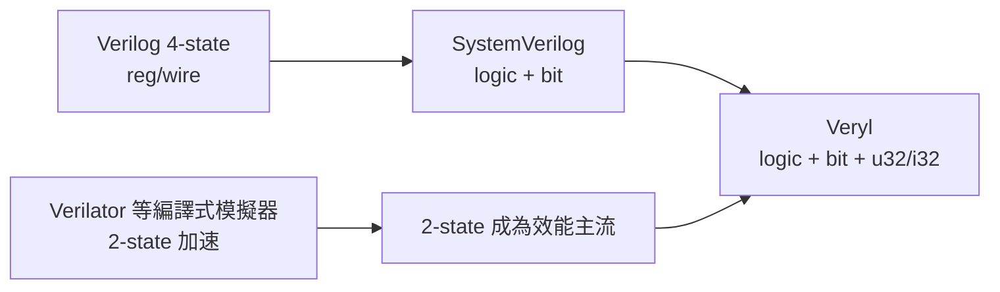

# logic 與 bit 型別：4-state 與 2-state 的抉擇

## 兩種基本型別

Veryl 提供兩種位向量型別作為硬體建模的基礎：

- `logic`：4-state 型別，每個位元可以是 `0`、`1`、`x`（未知）或 `z`（高阻抗）。這是與 Verilog `wire`/`reg` 對應的型別，也是預設的硬體訊號型別。
- `bit`：2-state 型別，每個位元只能是 `0` 或 `1`，沒有 `x` 與 `z`。

兩者都支援位寬參數，如 `logic<8>`、`bit<32>`。此外 Veryl 提供與 Rust 命名一致的整數別名：`u32`、`i32`、`u64`、`i64` 等，分別代表無號/有號、32/64 位元的整數。`u32` 在語意上等同於 32 位元的無號向量，但寫起來更簡潔，也更貼近軟體工程師的閱讀習慣。

```veryl
module Types (
    port a: input  logic<8>,
    port b: input  bit<8>,
    port c: output u32,
) {
    var x: logic<8> = a;
    let y: bit<8>   = b;
    assign c = 32'd1;
}
```

## X 與 Z 的語意

要正確使用這兩種型別，必須理解 `x` 與 `z` 在模擬與合成中的不同命運。

在模擬中，`x` 代表「值未知」：未初始化的 flip-flop、多個驅動源衝突、未接的輸入都可能產生 `x`。`x` 會在布林邏輯中傳播，而 `if (x)` 這種條件判斷在多數模擬器中按「非真」處理，這正是模擬與真實晶片行為分歧的經典來源——真實上電後的 flip-flop 狀態是隨機的 0 或 1，而不是溫馴的「走 else 分支」。`z` 則代表高阻抗，主要用於三態匯流排（tri-state bus） modeling；在晶片內部，現代設計準則普遍禁止內部三態，`z` 幾乎只出現在 I/O pad 層級。

在合成中，`x` 與 `z` 沒有模擬時的語意：綜合工具把 `x` 賦值視為「不關心」（don't care），有時用來指示工具做邏輯化簡；內部三態則直接不被支援（FPGA 上甚至需要用多工器模擬）。也就是說，`x` 在模擬與合成中是兩種完全不同的東西，這個語意斷層是 Verilog 遺留給所有設計師的負債。

Veryl 保留 `logic` 的 4-state 語意以維持與既有 Verilog 生態系的互通（transpile 出來的程式碼仍然是標準 SV），但鼓勵設計師在不需要 `x/z` 的場景改用 `bit`。

## 2-state 對模擬速度的意義

為什麼要提供 `bit`？答案是效能。4-state 模擬需要為每個位元維護四種狀態的編碼（通常兩個 bit 的狀態編碼加強度資訊），記憶體用量與運算開銷都高於 2-state。事件驅動模擬器（如 VCS、Questa、Xcelium）必須處理 `x` 傳播的複雜規則，排程與求值成本顯著增加。

真實的產業背景是編譯式模擬器（compiled-code simulator）的崛起。Verilator 自 2000 年代起將 Verilog 編譯成 C++，採用完全的 2-state 語意，捨棄 `x/z` 換取兩個數量級以上的速度提升，如今已成為大型 SoC 軟體模擬（如 RISC-V 開發）的事實標準。Google 開發的開源模擬器、各大 AI 晶片公司的大規模回歸測試，都建立在世界級模擬器必須夠快的認知之上。2-state 模擬的哲學是：與其模擬「未知的精確物理」，不如假設一切確定，把「偵測未初始化」的責任交給專門工具（如 `x`-propagation 檢查）。

Veryl 的 `bit` 型別呼應了這個趨勢：當你確定某段邏輯不需要 4-state 語意時，用 `bit` 表達意圖，也為將來對接 2-state 模擬流程留出空間。設計師可以按模組粒度選擇：介面與暫存器初始化相關的邏輯用 `logic`，純資料路徑用 `bit`。

## 與 SystemVerilog 對照

SystemVerilog 早在 IEEE 1800 標準（2005 年首版）中就引進了 2-state 型別 `bit` 與 `logic` 的區分：`logic` 是 4-state，`bit` 是 2-state，並且語法上與 Veryl 幾乎同名。Veryl 在這點上是與 SV 對齊的，差別在於：

- SV 的 `bit` 主要用在 testbench 與軟體側建模，RTL 設計中極少人使用；Veryl 則把它當作一等公民，鼓勵在合成邏輯中表達 2-state 意圖。
- SV 的整數別名（`int`、`longint`、`byte` 等）語意混雜，`int` 是 2-state、`integer` 是 4-state、有號無號規則各不相同，是知名的陷阱。Veryl 直接採用 Rust 風格的 `u32`/`i32`/`u64`/`i64`，命名即語意，不需要背表格。



## 小結

`logic` 與 `bit` 分別代表 4-state 與 2-state 兩種世界觀：前者忠實反映數位電路中「未知」與「高阻抗」的物理現實，是與 Verilog 生態互動的介面；後者放棄 `x/z` 換取模擬速度與更簡單的語意，呼應 Verilator 以來 2-state 加速的產業趨勢。Veryl 保留兩者並加上 `u32`/`i32` 等 Rust 風格別名，讓設計師可以依場景精確表達意圖——這正是型別系統的價值：不只是防錯，更是把設計意圖寫進程式碼本身。
