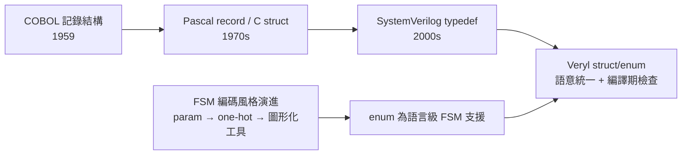

# Struct 與 Enum：把資料組織起來

## struct：打包相關訊號

硬體設計中最常見的結構之一是「一組一起流動的訊號」：valid/ready 握手、位址與資料、指令的 opcode 與 operand。在 Verilog 時代，這些訊號只能攤平成一排 `wire`，靠命名慣例維繫彼此的關係；一旦要改一個欄位，所有相關的宣告、串接、port map 都要同步修改，錯一處就是 bug。

Veryl 的 struct 提供了標準的解法：

```veryl
struct Packet {
    addr: logic<16>,
    data: logic<32>,
    vld:  logic,
}

module Sender (
    port p: output Packet,
) {
    var tx: Packet;
    assign tx.addr = 16'h1234;
    assign tx.data = 32'hdeadbeef;
    assign tx.vld  = 1;
    assign p = tx;
}
```

- `struct Packet { ... }` 定義一個記錄型別，欄位各自有型別與位寬。
- 成員存取用 `s.a` 的語法，與主流程式語言一致。
- 整個 struct 可以作為 port 型別，一次傳遞整包訊號；整體賦值 `p = tx` 會逐欄位對應。
- struct 可以參數化（類似 Rust 的 generic struct），用於位寬可變的資料結構。

struct 讓「這些訊號屬於同一個抽象」這個設計意圖第一次進入了語言本身，而不是存在於註解與命名慣例中。

## enum：有限狀態機的語言級支援

硬體另一個高頻結構是有限狀態機（FSM）。Verilog 時代的 FSM 是用 `localparam` 加編碼常數拼出來的，可讀性與可維護性都差。Veryl 的 enum 把狀態定義成真正的型別：

```veryl
enum State: logic<2> {
    Idle = 0,
    Run,
    Done,
}

module Ctrl (
    port clk: input  clock,
    port rst: input  reset,
    port go:  input  logic,
    port done: input logic,
) {
    var state: State;

    always_ff (clk, rst) {
        if_reset {
            state = State::Idle;
        } else {
            case state {
                State::Idle: if go { state = State::Run; }
                State::Run:  if done { state = State::Done; }
                State::Done: state = State::Idle;
            }
        }
    }
}
```

- `enum State: logic<2>` 明確指定底層編碼型別，`Idle = 0` 後續成員自動遞增。
- 引用成員用 `State::Idle` 的完整路徑語法，來源一目了然。
- 與 `case` 搭配時，編譯器可以檢查窮舉性：漏掉一個狀態就是編譯錯誤，而不是靠 simulation 才發現。
- enum 底層編碼（binary、one-hot 等）由型別宣告控制，例如用 `logic<3>` 配合手動編碼即可做 one-hot 風格。

## 對照 SystemVerilog

SystemVerilog 在 IEEE 1800（2005 年標準化，概念源自 1990 年代末的 Superlog 與 Co-Design Automation 的設計驗證語言工作，該公司 2002 年被 Synopsys 收購）中加入了 `typedef struct` 與 `typedef enum`。功能上 Veryl 的 struct/enum 與之同源，但可讀性差異很大：

- SV 的 `typedef enum {Idle, Run, Done} state_t;` 把成員清單、底層型別與型別名稱的順序安排得相當彆扭，且預設底層型別是 `int`（32 位元），若要控制編碼位寬需要額外語法；Veryl 則把編碼型別放在宣告處，一行看完。
- SV 的 struct 中的 packed/unpacked 區分（`typedef struct packed { ... }`）是初學者常見的陷阱，語意細節複雜；Veryl 統一了語意，減少記憶負擔。
- SV 的 case 窮舉檢查依賴 `unique case` 或 lint 工具；Veryl 的 enum case 檢查是語言內建。

## 歷史脈絡

記錄結構（record）不是新發明。COBOL（1959 年，美國國防部支持下的資料處理語言）的資料階層就用層級編號把相關欄位組織成記錄，這是商業資料處理「把相關資料打包」思想的源頭。Pascal（1970）的 `record`、C（1972）的 `struct` 把這個概念帶進系統程式設計，成為現代語言的標配。硬體語言遲遲未採用，是因為早期設計規模小、訊號攤平尚可應付；直到 1990 年代 SoC 出現、匯流排協定（欄位動輒數十個）成為日常，結構化資料的需求才爆發——SystemVerilog 的 struct 正是這波需求的產物。

FSM 編碼風格也有自己的演化史：早期手繪狀態圖、以 `parameter` 定義常數；1990 年代學術界提出 one-hot 編碼以利 FPGA 的 flip-flop 資源利用；2000 年代 EDA 工具（如 StateCAD、Stateflow）嘗試用圖形化工具管理狀態機；最終主流仍是「用語言原生 enum 表達、工具自動選編碼」。Veryl 的 enum 走的正是這條路的現代版本：語言級支援、編碼可控、編譯器檢查窮舉。



## 小結

struct 與 enum 讓 Veryl 把兩個硬體設計中最高頻的抽象——「一起流動的訊號群」與「有限狀態機的狀態」——從命名慣例升級為語言型別。搭配 `s.a` 成員存取、`State::Idle` 限定引用與 case 窮舉檢查，設計意圖在編譯期就能被機器驗證。這不是新發明，而是 COBOL/Pascal 以來六十年軟體工程經驗在 HDL 的落地；理解這條歷史線，才能明白為什麼「語言級 struct/enum」值得成為新一代 HDL 的標準配備。
