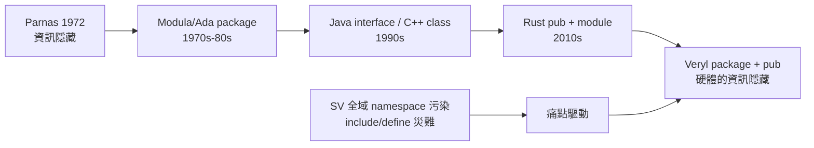

# Package 與 pub：資訊隱藏進入硬體

## package：共用的命名空間

專案一大，常數、函式、struct/enum 定義就會多到需要分類。Verilog 的解法是把共用定義放在 `package`（SystemVerilog）或更古老的 `\`include` 檔案加 `define` 巨集，兩者都屬於「全域命名空間」：所有東西都倒進同一個大池子，名稱衝突只能靠命名慣例（`MYPROJECT_FIFO_DEPTH`）避免。

Veryl 的 package 沿用 SV 的關鍵字但收緊語意：

```veryl
package FifoCfg {
    const DEPTH: u32 = 64;
    const WIDTH: u32 = 32;

    function count_bits(d: u32) -> u32 {
        return 32 - clz(d - 1);
    }
}

module Fifo (
    param DEPTH: u32 = FifoCfg::DEPTH,
) {
    // 使用 FifoCfg::WIDTH 等成員
}

import FifoCfg::*;
```

- `package P { const A: u32 = 1; }` 把常數、函式、struct/enum 定義封裝在命名空間 `P` 內。
- 預設情況下，package 的成員只在 package 內部可見；要從外部使用完整路徑 `P::A`，必須以 `pub` 標記該成員。
- `import P::*;` 把 package 成員引入目前作用域，免除重複寫前綴；星號 import 是顯式寫在原始碼中的，用到的範圍一目了然。
- package 可以參數化（generic package），讓同一組定義服務不同的位寬配置。

## pub：可見性是設計決策

`pub` 是 Veryl 從 Rust 借來的可見性修飾。在 Rust 的 module system 中，一個項目若未標 `pub`，就只有定義它的模組（及子模組）能看到；標了 `pub` 才成為對外的公開介面。這個機制回答了一個重要問題：這個定義是內部實作細節，還是對外契約？

```veryl
package CacheCfg {
    pub const LINE_SIZE: u32 = 16;
    const TAG_WIDTH: u32 = 20;
}
```

上例中 `LINE_SIZE` 是對外公開的配置項，外部模組可以寫 `CacheCfg::LINE_SIZE`；`TAG_WIDTH` 則是 package 內部的推導值，外部不可見。這帶來一個實際好處：內部細節可以自由重構（改名字、改公式），只要 `pub` 介面不動，外部程式碼不受影響。

## 對照 SV 的全域命名空間污染

SystemVerilog 的 package 沒有內建可見性控制：`package` 內的所有定義匯入後全部可見，內部輔助函式與公開 API 混在一起。更大的問題在設計層級：SV 專案常見 `\`include` 巨集檔（`\`defines` 是檔案層級、編譯順序敏感的全域狀態），多個 VIP 或 IP 的巨集名稱衝突是整合時的經典災難。這種「命名空間污染」在大型 SoC 中代價不菲——數百萬行的程式碼庫中，一個巨集的重新定義可以悄悄改掉遠方模組的行為。

Veryl 用兩個機制杜絕這類問題：一是 `\`define` 這類全域文字巨集在語言設計上被移除，參數一律走型別化的 `param`/`const`；二是 `pub` 把「誰能看見誰」變成編譯器強制的規則，而不是人為紀律。

## 歷史脈絡：Parnas 與資訊隱藏

可見性控制背後的思想可以精確定位到 1972 年。David Parnas 在 CACM 發表的經典論文 On the Criteria To Be Used in Decomposing Systems into Modules 提出：模組化的標準不應是「流程圖的切割」，而是「把難以預測的設計決策隱藏在模組內部，對外只暴露穩定的介面」。這就是資訊隱藏（information hiding）原則。Parnas 用一個 KWIC 索引系統的例子比較兩種模組化方案，證明「按介面分解」的系統在需求變更時的改動成本遠低於「按流程分解」。

這個思想在 1970-80 年代被 Modula（1975）、Ada（1983，其 package 與 private 部分正是 Parnas 思想的語言化）吸收，成為現代語言 module system 的基石；1995 年 MIT 的 Barbara Liskov（抽象資料型別）與後來 Java 的 interface、C++ 的 class 學派，都是這條線的延伸。Rust 在 2010 年代把這套思想以 `pub` 與模組路徑的形式重新詮釋，並成為 Veryl 借鑑的對象。

硬體領域接受這個思想特別晚，但特別有價值。IP 重用（IP reuse）自 1990 年代成為 SoC 產業的核心商業模式後，「介面穩定、實作可換」就是 IP 供應商的生存條件——客戶買的是介面契約，不是原始碼。語言級的資訊隱藏讓這個商業需求第一次有了語法支撐：package 的 `pub` 邊界就是 IP 的文件化 API，編譯器負責驗證。



## 小結

package 解決「定義往哪放、名字歸誰管」，`pub` 解決「誰能看見誰」。兩者合起來，把軟體工程 1972 年以来的資訊隱藏原則帶進硬體：內部實作可自由演化，對外介面由編譯器把關。相較於 SystemVerilog 的全域命名空間與巨集污染，Veryl 的做法犧牲了一點打字量，換來大型專案中更低的整合風險——這正是 Parnas 五十年前預言的效益曲線。
