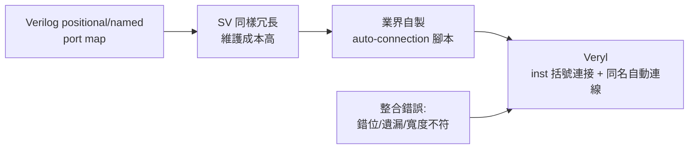

# Instance 與自動連線：讓 SoC 整合不再是苦差事

## `inst`：層級實例化

Veryl 用 `inst` 關鍵字做模組實例化：

```veryl
module Alu (
    port op:  input  logic<4>,
    port a:   input  logic<32>,
    port b:   input  logic<32>,
    port y:   output logic<32>,
) {
    // ... 運算邏輯
}

module Cpu {
    var op: logic<4>;
    var a:  logic<32>;
    var b:  logic<32>;
    var y:  logic<32>;

    inst u_alu: Alu;
    // 訊號透過 u_alu.op 等成員存取連接
    assign u_alu.op = op;
    assign u_alu.a = a;
    assign u_alu.b = b;
    assign u_alu.y = y;
}
```

`inst u: Foo;` 語意是「宣告一個型別為 Foo 的實例」。若模組有 param，可在型別位置給參數；若要連接訊號，可用括號連接語法：

```veryl
inst u_alu: Alu (
    op: op_bus,
    a:  a_bus,
    b:  b_bus,
    y:  y_bus,
);
```

這個括號內的連接類似 SV 的 named port connection，但寫在 inst 宣告內，語法更緊湊。

## 連線錯誤：大規模 SoC 的頭號 bug 來源

連接（connection）是 SoC 整合中最枯燥也最容易出錯的工作。一顆整合數十個 IP 的 SoC，頂層 netlist 動輒數千條訊號，常見錯誤包括：

- 錯位連接：port 順序對調（位址接上資料），行為詭異且難以發現。
- 遺漏連接：某個 port 忘了接，綜合器給 warning，模擬時訊號為 `x`。
- 寬度不符：兩邊位寬不一致，靠隱式截斷「過關」。
- 時脈/重置接錯 domain，造成 CDC bug。

真實的產業證據是「auto-connection 工具」的普遍存在。各大 IC 設計公司內部幾乎都有自製的 Python/Perl/TCL 腳本，用來從 IP 的 port 清單自動生成連線程式碼；商用工具（如 Cadence 的整合環境、Agilex/各家的 generate 工具）也把「自動產生頂層連線」當作賣點。一個功能如果全業界都在自己寫腳本解決，就說明它應該是語言的功能——Veryl 把它內建了。

## 依名稱自動連線

Veryl 提供自動連線機制，概念是：兩個模組介面中同名且相容的訊號自動對接，不需要逐條手寫。使用 `<>` 運算子表達這種「按名稱互連」的意圖：

```veryl
module BusMaster (
    port clk:   input clock,
    port rst:   input reset,
    port m_vld: output logic,
    port m_rdy: input  logic,
) {
    // ...
}

module Top {
    var clk: clock;
    var rst: reset;
    var m_vld: logic;
    var m_rdy: logic;

    inst u_master: BusMaster (
        clk,
        rst,
        m_vld,
        m_rdy,
    );
}
```

當兩個 instance 的介面訊號名稱一致（例如都遵守 `vld`/`rdy` 握手慣例）時，使用自動連線語法可以讓同名的訊號互相接通，省去逐一書寫的負擔。這個機制的價值在於「慣例即契約」：團隊只要遵守一致的命名規範（valid/ready、`i_`/`o_` 前綴等），頂層整合的程式碼量可以大幅縮減，而名字不匹配時編譯器會報錯，不會靜默錯接。



## 歷史脈絡

連接問題的嚴重性與整合密度同步成長。1980 年代的 ASIC 以單一功能塊為主，連接是幾十條線；1990 年代 SoC 概念興起（1994 年 LSI Logic 的 CoreWare 是早期商業化代表），IP 之間的互連開始成為主要工程量；2000 年代 ARM 生態讓「買 IP 組晶片」成為主流商業模式，頂層整合的錯誤成本被放大到流片層級。

業界的應對分三條線：一是方法學（如 IBM 的 CoreConnect、ARM 的 AMBA 匯流排規範，把互連標準化以減少自由度）；二是工具（auto-connection 腳本與整合環境）；三是語言（SystemVerilog 的 interface，以及新一代 HDL 的自動連線）。Veryl 屬於第三條線的最新實踐：把「按名稱連接」變成語言原語，讓慣例有語法地位。

值得注意的是 Rust 社群的影響。Rust 的 trait 與 derive 哲學強調「以宣告取代重複」，Veryl 的自動連線可以視為這個哲學在硬體的投影：與其在每個頂層重複書寫數百行 port map，不如宣告「這些介面同名互連」，讓編譯器展開成實際連線。省下的是打字，更省的是「抄錯一個名字」這類低級但致命的錯誤。

## 小結

`inst` 統一了實例化語法，括號連接集中了連線資訊，依名稱的自動連線則把整合慣例升級為語言功能。對照 SV 龐大的 port map 維護成本與業界氾濫的自製腳本，Veryl 的自動連線是「痛點語言化」的典型案例：整合錯誤既然是 SoC 的頭號 bug 來源，就應該由編譯器而非人眼來把關。
