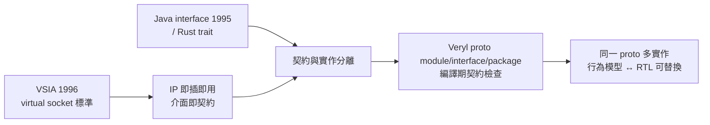

# ProtoModule 與契約：設計先於實作

## 從 trait 說起

軟體界早就解決了「只定介面、不定實作」的問題：Java 的 interface（1995）、Rust 的 trait、Haskell 的 type class，都是「契約與實作分離」的機制。契約的好處是雙向的——使用者可以針對契約寫程式而不依賴特定實作；提供者可以有多個實作，只要滿足契約就能替換。

硬體設計長期缺乏這個機制。Verilog 沒有任何介面契約概念：一個模組的「介面」就是它的 port 清單，但 port 清單不是一等公民——你無法宣告「我需要一個具有這組 port 的模組」，也無法驗證某個模組「符合」某組 port 規格。頂層連接錯了，錯誤要到 elaborate 甚至模擬才浮現。

Veryl 引入 proto（prototype）機制補上這一塊：

```veryl
proto module FifoIF (
    param WIDTH: u32,
    param DEPTH: u32,
    port clk:    input  clock,
    port rst:    input  reset,
    port w_vld:  input  logic,
    port w_rdy:  output logic,
    port w_data: input  logic<WIDTH>,
    port r_vld:  output logic,
    port r_rdy:  input  logic,
    port r_data: output logic<WIDTH>,
);
```

`proto module` 只宣告 param 與 port，沒有函式體——它是一份「模組長什麼樣」的契約。實作時用 `for` 關聯：

```veryl
module FifoRtl for FifoIF (
    param WIDTH: u32,
    param DEPTH: u32,
    port clk:    input  clock,
    port rst:    input  reset,
    port w_vld:  input  logic,
    port w_rdy:  output logic,
    port w_data: input  logic<WIDTH>,
    port r_vld:  output logic,
    port r_rdy:  input  logic,
    port r_data: output logic<WIDTH>,
) {
    // RTL 實作
}

module FifoModel for FifoIF (
    // 與上相同的 param/port 清單
) {
    // 行為模型實作：不含底層細節，模擬速度快
}
```

- `module FifoRtl for FifoIF { ... }` 表示這個模組聲明滿足 `FifoIF` 契約，編譯器會逐項比對 param 與 port，不符即編譯錯誤。
- 同一個 proto 可以有多個實作：`FifoRtl`（可合成 RTL）、`FifoModel`（行為模型）。
- 使用端宣告 port 型別為 proto module，就表示「我接受任何 FifoIF 的實作」；頂層用參數選擇要綁定哪個實作，即可在行為模擬與合成之間切換，測試台不需要重寫。

同樣的機制覆蓋三種宣告：`proto module`（模組契約）、`proto interface`（介面契約）、`proto package`（package 契約），讓契約思想貫穿所有層級的抽象。

## 可替換實作的實際場景

契約最直接的受益者是驗證流程。典型 SoC 開發中：

- 架構探索階段先用行為模型（C 參考模型或高階模擬版本）跑演算法驗證。
- RTL 實作完成後，兩者需要在同一個測試環境中逐模組對照（ equivalence / scoreboard）。
- 若模組介面是 proto，測試環境只需依賴 proto；切換實作不必改測試環境。

另一個場景是第三方 IP 整合：供應商交付的模組只要聲明 `for` 某個 proto，整合方就能在編譯期確認介面相容，而不必人工比對 port 清單。

## 對照 SystemVerilog

SV 沒有 proto module 概念。最接近的替代品是 `bind`、parameter override 搭配 generate，或用虛擬 interface（virtual interface，OVM/UVM 驗證方法學的基礎）在驗證層做間接引用——但這些都是驗證語意或工具慣例，不是設計語言的契約機制。SV 也沒有「模組符合某介面規格」的編譯期檢查，介面一致性始終靠人工或 lint。

## 歷史脈絡：VSIA 與 IP 標準化

硬體契約思想的產業源頭可以精確定位到 1996 年。Virtual Socket Interface Alliance（VSIA）於該年成立，匯集了 IBM、Motorola、TI、Cadence、Synopsys 等超過一百家公司，目標是為「virtual socket」（虛擬元件，即 IP block）定義統一介面標準，讓任意供應商的 IP 能像插座上的晶片一樣即插即用。VSIA 制定了介面文件、測試方法、品質指標（QIP，Quality Intellectual Property Metric，2001 年起）等文件，並推動了 IP 目錄與授權流程的標準化。VSIA 於 2008 年完成使命後解散，部分文件移交給 SPIRIT Consortium（其 IP-XACT 標準後併入 Accellera），但「IP 是可替換元件、介面是契約」的思想已成為 SoC 產業的常識。

配套的制度還包括：ARM 的 AMBA 規範（介面契約的 de facto 標準）、Accellera 的 SystemVerilog 標準化、以及 IP 驗證的成熟度評級。這整場運動的經濟邏輯很簡單：晶片設計成本（mask、EDA、人力）在 1990 年代末突破千萬美元，自研所有模組不再可行，「買 IP 組晶片」是唯一出路；而 IP 交易的前提是介面契約足夠精確、可機器驗證。VSIA 用文件與流程做到了「契約的人類可讀版」，proto 則把它升級為「契約的機器可讀版」——編譯器成為契約的公證人。



## 小結

`proto module` 讓「模組的介面規格」第一次成為語言中的一等公民：契約可宣告、實作可聲明 `for` 契約、符合性由編譯器驗證。搭配 proto interface 與 proto package，契約思想覆蓋了硬體抽象的所有層級。從 VSIA 到 IP-XACT，產業用二十年建立了 IP 交易的制度基礎；Veryl 用一組關鍵字把這個制度寫進語言，讓「設計先於實作、契約先於連接」從方法學口號變成編譯期事實。
