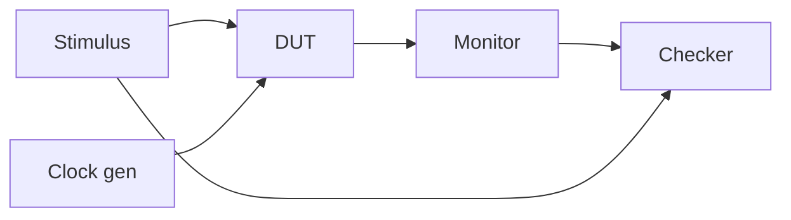

# 07.1 Testbench 結構

驗證（verification）是數位設計中最花費人力的環節。業界常說驗證佔整個專案七成以上的工時，而承載驗證工作的，就是 testbench。本章先建立 testbench 的基本結構觀念，再回顧模擬器生態的歷史脈絡，為後續 Veryl 的測試機制鋪路。

## Testbench 的基本分工：DUT 與 TB

一個典型的模擬環境由兩部分組成：

- DUT（Design Under Test）：被驗證的設計本體，例如一個 counter、一個 FIFO、一個 pipeline。
- TB（Testbench）：包圍 DUT 的驗證環境，負責產生輸入、觀察輸出、比對結果。

TB 內部通常可再細分為幾個角色：

- Clock generation：產生時脈，最簡單的形式是每半個週期反相的 `always` 迴圈。
- Stimulus（驅動）：依時間順序施加以輸入訊號，或以更高階的 transaction 抽象層驅動介面。
- Monitor（監控）：被動地取樣訊號，記錄或檢查行為。
- Checker / scoreboard：將觀察到的結果與期望值比對，決定通過或失敗。

在 Verilog 時代，這些角色往往混在同一個巨大的 module 裡，用 `$display`、`$monitor`、`$finish` 拼湊。這種寫法對小模組夠用，但專案一大就難以維護。SystemVerilog 後來引入 interface、class、program block 與 UVM 方法學，企圖讓 TB 具備軟體般的結構化能力，代價是語言複雜度暴增。

## 模組組織方式：Veryl 專案中的 test

Veryl 對測試的組織採取輕量但有明確慣例的做法。設計模組本身寫在 `.veryl` 檔中；測試相關的程式碼則透過兩個機制掛進來：

- `embed (cocotb)` 區塊：在原始檔內嵌入 Python/cocotb 風格的測試程式碼，並以 `#[test(testname)]` 屬性標記每一個測試。`veryl test` 會找出這些測試，交給對應的模擬器執行。
- 外部測試環境：對於大型驗證環境，也可以不依賴 embed，直接把 Veryl 轉譯出的 SystemVerilog 交給既有的驗證流程使用。

這個設計背後的取捨是：Veryl 不想重新發明一套驗證方法學（UVM 之類），而是把「測試怎麼組織、怎麼跑」這件事簡化到可以直接進 CI 的程度。測試與被測模組寫在同一個檔案附近，閱讀時就能看到對應的驗證程式碼，類比軟體界把 unit test 放在原始碼旁的傳統。

## 歷史：從 Verilog-XL 到事件驅動與編譯式模擬器

回顧歷史有助於理解今日工具的樣貌。

1980 年代末，Gateway Design Automation 推出 Verilog-XL，這是 Verilog 語言的原始實作，也是整個 Verilog 生態的起點。那個年代的 testbench 風格，是在同一個檔案裡用 initial 區塊寫線性驅動、用 always 產生 clock，輸出靠 `$display`，本質上是「腳本式的模擬」。Verilog-XL 後來被 Cadence 收購，長期是業界標準。

1990 年代出現了 PLI（Programming Language Interface），讓使用者能用 C 語言擴充模擬器——自訂系統任務、讀寫內部訊號、做自己的除錯器或延遲計算器。PLI 是模擬器生態走向「可擴充平台」的關鍵一步，也是後來各種驗證工具與模擬器整合的技術基礎。

進入 2000 年代，模擬器技術分成兩大路線：

- 事件驅動（event-driven）模擬器：以訊號事件為單位排程，任何訊號變化都觸發相關程序重新評估。VCS（Synopsys）、NC-Verilog（Cadence，後來的 Xcelium 前身）等商業模擬器屬於此類，經過高度最佳化後速度極快，但授權費昂貴。
- 編譯式（compiled / cycle-based）模擬器：把整個設計翻譯成機器碼或 C++ 程式再執行。開源陣營的 Icarus Verilog 與 Verilator 是代表。編譯式模擬在大型設計上往往比事件驅動快上幾個數量級，但對某些精細的 timing 情境支援有限。

這條歷史線的另一個面向是經濟制度：商業模擬器的一組 license 往往要數萬美元起跳，只有大公司負擔得起。這造成教育界與小團隊長期只能用低階工具，也解釋了為什麼 Icarus（1998 年前後起步）與 Verilator（2003 年開源）在開源社群有如此重要的地位——它們把模擬能力從商業授權制度中解放出來。本章後續將看到，Veryl 的測試流程正是建立在这些開源模擬器之上，讓「寫完模組就跑測試」成為每個人都能負擔的日常。

## 小結

Testbench 的核心角色——clock、stimulus、monitor、checker——從 Verilog-XL 時代至今沒有根本改變，改變的是表達方式與執行效率：從腳本式 `$display` 到 PLI 擴充，從事件驅動商業模擬器到編譯式開源模擬器。Veryl 選擇與這個生態共存而非另起爐灶，下一章我們來看它具體的 embed 機制。
