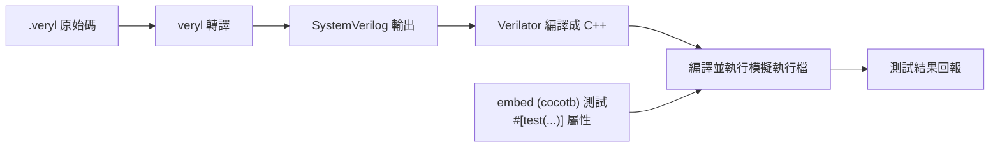

# 07.3 搭配 Verilator

Veryl 的測試與模擬流程，最主要的執行引擎是 Verilator。這一章介紹 Verilator 是什麼、它如何與 Veryl 配合，以及開源模擬器對整個產業的意義。

## Verilator：把 SystemVerilog 編譯成 C++

Verilator 由 Wilson Snyder 開發，2000 年代初開源，如今已是開源硬體社群事實上的標準模擬器。它的核心技術路線是「編譯式模擬」：把 SystemVerilog 設計翻譯成高度最佳化的 C++（近期版本也可產生 SystemC），再由 C++ 編譯器編成原生執行檔執行。

與事件驅動模擬器相比，編譯式模擬的優勢在速度：

- 事件驅動模擬器在執行期不斷排程、排隊、處理事件，靈活但開銷大。
- Verilator 在編譯期就把所有訊號的依賴關係分析完，產生線性執行的 C++ 程式碼，省掉執行期的排程成本。

結果是大設計的模擬速度常比事件驅動工具快一到兩個數量級。代價是它主要支援 synthesizable 的 RTL 子集，一些精細的 timing 情境與某些 testbench 慣用語法支援有限——但這對以 cocotb 驅動的驗證流程來說通常不是問題，因為驅動邏輯在 Python 側，DUT 只需要被乾淨地編譯。

## veryl test --simulator verilator 的流程

Veryl 將 Verilator 整合進測試流程。概念上，`veryl test --simulator verilator` 會做這些事（細節依版本而定，請參考官方文件）：

1. 掃描原始碼，收集所有 `#[test(...)]` 標記的測試。
2. 將 Veryl 程式碼轉譯為 SystemVerilog。
3. 呼叫 Verilator 將 DUT 編譯為 C++ 模型。
4. 串接 embed 區塊中定義的測試程式（cocotb 驅動），逐一執行。
5. 收集結果，回報通過或失敗。

對使用者而言，這條流程被壓縮成一行指令。重點在於：轉譯與模擬之間的接縫由工具處理，你只需要維護一份原始碼。

## 歷史：開源模擬器與教育和經濟的關係

要理解 Verilator 的意義，得先看商業 EDA 的授權制度。

從 1980 年代起，EDA 工具採用高價授權模式：一套商業模擬器（Verilog-XL、VCS、NC-Verilog、Xcelium）的年費以數萬美元計，一個大團隊的完整驗證環境動輒上百萬美元。這個模式支撐了 EDA 產業的研發，但也形成一道制度性的牆：大學實驗室、新創公司、業餘開發者都被排除在外。晶片設計因此長期是大企業的特權。

開源模擬器的出現逐步拆解了這道牆：

- Icarus Verilog：1998 年前後由 Stephen Williams 開始開發，是第一個被廣泛使用的開源 Verilog 模擬器。它採事件驅動架構，速度普通，但完整、自由，成為教育與輕量模擬的主力。
- Verilator：Wilson Snyder 的作品，2003 年正式開源。它原本是 Verilog 到 C 的轉譯器，後來演進為完整的編譯式模擬器。速度優勢使它不僅是「負擔不起商業工具的替代品」，在許多場景下甚至是「所有工具裡最快的選擇」，大公司也開始採用。

這兩個工具改變的不只是成本結構，更是學習曲線：一個學生裝好開源工具鏈就能做完整的 RTL 到模擬流程，硬體教育因此從「必須先取得商業授權」變成「打開筆電就開始」。而當這一代學生進入業界，他們把開源工作流帶進公司，反過來推動企業採用開源工具——這是典型的技術民主化路徑。

Veryl 選擇以 Verilator 作為主要測試後端，正是站在這條歷史延長線上：語言本身開源、工具鏈開源、模擬器開源，整條流程不需要任何商業授權。

## 小結

Verilator 把「模擬」從高價商業服務變成隨手可得的日常工具。Veryl 透過 `veryl test` 把轉譯、編譯、執行串成一行指令，讓開發者享受這個生態紅利而不用自己處理接線。下一章我們進一步看 cocotb 與 Python 驗證文化。
