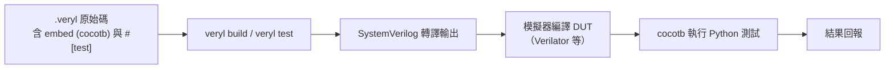

# 07.4 Cocotb 與 Python 驗證

如果說 Verilator 解決了模擬速度與成本的問題，cocotb 解決的是另一個問題：用什麼語言寫 testbench 才不痛苦。這一章介紹 cocotb、它在 Veryl 流程中的位置，以及 Python 驗證文化興起的歷史。

## Cocotb：coroutine 風格的 Python testbench

cocotb（coroutines + cosimulation testbench）是一個開源框架，讓你用 Python 撰寫 testbench，透過 cosimulation 與模擬器（Verilator、Icarus、商業模擬器皆可）連接。DUT 在模擬器中執行，Python 測試程式透過 VPI 等介面讀寫訊號。

它的核心語言機制是 coroutine：測試以 `async def` 函式撰寫，用 `await` 表達時間推進。一個最小的測試長這樣（概念示意）：

```python
import cocotb
from cocotb.clock import Clock
from cocotb.triggers import RisingEdge

@cocotb.test()
async def counter_test(dut):
    cocotb.start_soon(Clock(dut.clk, 10, units="ns").start())
    dut.rst = 1
    await RisingEdge(dut.clk)
    dut.rst = 0
    for i in range(10):
        await RisingEdge(dut.clk)
        assert int(dut.count.value) == i + 1
```

閱讀這段程式碼不需要解讀 `always`、`fork/join` 或 event 控制的交錯語意：時間推進是顯式的 `await`，檢查是普通的 Python `assert`。對寫過任何軟體測試的人來說，這個形式的學習成本遠低於傳統 HDL testbench。

## Veryl 到 cocotb 的完整流程

Veryl 把 cocotb 整合進自己的工具鏈。概念上的流程是：



1. 開發者在 `.veryl` 檔中以 `embed (cocotb)` 區塊寫測試，並用 `#[test(testname)]` 標記被測模組。
2. `veryl test`（或先 `veryl build` 再手動接 cocotb）把 Veryl 轉譯為 SystemVerilog。
3. 模擬器（如 Verilator）把 DUT 編譯為可 cosim 的模型。
4. cocotb 載入測試模組，逐項執行測試並回報。

要點是：Python 測試程式不需要知道 Veryl 的存在，它面對的是轉譯後的 DUT 訊號。這意味著即使某些模組還是純 SystemVerilog，同樣的 cocotb 測試也能直接套用——驗證環境與語言選擇解耦。

## 歷史：Python 驗證文化為什麼會興起

cocotb 誕生於 2013 年前後（最初名為 cocotb 的專案由 Chris Higgs 等人推動）。要理解它為什麼在那個時間點出現，得看當時驗證世界的三大痛點。

第一是 UVM 的重量級。SystemVerilog 的 UVM（Universal Verification Methodology）在 2010 年前後成為大公司驗證的標準方法學。它功能完備，但體系龐大：要寫一個簡單的受控測試，得建 agent、driver、monitor、sequence、sequencer、config object……初學者往往幾個月才能寫出第一個像樣的環境。業界內部甚至流行「UVM 工程師只會複製貼上樣板」的自嘲。這種重量級框架把小團隊與快速迭代的需求排除在外。

第二是軟硬人才的重疊越來越大。2010 年代，SoC 設計越來越像軟體專案：韌體、驅動程式、硬體加速器緊密耦合，團隊裡 Python 已是共通語言（腳本自動化、模型建立、資料分析）。當驗證工程師發現可以用熟悉的 Python 寫 testbench，用 pytest 般的直覺寫 assert，採用動能自然形成。

第三是開源模擬器成熟到足以承載 cosim。cocotb 需要模擬器提供 VPI 介面，Icarus 與 Verilator 的成熟使「免費跑 cocotb」成為可能，教育與開源社群因此快速累積使用者。

自此，驗證領域出現了光譜：一端是 UVM 式的重型工業方法學，另一端是 cocotb 式的輕量 Python 腳本。兩者各有適用場景，但後者明顯改變了小團隊與開源專案的驗證文化——驗證不再是「要嘛全套 UVM 要嘛土法煉鋼」的二選一。

## Veryl 的立場

Veryl 沒有發明新的驗證方法學，而是選擇接上這條 Python 驗證文化：embed (cocotb) 讓測試與模組同居一檔，`#[test]` 屬性讓測試可被工具發現，模擬器由 Verilator 等後端承擔。對熟悉 Python 的工程師而言，Veryl 的測試幾乎零額外學習成本；對硬體出身的人而言，這是進入軟體工作流（測試自動化、CI）最平滑的入口。

## 小結

cocotb 用 coroutine 把時間推進寫成顯式的 `await`，用 Python 把驗證從 UVM 的重量級儀式中解放出來。Veryl 透過 embed 與 `veryl test` 把這條路整合成一行指令。下一章我們看 `veryl test` 本身的自動化細節。
