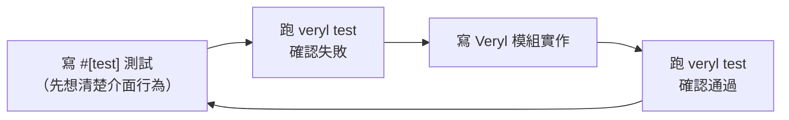

# 07.5 veryl test 自動化

前面幾章介紹了 testbench 結構、embed 機制、Verilator 與 cocotb。這一章把鏡頭拉回 Veryl 自己的指令：`veryl test` 如何把這些零件組成自動化測試流程，以及硬體開發如何因此吸收軟體界的測試文化。

## veryl test：一行指令跑測試

`veryl test` 是 Veryl 的測試入口。它的職責是：

1. 掃描原始碼，找出所有以 `#[test(testname)]` 屬性標記的測試。
2. 將 Veryl 程式碼轉譯為 SystemVerilog。
3. 呼叫指定的模擬器（`--simulator verilator` 等）編譯並執行測試。
4. 回報每個測試的通過與否。

整個流程對使用者是黑箱化的：你不需要知道 cocotb 的 Makefile 怎麼寫、Verilator 的 C++ wrapper 怎麼產生，一行 `veryl test` 完成。這個體驗直接對標軟體界 `cargo test` 的哲學——測試必須是零摩擦的日常動作，而不是偶爾為之的儀式。

## [test] 設定區段

Veryl.toml 提供了 `[test]` 區段，讓專案層級控制測試行為，例如預設的模擬器選擇等選項（確切的選項名稱隨版本演進，請參考官方文件）。把設定寫在專案設定檔而不是個人命令列，有兩個好處：

- 再現性：任何人在任何機器上 clone 專案後跑 `veryl test`，行為一致。
- CI 友善：CI 設定檔不需要重複工具參數，減少設定漂移。

## simulator 選擇

`veryl test` 支援多種模擬後端。以 Verilator 為例：

```bash
veryl test --simulator verilator
```

不同模擬器在速度與語言支援上有差異（回顧 07.1 與 07.3 章的比較）：Verilator 快但對某些精細語法支援有限；Icarus 通用但慢。能自由切換後端意味著：日常開發用快的，疑難排解時換另一個比對行為差異——模擬器本身也可以互相驗證。

## 測試驅動開發（TDD）移植到硬體

軟體界的 TDD（Test-Driven Development）主張：先寫測試，再寫實作，讓測試驅動設計。這個文化源自 Kent Beck 在 1990 年代末整理的 extremde Programming 實踐，經由 agile 運動普及。

硬體開發長期缺乏這個循環，原因不在於不想測，而在於測試成本高：寫一個傳統 testbench 需要大量樣板，跑模擬需要昂貴的授權與時間。當「寫個測試」要花一小時，人自然選擇先寫設計、之後再補測試——而「之後」往往不會來。

Veryl 把這個成本壓下來之後，TDD 循環變得可行：



先寫測試有額外的設計收益：測試強迫你先確定模組介面與行為規格，實作時反而更快。硬體介面一旦流片就難以更改，這種「先把規格想清楚」的紀律對硬體比軟體更有價值。

## 與 CI 整合的伏筆

`veryl test` 的終點不在本機。當測試可以一行指令完成、不需要互動、回傳明確的 exit code，它就具備了放進 CI（持續整合）的全部條件：每次 git push 自動跑 build、check、fmt、test，失敗就擋下 merge。

這條路我們會在第 08.4 章完整展開——包括 GitHub Actions 的 workflow 範例、toolchain pinning，以及 HDL 專案為什麼長期游離於軟體 CI 文化之外又如何被拉回來。本章只需記住：`veryl test` 是整個硬體 CI 大廈的地基。

## 小結

`veryl test` 把「掃描測試 → 轉譯 → 模擬 → 回報」壓縮成一行指令，`[test]` 設定區段保證再現性，多模擬器後端提供速度與相容性的取捨空間。測試成本降低後，TDD 的紀律得以移植到硬體，而這正是通向 CI 文化的第一步。
