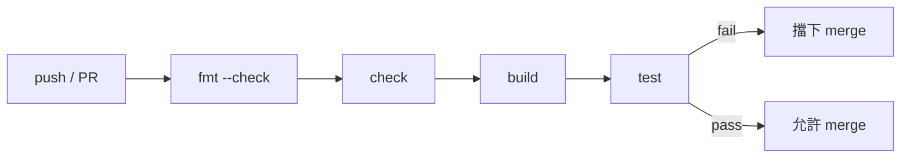

# 08.4 Git 與 CI/CD

前幾章建立的品質管線——check、fmt、test——要發揮全部威力，必須放在每次提交都自動執行的位置。這一章給出 GitHub Actions 上的完整 workflow 範例，討論 toolchain 版本管理，並回顧 CI 文化如何滲透到硬體界。

## 一個完整的 GitHub Actions workflow

以下是一個概念完整的 workflow yaml，在每次 push 與 pull request 時執行 Veryl 專案的全部檢查（各 action 的名稱與參數以官方文件為準）：

```yaml
name: ci
on:
  push:
    branches: [main]
  pull_request:

jobs:
  lint-and-test:
    runs-on: ubuntu-latest
    steps:
      - uses: actions/checkout@v4

      - name: Install verylup
        run: |
          curl -LsSf https://veryl-lang.org/install.sh | sh
          verylup install

      - name: Check format
        run: veryl fmt --check

      - name: Static check
        run: veryl check

      - name: Build
        run: veryl build

      - name: Test
        run: veryl test --simulator verilator
```

要點：

- `veryl fmt --check` 在最前面，格式錯誤最便宜、最先擋下。
- `veryl check` 是純靜態分析，不需要模擬器，秒級完成。
- `veryl build` 產生 SystemVerilog 輸出，可順便用 `git diff` 檢查轉譯輸出是否與提交一致（把輸出 commit 進 repo 的專案尤其適用）。
- `veryl test --simulator verilator` 跑完整模擬測試。GitHub 的 runner 上可安裝 Verilator，Icarus 同理。



## 版本管理：toolchain pinning

硬體工具鏈的再現性問題比軟體更尖銳：綜合結果可能因工具版本而異。Veryl 的解法沿襲 Rust 的 rustup 模式：

- verylup 是 Veryl 的工具鏈管理器，負責安裝與切換 Veryl 版本。
- 專案根目錄的 verylup.toml（或 Veryl.toml 中的對應設定）可以 pin 住專案使用的 toolchain 版本；任何人 clone 專案後，verylup 會自動使用 pinned 版本。

這保證了「在我機器上會過」不再成為藉口：本機與 CI 跑的是同一個編譯器版本，轉譯輸出位元級一致。軟體界早已用 lockfile（Cargo.lock、package-lock.json）解決同類問題，Veryl 直接移植了這個制度。

## 歷史：HDL 專案為何游離於版本控制主流之外

有趣的是，IC 設計其實是版本控制的先行者——只是走了一條岔路。

1980 年代起，IC 公司就面臨海量檔案的管理問題，但當時的解法不是後來的 Git，而是公司內部的專有版本控制系統與 binary 資料庫：設計資料（網表、版圖資料庫）以二進位格式存放在中央資料庫，簽出（checkout）與鎖定（lock）制度管理併發，配合授權鎖（license）管理工具使用權。Synopsys 與 Cadence 等公司的設計管理產品（如 design management 系統）就是這個時代的產物。這套制度高效但封閉：資料格式專有、流程依賴內部系統、與外界的開放版本控制格格不入。

與此同時，軟體界走出了另一條路：CVS（1990）→ Subversion（2000）→ Git（2005）→ GitHub（2008）→ 分散式協作與開源文化。軟體的原始碼是純文字，diff、merge、code review 的工具鏈全部建立在此之上。

結果是兩個行業的協作文化分道揚鑣：軟體有了 pull request、code review、CI 的完整閉環，硬體的設計資料鎖在內部資料庫裡，review 靠電子郵件附件與會議。

## CI 文化如何滲透到硬體

軟體 CI 本身也有一部演化史：Jenkins（Hudson，2004 年前後）把「每次提交自動建置」變成公司內部標配；Travis CI（2011）把它搬上雲端並與 GitHub 整合；GitHub Actions（2019）把 CI 直接內建進程式碼託管平台，徹底降低了採用門檻。

硬體專案接上這條路的關鍵前提是：設計原始碼變成純文字（Verilog/VHDL 本來就是），且開源工具鏈（Icarus、Verilator、開源綜合與 P&R）足夠成熟，能在 CI runner 上跑完整流程。Yosys、nextpnr、Verilator 加上 cocotb，構成了免費的硬體 CI 基礎設施；開源 FPGA 社群（如 1BitsSquared、Tiny Tapeout 等專案的實踐）率先把它變成日常。如今一個開源 RTL 專案的標準配備已經是：GitHub Actions 跑 lint、模擬測試、甚至 FPGA bitstream 產生。

Veryl 的工具鏈設計完全對準這個趨勢：所有子命令（build、check、fmt、doc、test）都是非互動、有明確 exit code、可在乾淨機器上執行的——這正是 CI 工具的入場資格。

## 小結

GitHub Actions 加 verylup pinning，讓 Veryl 專案獲得軟體級的再現性與自動化品質管線。這不是模仿，而是收復失土：版本控制與 CI 本來就該屬於硬體設計，只是專有資料庫與授權鎖的歷史包袱讓它慢了二十年。下一章討論最後一塊拼圖——如何把既有 SystemVerilog 專案漸進遷移到這個新工作流。
