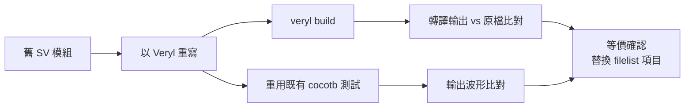

# 08.5 漸進遷移策略

到目前為止，本書介紹的 Veryl 工具鏈都假設一個（至少部分的）綠地專案。現實中多數工程師面對的是既有 SystemVerilog 專案：數十萬行的 RTL、多年累積的 IP、成熟的驗證環境。全部重寫不現實，永遠不動則與更好的工具無緣。這一章討論第三條路：漸進遷移。

## 為什麼是漸進

語言遷移的歷史反覆證明「大爆炸式重寫」的危險：團隊花一兩年重寫整個系統，期間新功能停滯、新舊行為難以對齊，許多專案死在半路。成功的遷移幾乎都是漸進的：新舊共存，邊界明確，每次只搬一小塊，隨時可以停在某個穩定狀態。

硬體的特殊之處是風險結構：RTL 的錯誤要到模擬、綜合、甚至流片才暴露，而流片成本以百萬美元計。因此硬體遷移的核心要求比軟體更嚴格——遷移前後的行為必須可驗證等價。

## 策略一：新模組用 Veryl

最低風險的起點：所有新寫的模組用 Veryl，既有模組維持 SystemVerilog 不動。

新模組享有 Veryl 的全部好處：位寬與型別檢查、`always_comb`/`always_ff` 的明確語意、fmt/check/doc 工具鏈。舊模組零風險，因為根本沒碰。團隊在真實工作中累積 Veryl 經驗，而不是在培訓課程裡。

## 策略二：舊模組以 embed 或外部 SV 引用

新 Veryl 模組需要呼叫舊 IP 時，有兩條路（回顧 07.2 章）：

- `embed (inline)` 把舊 SV 片段內嵌進專案編譯單元。
- `$sv` namespace 直接引用外部 SystemVerilog 識別字（module、function 等）。

Veryl 轉譯的輸出就是 SystemVerilog，所以最終整個專案仍是一般的 SV 檔案集合，可以直接交給既有的綜合與模擬流程。

## filelist 整合

既有專案通常用 filelist（檔案清單，如 `.f` 檔）告訴綜合器與模擬器要編譯哪些檔案。遷移期的整合方式是：

1. Veryl 專案透過 `veryl build` 產生 SV 輸出到固定目錄。
2. filelist 中加入這些產生的檔案，與既有 SV 檔並列。
3. CI 或腳本保證「先 build 再跑後端工具」的順序。

這樣綜合器、模擬器、lint 工具完全不需要知道 Veryl 的存在——它們看到的只是 SV。

## 驗證等價性

每搬一個模組，都要證明 Veryl 版本與原 SV 版本行為相同。實用的做法有兩層：

- 轉譯輸出比對：Veryl 的轉譯是語意保持的，對簡單模組可以直接 diff 轉譯輸出與手寫 SV（語法上不會逐字相同，但結構對應清晰可查）。
- 模擬比對：對同一組測試激勵，分別跑舊 SV 模組與 Veryl 版本，比對輸出波形或關鍵訊號。既有 cocotb 測試（07.4 章）可以直接重用——測試面對的是 DUT 訊號，不關心底下是哪種語言。

## 團隊導入策略

技術之外，遷移的成敗更取決於人。實務上有效的順序：

1. 從小而獨立的模組開始（例如一個計數器、一個 FIFO），讓兩三位有意願的工程師先跑通整條流程。
2. 把 fmt、check、test 接上 CI（08.4 章），讓工具紅綠燈替你說話，而不是靠個人號召。
3. 在 code review 中累積「Veryl 檢查攔到了什麼錯」的實例，這是最有說服力的內部宣傳。
4. 訂出明確的邊界規則：例如「新模組一律 Veryl，舊模組只在其測試完備時才重寫」，避免遷移範圍無限膨脹。
5. 接受停滯狀態：專案可以長期維持「Veryl 新碼 + SV 舊碼」的混合，這不是失敗，是穩態。

## 歷史：軟體界大規模語言遷移的先例

硬體界的漸進遷移並不孤單，軟體界已有完整的教科書。最貼切的類比是 C++ 到 Rust：兩者都是系統級語言，遺留程式碼巨大，而 Rust 團隊明確採用漸進策略——Rust 與 C 之間有穩定的 FFI 與 ABI，允許逐模組、逐 crate 重寫；Firefox 的 Renderer（WebRender、Stylo 等元件）就是以「一次一個元件」的方式逐步以 Rust 重寫後整合回 Firefox 的，而非整個瀏覽器重寫。Google、微軟等公司報告的 Rust 導入也全是增量模式。

這些案例的共同教訓，恰好就是硬體遷移需要的清單：互通層（FFI，對應 Veryl 的 embed 與 `$sv`）、等價性驗證（測試，對應模擬比對）、邊界紀律（新碼用新語言的規則）、以及不追求百分之百（穩態可以是混合）。Veryl 選擇以 SystemVerilog 為編譯目標、以 embed 機制為共存接口，正是把這份軟體界的遷移經驗直接移植到硬體。

## 小結

漸進遷移的四根支柱：新模組用 Veryl、舊 IP 以 embed/`$sv` 共存、filelist 讓既有後端工具無感整合、模擬比對驗證等價。團隊面則靠 CI 紅綠燈與小範圍成功案例推動。這條路在軟體界已被 C++→Rust 等案例反覆驗證過；Veryl 把它帶進了 RTL 的世界。至此，本書的 Veryl 之旅告一段落——從語言、工具到工作流，你已經具備在一個真實專案中開始使用 Veryl 的全部知識。
