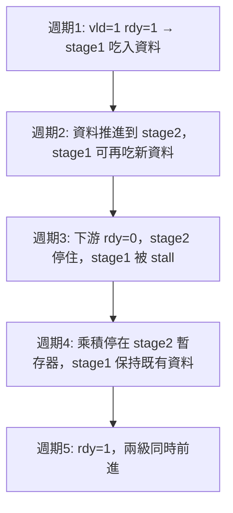

# 實戰（一）流水線處理單元：專案目標與架構

前面八章我們把 Veryl 的語言要素逐一走過：module、interface、enum、struct、generics、握手與驗證。從這一章開始，我們把這些積木組合起來，做第一個真正「像樣」的設計——一個可參數化位寬的定點 MAC/ALU 流水線處理單元。選這個題目的理由很簡單：它夠小，可以完整展示在紙上；又夠大，會遇到流水線、握手、位寬推導、時脈收斂等所有真實設計都躲不掉的問題。

## 專案目標

我們要做的處理單元叫 `pipe_mac`，規格如下：

- 輸入兩個運算元 `a` 與 `b`，位寬由 generic `W: u32` 參數化，預設 16 位。
- 支援三種運算：MAC（`acc + a * b`）、乘法（`a * b`）、加法（`a + b`），以 opcode 選擇。
- 內部為兩級流水線：第一級做乘法與 opcode 解碼，第二級做累加與結果暫存。
- 對外採用 valid/ready 握手，上游可以隨時 stall 我們，我們也可以在忙碌時回壓（backpressure）上游。
- 累加器 `acc` 為 `$clog2` 推導後的加寬位寬，避免溢位。

「可參數化」不只是把 8 換成 16 而已。位寬一變，乘法器的結構、加法器的進位鏈、時脈週期都會變。Veryl 的 generics 讓我們寫一份程式碼，綜合出任意位寬的版本，這正是硬體描述語言相對於畫電路圖的核心價值。

## 模組劃分

整個專案切成四個 module 與一個 interface：

- `mac_if`：interface，定義輸入通道（`vld`、`a`、`b`、`opcode`）與輸出通道（`rdy`、`result`）的握手訊號。
- `pipe_mac`：頂層，串接兩級流水線，對外暴露 `mac_if` 的 modport。
- `stage1`：第一級——解碼 opcode、暫存運算元、啟動乘法。
- `stage2`：第二級——接收乘積，依 opcode 做累加或直接輸出。

劃分原則是「一級一 module」。這樣每一級的 pipeline register 都留在 module 邊界上，測試時可以單獨餘波（stimulus）每一級，也符合後續章節要做 formal 驗證時「以模組為單位」的慣例。

## 架構圖

兩級之間的資料流與控制流是分開的：資料一路向前，控制（`rdy`）一路向後。這是所有流水線設計的通則——控制訊號逆流，是 backpressure 的物理本質。

## valid/ready 流水線行為

用時間軸看一次完整往返。假設下游在週期 3 變忙：

注意週期 3~4 的行為：stage1 的輸入資料必須「原地不動」，既不能丟掉、也不能重複吃入。這就是 valid/ready 協定要保證的不變量，下一節我們專門談它的細節與陷阱。

## 為什麼從 MAC 開始

MAC（multiply-accumulate）是 DSP 的原子操作：FIR 濾波器、FFT 的 butterfly、神經網路的矩陣乘法，拆到最後都是一排 MAC。歷史上，從 1980 年代的 TI TMS32010 數位訊號處理器開始，「一個週期能不能做完一次 MAC」就是 DSP 晶片的賣點；今天每一顆 AI 加速器的算力，說到底都是在數每秒能做幾次低精度的 MAC。用 MAC 當第一個實戰題材，等於是把整個訊號處理與 AI 晶片史的最小單元，放進你的第一份流水線程式碼裡。

下一節，我們先把手shaking 協定的規則與歷史講清楚，再動筆寫程式。
