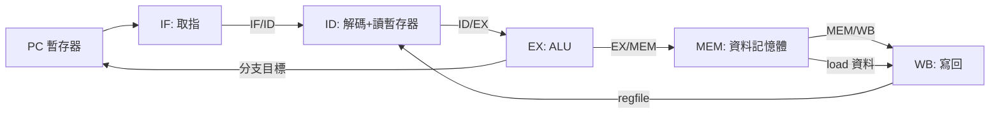

# RV32I 五階段管線

有了 AXI4-Lite 暫存器介面與流水線握手，我們已經具備打造處理器的所有零件。這一節建立 RV32I 五階段管線的骨架：架構、階段暫存器的 Veryl 定義、關鍵模組的形狀。完整的 ALU、CSR、與驗證環境留給讀者補完——本章的目標是讓你「拿著骨架就能往下蓋」。

## 為什麼是五階段

Hennessy 與 Patterson 的教科書用五階段管線作為教學經典，不是偶然：它把一條指令的一生切成五個複雜度大致均衡的階段——

- IF（Instruction Fetch）：以 PC 查 instruction memory。
- ID（Instruction Decode）：解碼、讀暫存器堆。
- EX（Execute）：ALU 運算、計算分支目標。
- MEM（Memory Access）：load/store 走 data memory。
- WB（Write Back）：結果寫回暫存器堆。

每一級之間以 pipeline register 相隔。經典教科書（Patterson & Hennessy）把這五級畫成一張橫向的資料通路圖；我們以 mermaid 重現它的骨架：



兩條回饋路徑值得注意：WB 寫回暫存器堆（影響 ID 的讀值），EX 的分支結果回到 PC（影響 IF 的取指位址）。回饋就是冒險的來源，下一節會專門處理。

## 以 struct 組織階段暫存器

五級之間流動的是「指令的狀態快照」。用 struct 把每級封包定義清楚，是 Veryl 描述管線最舒適的方式：

```veryl
package cpu_pkg {
    // RV32I 常數
    pub const XLEN: u32 = 32;

    enum ALUOp: logic<3> {
        Add = 0, Sub, And, Or, Xor, Slt, Sll, Srl
    }

    // ID/EX 封包：EX 需要的一切
    struct IdEx {
        pc:      logic<32>,
        rs1_val: logic<32>,
        rs2_val: logic<32>,
        rd:      logic<5>,
        alu_op:  ALUOp,
        imm:     logic<32>,
        valid:   logic,
    }

    // EX/MEM 封包
    struct ExMem {
        alu_result: logic<32>,
        store_data: logic<32>,
        rd:         logic<5>,
        mem_read:   logic,
        mem_write:  logic,
        valid:      logic,
    }

    // MEM/WB 封包
    struct MemWb {
        result:   logic<32>,
        rd:       logic<5>,
        reg_write: logic,
        valid:    logic,
    }
}
```

`valid` 位元明確進入封包，讓 bubble（無效指令）在管線裡有一致的表示——與第 9 章握手協定的 valid 語意一脈相承。

## 階段暫存器與頂層骨架

```veryl
import cpu_pkg::*;

module Core (
    clk: input clock,
    rst: input reset,
) {
    // 程式計數器
    var pc: logic<32>;

    // 管線暫存器（每級之間）
    var id_ex_r:  IdEx;
    var ex_mem_r: ExMem;
    var mem_wb_r: MemWb;

    always_ff (clk, rst) {
        if_reset {
            pc = 0;
            id_ex_r.valid = 0;
            ex_mem_r.valid = 0;
            mem_wb_r.valid = 0;
            id_ex_r.alu_op = ALUOp::Add;
            id_ex_r.rd = 0;
            ex_mem_r.rd = 0;
            mem_wb_r.rd = 0;
            ex_mem_r.mem_read = 0;
            ex_mem_r.mem_write = 0;
            mem_wb_r.reg_write = 0;
        } else {
            pc = next_pc;
            // 每一拍，把上一級的組合輸出鎖進下一級封包
            id_ex_r = id_ex_next;
            ex_mem_r = ex_mem_next;
            mem_wb_r = mem_wb_next;
        }
    }

    // 各級組合邏輯（骨架：IF/ID 解碼、EX 的 ALU、MEM、WB）
    var next_pc:    logic<32>;
    var id_ex_next: IdEx;
    var ex_mem_next: ExMem;
    var mem_wb_next: MemWb;

    // 暫存器堆：2R1W
    var regs: logic<32>[32];
    var rs1_val: logic<32>;
    var rs2_val: logic<32>;
    var wb_data: logic<32>;
    var wb_en:   logic;
    var wb_rd:   logic<5>;

    always_comb {
        rs1_val = regs[mem_wb_r.rd] ; // 骨架：實際由 ID 級以 rs1 位址索引
        rs2_val = regs[mem_wb_r.rd] ;
    }

    always_ff (clk, rst) {
        if_reset {
            for i: u32 in 0..32 {
                regs[i] = 0;
            }
        } else {
            if wb_en && wb_rd != 0 {
                regs[wb_rd] = wb_data;
            }
        }
    }
}
```

（骨架刻意保留 `id_ex_next` 等中間變數未實作——它們分別屬於 decode、execute、memory 各級的組合邏輯，建議各自成為獨立 module，以 modport 或 port 串接，如第 9 章的 stage1/stage2。）

## 蓋房子的順序

建議的實作順序：先做「只會跑 addi 的單週期核心」驗證解碼與暫存器堆；再切五級；然後加入 hazard 處理（下一節）；最後跑 RISC-V 官方 rv32i compliance 測試集。每一步都對應教科書的一章，也對應 RISC-V 這個開放 ISA 給教育界的禮物：規格完全公開，任何人都能走完這條路。
