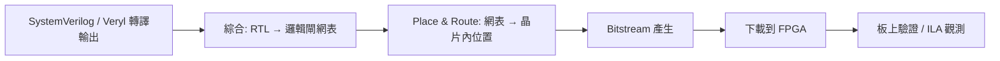

# 上 FPGA 綜合部署

RTL 寫完、模擬通過，只是旅程的一半。設計要變成真的電路，得走完 FPGA 的後端流程：綜合（synthesis）→ 佈局繞線（place & route）→ 位元流（bitstream）。這一節講流程、工具與 constraint，也講一段四十年的硬體史。

## FPGA 流程



三個階段各自有 最佳化目標：綜合把 RTL 映射到 FPGA 的基本單元（LUT、FF、DSP block、BRAM），同時做邏輯化簡；place & route 決定每個單元放在晶片哪個位置、訊號走哪條線，這一步的繞線延遲往往主導整體時脈；bitstream 則是把佈局結果編碼成可載入的組態檔。每一步都是 NP-hard 問題的啟發式解——FPGA 工具本身是龐大的軟體工程。

## 工具鏈

- Xilinx Vivado：Zynq、Artix/Kintex 系列的官方工具，整合綜合、P&R、ILA 邏輯分析儀。
- Intel Quartus：Cyclone/Maxstrat（原 Altera）系列的對應物。
- 開源組合：yosys（綜合）+ nextpnr（P&R），支援 Lattice iCE40、ECP5 以及後續加入的各系列。對教學與開源晶片運動而言，這條鏈的意義是「工具不再黑箱」。

Veryl 的角色在這條鏈的最前端：`veryl build` 產出乾淨的 SystemVerilog，直接餵進上述任何工具。Veryl 本身的 ASIC 後端實驗（如本書提到的 veryl2chip 工具鏈）與 FPGA 工具是互補而非取代關係。

## Constraint 與 clock 定義

綜合器不會讀心術——你必須以 constraint（約束）檔告訴它時脈頻率、I/O 延遲預算、接腳位置。以 Xilinx 的 XDC 為例，定義 100 MHz 時脈就是：

```
create_clock -period 10.000 -name sys_clk [get_ports clk]
```

FPGA 工具會以這個數字為目標做 timing closure：報告裡的 WNS（Worst Negative Slack）為正表示收斂。第 9 章講的 Fmax 與 critical path，在這裡化成具體數字。做為工程師的紀律：constraint 檔要進版本控制，因為「設計對不對」與「設計多快」一樣是規格的一部分。

## 歷史：從 XC2064 到開源工具鏈

1985 年，Xilinx 出貨 XC2064——史上第一顆 FPGA：64 個可組態邏輯方塊，由創辦人之一 Ross Freeman 提出的「可程式化硬體」概念實現。Freeman 後來入選美國發明家名人堂。FPGA 的商業意義是顛覆了 ASIC 的 NRE（non-recurring engineering）經濟學：ASIC 一次流片動輒數萬到數百萬美元，改一個錯就要再等一輪；FPGA 幾百美元一顆、當天重燒、失敗零成本。對量產晶片，ASIC 仍然單位成本較低；但對原型、小量、演算法常變的場合，FPGA 完全改寫了遊戲規則。這也是為什麼本書一路用 FPGA 做部署目標：它是工程師「把設計變真」成本最低的路。

開源工具鏈的故事同樣重要。2015 年，Clifford Wolf 的 Project IceStorm 透過反向工程，完整解出 Lattice iCE40 的位元流格式，让開源綜合與 P&R 首次能生產真實 FPGA 的位元流。此後 Lattice 官方公開了 iCE40 與 ECP5 的文件，nextpnr 接棒成為通用開源 P&R。工具的開放意味著：學生可以在一學期內走完「寫 HDL → 綜合 → 上板」全程而不依賴任何授權伺服器——這對教育與開源硬體的意義，如同 GCC 之於軟體。

下一章，我們把鏡頭拉遠，看整個開源 EDA 生態的興起。
